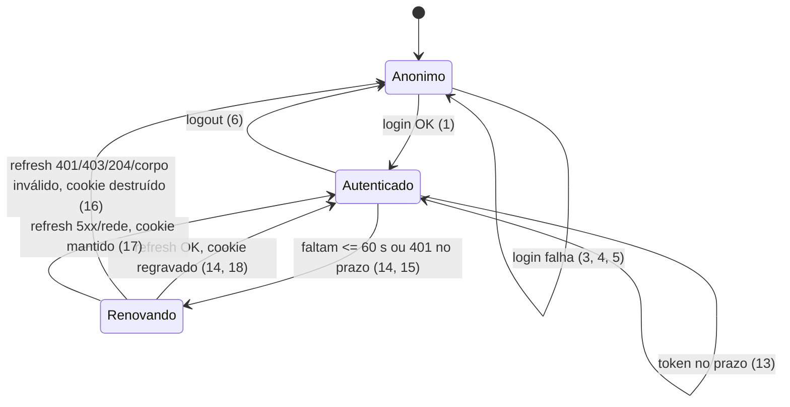

# Backoffice — sessão no servidor (iron-session) e camada HTTP padronizada

> Build this with **tlc-implement**.
> Every criterion below becomes a check with a proof, referenced by its number. Nothing under
> `Unresolved` gets settled while building.

## Intent

No backoffice (`apps/backoffice`), o access token vive na memória do navegador
(`stores/session.ts`, zustand) e é enviado pelo cliente como `Authorization: Bearer` a cada
chamada. Um XSS consegue lê-lo, num produto que guarda filiação religiosa (dado sensível,
LGPD art. 5º, II). Cada F5 ou nova aba gasta uma rotação de refresh. Duas abas abertas ao mesmo
tempo apresentam o mesmo refresh token, e o backend trata a segunda como reuso e revoga todas as
sessões da credencial (`docs/backend/ibfc-server.md` §4; inferido do contrato, não reproduzido).
Nenhuma rota é protegida no servidor: `/pessoas` renderiza para quem não está logado até um
fetch falhar.

A camada HTTP também está espalhada. Cinco route handlers repetem `const BACKEND`, a leitura de
`Authorization` e o repasse de erro. Os cookies de auth vivem em `/api/auth/{login,logout,refresh}`.
As páginas montam URLs literais. Um erro de estatísticas em `/pessoas` mostra dois toasts: o de
`apiFetch` e o do chamador.

Quando esta task estiver pronta, o navegador guarda só um cookie selado e httpOnly. Login e
logout são Server Actions de um único módulo de auth. O servidor injeta o token, renova a sessão
uma vez por janela e protege as páginas. O cliente faz `apiFetch` sem token, com toasts
padronizados e sem duplicatas. As telas falam com o backend por um serviço de domínio
(`membrosService`).

28 critérios em 6 slices · 8 one-way doors · 2 open, ambos blocks go-live

## Criteria

### Slice A — Login e logout como Server Actions

1. Quando o usuário submete e-mail e senha válidos em `/login`, a action `login` chama
   `POST {API_URL}/auth/login` com `{ email, senha }` e grava o cookie `church_session`, selado
   pelo iron-session, contendo `accessToken`, `accessTokenExpiraEm`, `refreshToken` e `lembrar`.
   O cookie é `HttpOnly`, `SameSite=Lax`, `Path=/`, e `Secure` quando
   `NODE_ENV=production`. Em seguida a action redireciona para `/pessoas`. Nenhum dos três
   tokens aparece em corpo de resposta, HTML ou payload RSC enviado ao navegador.
2. Dado "Lembrar de mim" marcado, `church_session` sai com `Max-Age=2592000`. Desmarcado, sai
   sem `Max-Age` nem `Expires` (cookie de sessão).
3. Se o backend responde ao login com status não-2xx, a action não grava cookie e retorna
   `{ message }` com a `message` do backend, ou `'Falha ao fazer login.'` quando ela não vem.
   A tela exibe `toast.error(message)`. Isso cobre 401 e o 423 de bloqueio.
4. Se o backend responde 2xx com um corpo sem `data.accessToken`, `data.accessTokenExpiraEm` ou
   `data.refreshToken` (string não vazia), a action não grava cookie e retorna
   `'Resposta inválida do servidor de autenticação.'`.
5. Se a chamada de login ao backend rejeita (rede), a action não grava cookie e retorna
   `'Algo deu errado. Tente novamente em instantes.'`, sem lançar exceção ao cliente.
6. Dado `church_session` válido, quando a action `logout` é chamada, o backend recebe
   `POST /auth/logout` com `{ refreshToken }` e `Authorization: Bearer <accessToken>`. O cookie
   é destruído e a action redireciona para `/login`. Se o backend falhar, o cookie é destruído e
   o redirect acontece do mesmo jeito.
7. Sem cookie, `logout` redireciona para `/login` sem chamar o backend.

### Slice B — Proteção de páginas

8. Sem `church_session`, um `GET` em `/`, `/pessoas` ou `/pessoas/<id>` recebe `307` para
   `/login` vindo de `proxy.ts`, e nenhuma chamada a `/api/membros*` acontece.
9. Com `church_session` presente, `GET /login` recebe `307` para `/pessoas`.
10. `proxy.ts` não roda em `/api/*`, `/_next/*` nem em arquivos estáticos.
11. Com `church_session` ausente ou adulterado (o selo não abre), `app/pessoas/page.tsx` e
    `app/pessoas/[id]/page.tsx` redirecionam para `/login` via `verifySession()`, mesmo que o
    proxy não tenha rodado.
12. Sem sessão válida, as route handlers `/api/membros`, `/api/membros/[id]` e
    `/api/membros/exportar` respondem `401 { message: 'Sua sessão expirou. Entre novamente.' }`
    sem chamar o backend.

### Slice C — Token e refresh no servidor

13. Dado que `accessTokenExpiraEm` está a mais de 60 s no futuro, a chamada de dados ao backend
    leva `Authorization: Bearer <accessToken da sessão>` e nenhum `POST /auth/refresh` acontece.
14. Dado que faltam 60 s ou menos, ou que o token já expirou, o servidor chama
    `POST /auth/refresh` com o `refreshToken` da sessão antes da chamada de dados. Depois usa o
    novo `accessToken` e regrava `church_session` com os três valores novos, preservando
    `lembrar`.
15. Se a chamada de dados devolver 401 apesar de o token ainda estar no prazo, o servidor
    renova a sessão uma vez e repete a chamada uma única vez. Se a repetição devolver 401, o
    cookie é destruído e o handler responde 401 com a mensagem do critério 12.
16. Se o refresh responder 401, 403 ou 204, ou trouxer um corpo sem os três campos, o cookie é
    destruído e o handler responde 401 com a mensagem do critério 12.
17. Se o refresh responder 5xx ou rejeitar por rede, o cookie é mantido. O handler responde com
    o mesmo status (`502` quando foi rede) e `{ message: 'Algo deu errado. Tente novamente em instantes.' }`.
18. Quando N requisições com o mesmo `refreshToken` precisam renovar dentro de uma janela de
    10 s, o backend recebe exatamente 1 `POST /auth/refresh`. Todas usam o mesmo novo
    `accessToken` e gravam o mesmo cookie. O mecanismo é o mapa em memória do `Decided`.

### Slice D — Chamada ao backend reutilizável (servidor)

19. Sempre: nenhuma route handler lê o header `Authorization` vindo do navegador. Um request com
    `Authorization: Bearer forjado` e sem cookie recebe o 401 do critério 12.
20. `GET /api/membros`, `GET /api/membros/[id]` e `GET /api/membros/exportar` mantêm o contrato
    de hoje. `/api/membros` responde `{ data, total, page }`. `/api/membros/[id]` responde
    `{ data }`, ou `204` sem corpo. `/api/membros/exportar` responde
    `Content-Type: text/csv; charset=utf-8` com `Content-Disposition: attachment; filename="membros.csv"`.
21. Um status de erro do backend diferente de 401 chega ao navegador com o mesmo status e o
    mesmo corpo JSON.

### Slice E — Cliente HTTP e toasts (navegador)

22. Sempre: nenhum código que roda no navegador lê, guarda ou envia token. `apiFetch` não envia
    `Authorization`, e `stores/session.ts` e a dependência `zustand` não existem mais em
    `apps/backoffice`.
23. Quando uma chamada de `apiFetch` recebe 401, o navegador vai para `/login?sessao=expirada`
    e a tela de login exibe `toast.info('Sua sessão expirou. Entre novamente.')` uma única vez.
24. Quando várias chamadas concorrentes recebem 401, ocorre uma única navegação para `/login` e
    nenhum toast de erro aparece além do critério 23.
25. `403` exibe `toast.error('Sem permissão para realizar esta ação.')`. `5xx` ou falha de rede
    exibem `toast.error('Algo deu errado. Tente novamente em instantes.')`. Outro `4xx` com
    `message` exibe `toast.error(message)`. Em todos esses casos a promise rejeita. `204`
    resolve `null`, sem toast.
26. Quando chamadas concorrentes falham com a mesma mensagem, só um toast com essa mensagem fica
    visível (o `toastId` é a mensagem). Um `500` nas três estatísticas de `/pessoas` mostra
    exatamente 1 toast.

### Slice F — Serviço de domínio

27. `/pessoas` e `/pessoas/[id]` mantêm o comportamento de hoje: StatCards, lista, filtros de
    status, paginação, exportação com download de `membros.csv`, toast quando o CSV começa com
    `erro\n`, e `'Membro não encontrado'` no `204`. Todas as chamadas passam por
    `membrosService` (`listar`, `obter`, `exportar`), sem URL literal nas páginas.
28. Sempre: `app/**` e `services/**` não contêm a string `/api/auth/`. As rotas
    `POST /api/auth/login`, `/logout` e `/refresh` respondem `404`.

## States

## Out of scope

- Botão "Sair" na interface. O layout ainda não tem `SideMenu` nem um lugar definido para ele;
  a action `logout` fica pronta para quem montar o shell.
- Loader global com contador de requisições, como o `requestHandlerController` do
  viacerta-web-workspace. Ninguém pediu e nenhuma tela usa.
- Opção para desligar o toast automático por chamada (o equivalente a `apiWithoutErrorHandler`).
  Nenhum chamador precisa hoje. O toast duplicado de `/pessoas` some removendo o toast do
  chamador.
- Páginas como Server Components buscando dados direto no servidor, o que eliminaria
  `/api/membros*`. É uma refatoração das telas, maior que esta task.
- Trava de refresh compartilhada entre instâncias (Redis ou similar). Depende do Unresolved 2.
- `GET /admin/membros/:id` direto no backend. A varredura paginada em `/api/membros/[id]`
  continua (hazard já documentado no código).

## Observable

| Surface | Decision | Landing |
| --- | --- | --- |
| tela `/login` | error state | 3, 4, 5 |
| tela `/login` | loading (submitting) | existing - `Button` com `disabled={isSubmitting}` |
| tela `/login` | estado "sessão expirada" | 23 |
| tela `/login` | já autenticado | 9 |
| tela `/login` | empty state | n/a - o formulário está sempre presente |
| tela `/pessoas` | unauthorised | 8, 11 |
| tela `/pessoas` | error state | 25, 26 |
| tela `/pessoas` | empty, loading, filtros, paginação, export | 27 (existing - comportamento mantido) |
| tela `/pessoas/[id]` | unauthorised | 8, 11 |
| tela `/pessoas/[id]` | not found (204) | 27 |
| action `login` | retorno de erro | 3, 4, 5 |
| action `login` | quem pode chamar | existing - Server Actions do Next checam a origem (Origin vs Host) |
| action `logout` | falha do backend | 6 |
| API `GET /api/membros*` | error shape e códigos | 12, 16, 17, 21 |
| API `GET /api/membros*` | quem pode chamar | 12, 19 |
| API `GET /api/membros*` | rate limit | n/a - o BFF não limita; o backend responde 423 só no login |
| API `POST /api/auth/*` | remoção | 28 |

## Swept

- validation: 4 - corpo do backend validado antes de gravar o cookie; os campos do formulário seguem com o zod de hoje (existing)
- failure modes: 5, 6, 17, 25
- idempotency and retry: 15 - uma única repetição após o refresh; o logout é idempotente sem cookie (7)
- authorization: 8, 11, 12, 19 - os papéis continuam no backend (existing - guard `admin`); 403 em 25
- concurrency and ordering: 18 (refresh entre requisições do servidor), 24 (401 concorrentes no navegador), 26 (toasts concorrentes)
- data lifecycle: 2, 6, 16 - vida do cookie; nada persiste no navegador fora dele (22)
- external-dependency failure: 5, 17, 25
- state transitions: diagrama em States, criado a partir de 1, 3–6 e 13–17
- observability: n/a - nada é registrado quando o refresh falha; a falha aparece como 401 (confirmado pelo usuário em 2026-10-19)

## Impact

| Front | What changes |
|---|---|
| domain | termo removido: `Sessao` (`stores/session.ts`, cliente). Quem depende dele hoje: `app/login/page.tsx` e `lib/http.ts` |
| domain | termo novo: `SessionData` - `{ accessToken, accessTokenExpiraEm, refreshToken, lembrar }` selado em `church_session`, só no servidor (`import 'server-only'`) |
| domain | termo novo: `membrosService` - `listar`, `obter`, `exportar`, chamado pelas páginas no lugar de URLs literais |
| domain | `apiFetchRaw` deixa de ter chamador fora do serviço. Hoje `PessoasPage.handleExport` o usa |
| stored data | os cookies `refreshToken` e `rememberMe` (`Path=/api/auth`) ficam órfãos. Todo usuário logado precisa entrar de novo uma vez após o deploy. A action `login` apaga os dois. Não há nada a migrar no servidor |
| tests | as specs de `app/api/auth/{login,logout,refresh}/route.spec.ts` saem junto com as rotas. A cobertura delas passa para as specs da action e da sessão (critérios 1–7 e 13–18). Não é teste apagado sem substituto; dizer isso no PR |
| tests | `jest.config.mjs`: o projeto `server` só casa `app/api/**/*.spec.ts`. As specs de servidor fora de `app/api` (sessão, chamada ao backend, actions) precisam rodar em ambiente `node`, não no jsdom do projeto `client` |
| config | nova variável `SESSION_SECRET` (≥ 32 caracteres) em `apps/backoffice`. Sem ela, o iron-session lança erro na primeira leitura de sessão |
| docs | `.tasks/pessoas-lista-interceptores.md`: as linhas "Sessão: accessToken em memória (zustand)" e "BFF routes … auth/login, refresh, logout" do `Decided` ficam superadas. Anotar lá |
| docs | `docs/backend/ibfc-server.md` §11 cita `NEXT_PUBLIC_API_URL` como exemplo para o web. O código usa `API_URL`, só no servidor, o que é o correto para o BFF. Corrigir o exemplo |

## Decided

| Decision | Shape | Alternative rejected |
|---|---|---|
| Biblioteca de sessão | `iron-session@^9` (exige Node ≥ 22.13; local `v24.21.0`) e `server-only` declarados em `apps/backoffice/package.json` | next-auth/Auth.js: assume ser dono das credenciais, não deduplica o refresh e está em manutenção sob o Better Auth. jose: mais código para o mesmo selo. Dois cookies httpOnly simples: tokens sem criptografia |
| Cookie de sessão | nome `church_session`; selado; `HttpOnly`, `SameSite=Lax`, `Path=/`, `Secure` em produção; `Max-Age=2592000` só com `lembrar` | manter `refreshToken` e `rememberMe` em `Path=/api/auth`: `proxy.ts` e as páginas não conseguem lê-los |
| Segredo | env `SESSION_SECRET`, ≥ 32 caracteres, nunca commitado | segredo derivado de outra variável: acopla rotação de chaves sem relação |
| Auth como Server Actions | um módulo `'use server'` exporta `login(values) → { message } \| redirect('/pessoas')` e `logout() → redirect('/login')`; `app/api/auth/*` removido | `app/api/auth/route.ts` exportando `login`/`logout`: o Next só aceita exports de método HTTP em `route.ts`, e o build falha. `/api/auth/session` com POST/DELETE: um endpoint a mais, sem a checagem de origem que as actions já têm |
| Deduplicação do refresh | `Map<refreshToken, Promise<SessionData \| null>>` no escopo do módulo, com a entrada retida 10 s depois de resolver | sem deduplicação: o reuso revoga todas as sessões (§4 do backend). Trava em Redis: não há infraestrutura (Unresolved 2) |
| HTTP com `fetch`, sem axios | servidor: uma função de chamada ao backend que monta a URL a partir de `API_URL`, injeta o Bearer, aplica 13–17 e devolve `Response`. Navegador: `apiFetch`/`apiFetchRaw` com 22–26 | axios: os interceptors são uma função wrapper. Seria uma dependência a mais (Princípio IV) para o que `fetch` já faz, e já tinha sido rejeitado em 2026-10-05 |
| Toasts sem store | `apiFetch` chama `toast.*` do react-toastify direto, com `toastId` igual à mensagem; um flag de módulo bloqueia a segunda navegação no 401 | fila no Redux/zustand com um componente `ErrorHandler`, como no viacerta-web-workspace: lá a fila existe para alimentar um componente React, mas o react-toastify já é imperativo fora do React e o `toastId` resolve a rajada |
| Serviço por domínio | `services/membros.ts` exporta `membrosService` sobre `apiFetch`; cada domínio novo ganha o seu `services/<dominio>.ts` | URLs literais nas páginas (hoje): cada tela reimplementa caminho, query e tipo de resposta |

## Surface

| Route | In | Out | Status | Criteria |
|---|---|---|---|---|
| action `login` | `{ email, senha, lembrar }` | `{ message }` ou redirect `/pessoas` + `Set-Cookie: church_session` | — | 1–5 |
| action `logout` | — (cookie) | redirect `/login`, cookie destruído | — | 6, 7 |
| `GET /api/membros` | `?status&bairro&idGc&page&limit` + cookie | `{ data, total, page }` | 200, 401, status do backend | 12, 20, 21 |
| `GET /api/membros/[id]` | cookie | `{ data }` | 200, 204, 401 | 12, 20 |
| `GET /api/membros/exportar` | `?status&bairro&idGc` + cookie | `text/csv` | 200, 401, status do backend | 12, 20 |
| `POST /api/auth/{login,logout,refresh}` | — | — | 404 (removidas) | 28 |

## Sources

- Conversa de 2026-10-19 (sem endereço). Trechos que decidem: *"Ta, vamos de iron-session então."*;
  *"quero injetar o token corretamente, headers, ter interceptors, errors handles com toasts,
  coisas do gênero, reutilizáveis"*; *"api/auth/route.ts login() logout() … Se não for o mais
  seguro/convencional, pode seguir com a abordagem recomendada"* (user delegated → Server Actions).
  Confirmados pelo usuário na mesma data (*"3- Correto"*): os textos `'Sua sessão expirou. Entre
  novamente.'` (12, 23), a margem de 60 s (13, 14), a janela de 10 s (18) e não registrar nada
  quando o refresh falha.
- Decisão de 2026-10-05 (memória do projeto): fetch nativo sem Axios; 401 leva ao login com um
  toast pedindo para entrar de novo; 403 é "sem permissão"; 500 ou rede mostram o toast genérico;
  o BFF expõe só rotas explícitas.
- [Next.js — How to implement authentication](https://nextjs.org/docs/app/guides/authentication):
  Server Actions para login, cookie httpOnly selado, `proxy.ts` otimista, DAL com `verifySession`,
  route handlers tratadas como endpoints públicos.
- [vvo/iron-session README](https://github.com/vvo/iron-session): `getIronSession(await cookies(), opts)`,
  `nextProxyCookies` em `proxy.ts`, senha ≥ 32 caracteres, v9 com Node ≥ 22.13, orçamento de ~3 KB.
- `docs/backend/ibfc-server.md` §4 (rotação e reuso do refresh, `accessTokenExpiraEm`) e §11
  (envelope, 204, refresh serializado). Vence o Swagger.
- `.tasks/pessoas-lista-interceptores.md`: o contrato de toasts e das BFF routes que esta task
  mantém (critérios 20, 21, 25 e 27).
- `~/Documents/viacerta/viacerta-web-workspace/src/config/api.ts` e `src/services/`: só
  referência de padrão (serviço por domínio, rajada de 401 sem toasts em cascata). Nenhum código
  é copiado de lá.

This task is the record of decision. If a linked document diverges, ask before building.

## Unresolved

| # | Kind | Question | Until answered |
|---|---|---|---|
| 1 | blocks go-live | O frontend não tem `.env` hoje (confirmado em 2026-10-19). `SESSION_SECRET` (≥ 32 caracteres) precisa ser criada no `apps/backoffice/.env.local` de quem roda local e nas variáveis de ambiente do projeto na Vercel, junto com `API_URL` | O backoffice não sobe sem ela. As specs usam um valor sintético; `.env.example` lista só os nomes |
| 2 | blocks go-live | O deploy deve ser na Vercel (2026-10-19: "provavelmente vai ser a vercel"), com várias instâncias serverless. O mapa do critério 18 deduplica só dentro de uma instância. Recomendação: uma janela de tolerância no `ibfc-server`, em que reapresentar o refresh recém-rotacionado dentro de ~10 s devolve a mesma sessão nova em vez de revogar tudo. Fica como issue separada no backend. Alternativa: trava em Redis (Upstash), que traz dependência e infraestrutura novas | Implementado com o mapa em memória. Em produção com várias instâncias, dois refreshes simultâneos em instâncias diferentes ainda podem revogar todas as sessões da credencial |
