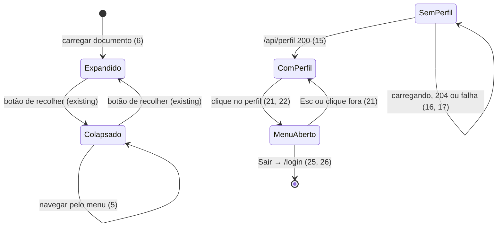

# Backoffice — layout da aplicação com menu lateral

> Build this with **tlc-implement**.
> Every criterion below becomes a check with a proof, referenced by its number. Nothing under
> `Unresolved` gets settled while building.

## Intent

Hoje as telas autenticadas do backoffice (`/pessoas` e `/pessoas/{id}`) não têm menu. Depois do
login, o usuário cai em `/pessoas` e não tem como chegar a outra área nem como sair. A Server
Action `logout` existe em `apps/backoffice/app/actions/auth.ts`, mas nenhuma tela a chama. Cada
tela nova teria de montar o próprio layout. O `@church/ui` já tem as peças: `Page`, `SideMenu`,
`MenuDrawer`, `Navigation` e `NavItem`, entregues no lote 5 (`.tasks/lamb-page-shell.md`). Nenhum
app as consome. A sublista do `NavItem` também diverge do Figma: mostra o ponto em todos os
sub-itens e não tem linha-guia. A fonte não traz números de impacto.

Com a entrega, toda página autenticada do backoffice fica dentro da `Page` do `@church/ui`. A
partir de 960px, ela tem o SideMenu do protótipo
([Side menu `282:37325`](https://www.figma.com/design/HQ5Vfbwug9vzIskrlSIXJW/Backoffice?node-id=282-37325&m=dev),
na tela
[`141:4443`](https://www.figma.com/design/HQ5Vfbwug9vzIskrlSIXJW/Backoffice?node-id=141-4443&m=dev)).
Abaixo de 960px, ela tem a barra de topo com o MenuDrawer. A árvore do menu é definida no front
end, porque o backend não tem endpoint de telas ou rotas. Isso foi verificado nas 44 rotas dos
controllers do `ibfc-server` e no §5 de `docs/backend/ibfc-server.md`. O item da página atual
vem da URL. O rodapé mostra o usuário logado com nome e papel, e o clique nele abre um menu com
"Sair".

26 critérios em 6 slices · 6 one-way doors · 5 open, 0 block

## Criteria

### Sublista do NavItem como no Figma (`@church/ui`)

1. Dado um `NavItem` expandido, um sub-item sem `activated` não mostra o ponto. Só o sub-item
   `activated` mostra o ponto de 4px a 19px da borda, junto do `bg-selected`, do `text-primary` e
   de `aria-current="page"` (Lamb Nav sub-item `13506:10602`: ocioso só texto; ativo com ponto e
   fundo). Isso vale nas duas densidades: Painel com 32px e App com 48px.
2. Dado um `NavItem` expandido com sub-itens, a sublista mostra uma linha-guia vertical de 1px em
   `neutral-17`, na coluna do ponto (centro a 19.5px da borda do item). Ela vai do topo do
   primeiro sub-item ao fim do último (`Rectangle 1`, `I282:37325;13021:3767;13506:10539`: 1×144
   para 4 sub-itens de 32px com gap de 4px). O pop-up do modo colapsado não tem linha-guia nem
   ponto.

### Shell das páginas autenticadas

3. Dada uma sessão válida, quando o usuário abre `/pessoas` ou `/pessoas/{id}`, então o conteúdo
   atual da página aparece dentro do `<main>` da `Page`. A partir de 960px, o SideMenu de 240px
   fica à esquerda. Abaixo de 960px, aparecem a barra de topo com "Abrir menu" e o MenuDrawer,
   como já faz a `Page`.
4. Sempre, `/login` renderiza sem SideMenu, sem barra de topo e sem link "Pular para o conteúdo".
5. Quando o usuário recolhe o menu e depois clica num item com `href`, então a navegação acontece
   no cliente, pelo `Link` do Next, sem recarregar o documento. O SideMenu continua recolhido na
   página nova.
6. Sempre, ao carregar ou recarregar o documento, o SideMenu começa expandido
   (`defaultCollapsed=false`).

### Árvore do menu (front end)

7. Sempre, o meio do SideMenu e do MenuDrawer mostra, nesta ordem:
   - "Início";
   - "Pessoas", com os sub-itens "Membros", "Visitantes", "GCs" e "Ministérios";
   - "Ensino";
   - "Gestão".

   O rodapé mostra "Configurações". Rótulos e ícones seguem o `282:37325`. O segundo "Visitantes"
   de primeiro nível do protótipo não aparece (Unresolved 2).

8. Sempre, os destinos são:

   | Item          | `href`                     |
   | ------------- | -------------------------- |
   | Início        | `/inicio`                  |
   | Membros       | `/pessoas`                 |
   | Visitantes    | `/pessoas?aba=visitantes`  |
   | GCs           | `/pessoas?aba=gcs`         |
   | Ministérios   | `/pessoas?aba=ministerios` |
   | Ensino        | `/ensino`                  |
   | Gestão        | `/gestao`                  |
   | Configurações | `/configuracoes`           |

   "Pessoas" não tem `href`, porque um pai só expande a sublista. "Ensino" e "Gestão" são folhas
   até a fonte definir os filhos (Unresolved 1).

9. Dada uma sessão válida, quando o usuário abre `/inicio`, `/ensino`, `/gestao` ou
   `/configuracoes`, então o `<main>` mostra o `EmptyState` com o título "Em construção" dentro
   do shell. Uma URL fora da árvore, como `/qualquer-coisa`, devolve o 404 do Next.
10. Dada uma sessão válida, quando o usuário abre `/pessoas?aba=visitantes`, `?aba=gcs` ou
    `?aba=ministerios`, então o `<main>` mostra o `EmptyState` "Em construção" no lugar da lista
    de membros. Um valor de `aba` desconhecido mostra a lista de membros, como `/pessoas`.

### Item atual pela URL

11. Em `/pessoas` (sem `aba`, com `aba=membros` ou com `aba` desconhecida) e em `/pessoas/{id}`,
    "Pessoas" aparece expandido e `selected`, com ícone preenchido, sem fundo e sem
    `aria-current`. "Membros" aparece `activated`. Nenhum outro item fica ativo. É o estado do
    `141:4443`.
12. Em `/pessoas?aba=visitantes`, só "Visitantes" fica `activated`, e "Pessoas" fica `selected`. O
    mesmo vale para `gcs` → "GCs" e `ministerios` → "Ministérios".
13. Em `/inicio`, `/ensino`, `/gestao` e `/configuracoes`, só o item de mesmo `href` fica
    `activated`, e "Pessoas" não fica `selected`.
14. Quando o usuário clica num sub-item de "Pessoas" estando em `/pessoas`, então o item ativo
    muda para o novo sub-item, sem recarregar o documento. Isso vale porque a URL muda só na query.

### Usuário no rodapé

15. Dado que `GET /api/perfil` responde 200 com `{ nome: "Fulano Teste", papel: "admin" }`,
    então o rodapé mostra o botão de perfil com o Avatar de iniciais (o `/perfil` não devolve
    foto), "Fulano Teste" e "Administrador". Os rótulos de `papel` são `admin` → "Administrador",
    `secretaria` → "Secretaria" e `lider` → "Líder". Com `papel: null`, aparece só o nome.
16. Enquanto `GET /api/perfil` não responde, o rodapé mostra "Configurações" e nenhum botão de
    perfil.
17. Se `GET /api/perfil` falhar com 5xx ou erro de rede, então o rodapé fica sem botão de perfil
    e aparece um único toast "Algo deu errado. Tente novamente em instantes." (`apiFetch`
    existente). Se responder 204, o rodapé fica sem botão de perfil e sem toast. Se responder 401,
    o usuário vai para `/login?sessao=expirada` (existente).
18. Quando o navegador chama `GET /api/perfil` com sessão válida, então a rota chama `/perfil` no
    `ibfc-server` pelo `sessionFetch`. Ela responde 200 com `{ nome, papel }`:
    - `nome` vem do campo `nome` do backend;
    - `papel` vem do claim `roles` do access token usado na chamada, com precedência `admin` >
      `secretaria` > `lider`;
    - `papel` é `null` quando o token não decodifica ou não tem nenhum desses papéis.
19. Se `/perfil` responder 204, então `GET /api/perfil` responde 204 sem corpo. Se responder outro
    status de erro, a rota o repassa com o corpo (`relayError`). Sem sessão, a rota responde 401
    `{ message: "Sua sessão expirou. Entre novamente." }` (`sessionExpired`).
20. Sempre, o corpo de `GET /api/perfil` tem só `nome` e `papel`: nem `email`, nem `telefone`, nem
    `gc`, nem o token.

### Menu do perfil e "Sair"

21. Dado `profileMenuItems` no SideMenu com `user`, então o botão de perfil é o gatilho de um
    `MenuDropdown`, com `aria-haspopup="menu"` e `aria-expanded`. O clique abre o `role="menu"`
    acima do botão, com a borda inferior do menu sobre a borda superior do botão, alinhado à
    esquerda. Esc e clique fora fecham o menu, e o foco volta ao botão (comportamento existente
    do `MenuDropdown`). Isso vale também colapsado, quando o botão mostra só o Avatar.
22. Dado `profileMenuItems` no MenuDrawer, o botão de perfil do rodapé abre o mesmo menu, acima
    dele. A `Page` repassa `nav.profileMenuItems` ao MenuDrawer.
23. Sempre, sem `profileMenuItems`, o botão de perfil continua um `<button>` que só chama
    `onProfileClick`, como hoje. As specs atuais do SideMenu, do MenuDrawer e da Page continuam
    passando.
24. Dado `side="top"` no `MenuDropdown`, o menu abre acima do gatilho (`bottom-full`, `mb-1`). O
    padrão continua `side="bottom"` (`top-full`, `mt-1`), sem mudança para quem já usa o
    componente.
25. No backoffice, o menu do perfil tem um único item, "Sair", com o ícone `logout`. Quando o
    usuário o escolhe, a Server Action `logout` existente roda: o cookie `church_session` é
    removido e o navegador termina em `/login`.
26. Se `POST /auth/logout` falhar no backend (rede ou 5xx), o resultado é o mesmo do critério 25:
    a sessão local é destruída e o navegador vai para `/login`. Isso já está no `.catch` do
    `logout`.

## States

## Out of scope

- **Outros itens no menu do perfil** (meu perfil, trocar senha): ninguém pediu. Só "Sair" (25).
- **Filtrar itens por papel:** ninguém pediu. Uma `secretaria` vê "Membros" e recebe o 403 já
  tratado pelo `apiFetch` (Unresolved 3).
- **Persistir o recolhimento entre recargas:** o README do SideMenu deixa para o app, e ninguém
  pediu (6).
- **Conteúdo das abas Visitantes, GCs e Ministérios e das áreas Início, Ensino, Gestão e
  Configurações:** são telas próprias. Aqui elas só existem como "Em construção" (9, 10).
- **Ajustes da tela "Gestão de pessoas" ao `141:4443`:** chips de aba, cards, colunas, widget de
  usuário no cabeçalho e padding do corpo pelo `PageBody`. A tela atual só passa a morar no shell
  (3). O pedido deixou essa tela para depois.

## Observable

| Surface                 | Decision                 | Landing                                                                              |
| ----------------------- | ------------------------ | ------------------------------------------------------------------------------------ |
| shell (SideMenu/Drawer) | vazio                    | n/a - a árvore é estática e nunca vazia (7)                                          |
| shell (SideMenu/Drawer) | carregando               | 16                                                                                   |
| shell (SideMenu/Drawer) | erro                     | 17                                                                                   |
| shell (SideMenu/Drawer) | não autorizado           | existing - `proxy.ts` redireciona para `/login`; as páginas chamam `verifySession`   |
| shell (SideMenu/Drawer) | densidade e ordem        | 1, 2, 7                                                                              |
| shell (SideMenu/Drawer) | ação destrutiva confirma | n/a - "Sair" não destrói dados; basta entrar de novo (25)                            |
| telas "Em construção"   | vazio, carregando, erro  | 9, 10 - estáticas, sem chamada                                                       |
| telas "Em construção"   | não autorizado           | existing - `proxy.ts`                                                                |
| API `GET /api/perfil`   | forma da resposta        | 18, 20                                                                               |
| API `GET /api/perfil`   | forma e códigos de erro  | 19                                                                                   |
| API `GET /api/perfil`   | quem pode chamar         | 19 - sessão do cookie; sem sessão, 401                                               |
| API `GET /api/perfil`   | versionamento            | n/a - rota interna do BFF, consumida só pelo próprio app                             |
| API `GET /api/perfil`   | limite de taxa           | n/a - o backend não tem limite documentado, e a rota é chamada uma vez por documento |

## Swept

- validation: 18 - token sem `roles` reconhecível vira `papel: null`
- failure modes: 17, 19, 26
- idempotency and retry: n/a - `/api/perfil` é só GET, e o retry após 401 e a renovação já estão
  no `sessionFetch`; um segundo "Sair" encontra a sessão já destruída, e o `logout` só redireciona
- authorization: existing - `proxy.ts` e `verifySession`; filtro por papel em Unresolved 3
- concurrency and ordering: existing - `/api/perfil` e as chamadas da `PessoasPage` saem juntas, e
  `refreshOnce` em `lib/server/backend.ts` serializa a renovação pelo mesmo refresh token
- data lifecycle: n/a - nada é gravado; o recolhimento vive em memória (6)
- external-dependency failure: 17, 19, 26
- state transitions: 5, 6, 15, 16, 21, 25
- observability: n/a - o backoffice não tem canal de log além dos toasts, e a falha do perfil já é
  visível (17)

## Impact

| Front        | What changes                                                                                                                                                                                                                                                                                                                                           |
| ------------ | ------------------------------------------------------------------------------------------------------------------------------------------------------------------------------------------------------------------------------------------------------------------------------------------------------------------------------------------------------ |
| `@church/ui` | `NavItem`: o ponto passa a aparecer só no sub-item `activated`, e a sublista ganha linha-guia (1, 2). Isso afeta SideMenu, MenuDrawer e Page, nas stories e nas specs. O teste `NavItem.spec.tsx:430` ("always-visible 4px dot … no vertical guide line") afirma o contrário e muda junto. O critério 33 de `.tasks/lamb-alinhamento.md` foi emendado. |
| backoffice   | `/pessoas` e `/pessoas/{id}` passam a ter um layout compartilhado com `/inicio`, `/ensino`, `/gestao` e `/configuracoes`, e `/login` fica fora dele. A `Page` usa `h-full`, então `html`/`body` precisam de altura cheia. Hoje o `layout.tsx` raiz não define isso.                                                                                    |
| backoffice   | A `PessoasPage` ganha o ramo "Em construção" para `aba` conhecida diferente de `membros` (10). O `p-6` dela fica dentro do `<main>` da `Page`, e o ajuste para o `PageBody` está fora.                                                                                                                                                                 |
| domain       | Termo novo: `papel` (`'admin' \| 'secretaria' \| 'lider' \| null`), o papel exibido do usuário logado, na resposta de `GET /api/perfil`. Reusa os valores do `PapelUsuario` do backend.                                                                                                                                                                |
| domain       | Termo novo: `aba` (`membros` \| `visitantes` \| `gcs` \| `ministerios`), a query de `/pessoas` que escolhe a aba da gestão de pessoas.                                                                                                                                                                                                                 |
| `@church/ui` | `SideMenu`, `MenuDrawer` e `Page` ganham `profileMenuItems`, e o `MenuDropdown` ganha `side`. As duas props são opcionais, com padrão igual ao comportamento atual (23, 24). Nenhum consumidor existente muda.                                                                                                                                         |
| backoffice   | A Server Action `logout` ganha o primeiro chamador de UI (25).                                                                                                                                                                                                                                                                                         |
| stored data  | Nada a migrar: nenhum cookie ou campo de sessão novo.                                                                                                                                                                                                                                                                                                  |

## Decided

| Decision                                  | Shape                                                                                                                                                                                                                                                                                  | Alternative rejected                                                                                                                                                                                                                                                                                                                                                                |
| ----------------------------------------- | -------------------------------------------------------------------------------------------------------------------------------------------------------------------------------------------------------------------------------------------------------------------------------------- | ----------------------------------------------------------------------------------------------------------------------------------------------------------------------------------------------------------------------------------------------------------------------------------------------------------------------------------------------------------------------------------- |
| Árvore do menu no front end               | Um módulo estático no `apps/backoffice` com `{ label, iconName, href?, subItems? }[]` e os itens de rodapé (7, 8). O shell deriva `activated`/`selected` da URL (`usePathname` + `useSearchParams`) e entrega `NavItemProps[]` ao `Page.nav`. Telas novas entram editando esse módulo. | Endpoint de menu no `ibfc-server`: não existe (rotas dos controllers e §5 da doc), e o usuário decidiu "se não houver, vamos deixar a cargo do front end". Fecha a possibilidade de o backend esconder telas por papel sem um deploy do front.                                                                                                                                      |
| Perfil pelo BFF, buscado no navegador     | `GET /api/perfil` → `200 { nome: string, papel: 'admin' \| 'secretaria' \| 'lider' \| null }` \| `204` \| erro repassado (18–20), chamado pelo shell com `apiFetch`.                                                                                                                   | Chamar `sessionFetch('/perfil')` no layout de servidor: quando o access token está perto de expirar, o `sessionFetch` renova e grava o cookie (`saveSession`), e o Next só permite gravar cookie em Server Action ou Route Handler. Numa renderização, o refresh rotacionado se perderia, e reapresentar o antigo faz o backend revogar todas as sessões da credencial (§4 da doc). |
| Papel lido do claim `roles` do JWT no BFF | A rota decodifica o payload do access token (sem verificar a assinatura, só para exibir; o backend continua autorizando) e escolhe por `admin` > `secretaria` > `lider`.                                                                                                               | Guardar os papéis no iron-session no login: sessões já abertas não teriam o campo e ficariam sem papel até novo login. Pedir ao backend que `/perfil` devolva os papéis: é mudança em outro repositório, e o token já carrega a informação.                                                                                                                                         |
| Abas de Pessoas como query `?aba=`        | `/pessoas?aba=visitantes\|gcs\|ministerios`. Sem `aba` ou com `aba=membros`, mostra a lista de membros (8, 10–12).                                                                                                                                                                     | Rotas `/pessoas/visitantes` etc.: o segmento dinâmico `/pessoas/[id]` já existe, então cada aba exigiria uma página estática própria, e "Membros" em `/pessoas` ficaria assimétrico. No `141:4443` as quatro são chips da mesma tela "Gestão de pessoas" (Unresolved 4).                                                                                                            |
| Menu do perfil no `@church/ui`            | `profileMenuItems?: MenuItemProps[]` em `SideMenuProps` (e, portanto, em `Page.nav`) e em `MenuDrawerProps`. Com ela, o `ProfileButton` vira o gatilho de um `MenuDropdown`; sem ela, nada muda (21–23).                                                                               | O consumidor envolver o perfil por fora com `onProfileClick` e um menu próprio: o `ProfileButton` é interno ao SideMenu, e não haveria âncora para posicionar o menu. Trocar `user` por um `ReactNode` livre: perde o layout de perfil do Lamb que o SideMenu garante (critérios 13 e 14 do lote 5).                                                                                |
| Direção do `MenuDropdown`                 | `side?: 'bottom' \| 'top'`, padrão `'bottom'` (24). É o mesmo nome do `side` do MenuDrawer, que também diz de que lado o elemento abre.                                                                                                                                                | Calcular a direção em JS pelo espaço disponível: o perfil fica sempre no rodapé, então a direção é conhecida. Medir no cliente traria salto após a hidratação, o que o lote 1 já rejeitou.                                                                                                                                                                                          |

## Surface

| Route             | In               | Out             | Status                                  | Criteria   |
| ----------------- | ---------------- | --------------- | --------------------------------------- | ---------- |
| `GET /api/perfil` | cookie de sessão | `nome`, `papel` | `200`, `204`, `401`, 4xx/5xx repassados | 18, 19, 20 |

## Sources

- [Backoffice — Side menu `282:37325`](https://www.figma.com/design/HQ5Vfbwug9vzIskrlSIXJW/Backoffice?node-id=282-37325&m=dev).
  **Binding** para o menu: 240×1124; topo de 64px com logo e botão de recolher; `Menus` com
  Início, Pessoas (aberto: Membros ativo, Visitantes, GCs, Ministérios, linha-guia `Rectangle 1`
  1×144 em x 19.5), Ensino (fechado), Visitantes (primeiro nível, com ponto), Gestão (fechado);
  rodapé com o Nav item "Configurações" e o bloco do usuário (Avatar 39px, "Lucas Vieira" /
  "Administrador", chevron). Variáveis do nó: `neutral/17` #dee1e8, `neutral/83`, `neutral/999`,
  `neutral/a20`.
- [Backoffice — tela `141:4443`](https://www.figma.com/design/HQ5Vfbwug9vzIskrlSIXJW/Backoffice?node-id=141-4443&m=dev).
  **Binding** para o shell: SideMenu à esquerda e conteúdo "Gestão de pessoas" com os chips
  Membros, Visitantes, Grupos de Crescimento e Ministérios. O conteúdo está fora desta task.
- [Lamb — Nav sub-item `13506:10602`](https://www.figma.com/design/7I9GnO3cTPpaJPOUfFsI9t/Lamb-Design-System?node-id=13506-10602).
  **Binding** para o critério 1: ocioso só texto; ativo com ponto e fundo; o terceiro estado tem
  fundo e não tem ponto.
- [Lamb — SideMenu `12967:3606`](https://www.figma.com/design/7I9GnO3cTPpaJPOUfFsI9t/Lamb-Design-System?node-id=12967-3606):
  traz também "Comunicação", que o protótipo do Backoffice não tem. Vale o protótipo.
- `docs/backend/ibfc-server.md`: §4 (papéis `lider`, `admin`, `secretaria`; claim `roles`; rotação
  do refresh), §5 (índice de 42 endpoints, nenhum de menu) e `GET /perfil`
  (`{ id, nome, email, telefone, gc }`, 204 se a pessoa não existe).
- `~/Documents/personal/ibfc-server/src/**/presentation/*.controller.ts`: confirma que não há
  rota de telas ou menu.
- Pedido do usuário (chat, 2026-10-19, sem endereço): "precisamos de um layout para toda aplicação
  com o menu lateral" · "Verifique se temos um endpoint que retorna as telas/paths do sistema, se
  não houver, vamos deixar a cargo do front end cuidar disso."
- Respostas do usuário (chat, 2026-10-19): destinos sem tela → "Árvore toda + Em construção" (7–10,
  13); clique no perfil → "Menu com 'Sair'", que chama a Server Action `logout` (21–26).

This task is the record of decision. If a linked document diverges, ask before building.

## Unresolved

| #   | Kind | Question                                                                                                                               | Until answered                                                                                                      |
| --- | ---- | -------------------------------------------------------------------------------------------------------------------------------------- | ------------------------------------------------------------------------------------------------------------------- |
| 1   | open | Quais são os sub-itens de "Ensino" e "Gestão"? No protótipo os dois estão fechados, com chevron.                                       | Escritos como folhas para `/ensino` e `/gestao`, sem chevron (7, 8). Viram grupos quando os filhos forem definidos. |
| 2   | open | O "Visitantes" de primeiro nível, com ponto no lugar do ícone, logo abaixo de Ensino, é intencional? Ele repete o sub-item de Pessoas. | Omitido (7). Vale levar às notas do designer.                                                                       |
| 3   | open | O menu deve esconder itens por papel? Uma `secretaria` só tem acesso a `/admin/visitantes` no backend.                                 | Todos veem todos os itens. O 403 aparece como o toast "Sem permissão para realizar esta ação." (`apiFetch`).        |
| 4   | open | Visitantes, GCs e Ministérios são abas de `/pessoas` (`?aba=`) ou telas com rota própria?                                              | Escrito como abas por query (8, 10, 12), pelo layout de chips do `141:4443`.                                        |
| 5   | open | Cor da linha-guia: as variáveis do nó e o screenshot indicam `neutral-17`, mas o `Rectangle 1` não foi lido isolado.                   | Escrito `neutral-17` (2). Confirmar no `get_design_context` antes de construir.                                     |
