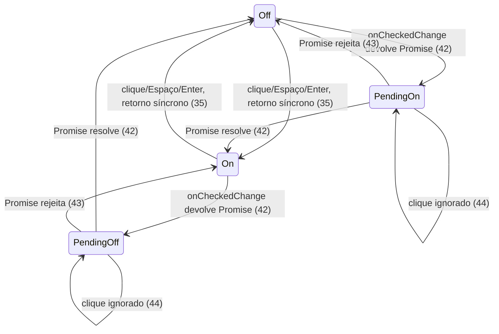

# Lote 1 do Lamb: os atoms novos do `@church/ui`

> Build this with **tlc-implement**.
> Every criterion below becomes a check with a proof, referenced by its number. Nothing under
> `Unresolved` gets settled while building.

## Intent

O design system Lamb, entregue pelo designer em 2026-10-05, tem 8 atoms que o `@church/ui` não
tem: Divider, Spinner, CountBadge, Logo, Chip, Radio, Toggle e Stack. Hoje, uma tela que precise
de separador, indicador de carregamento, contador de novidades, marca da igreja, filtro rápido,
escolha única, interruptor liga/desliga ou espaçamento entre componentes tem de montar a peça por
conta própria, fora dos tokens e das regras de acessibilidade do Lamb. Os lotes 2 a 5 (molecules,
overlays, organisms e o template `Page`) também ficam parados: 7 dos 23 componentes seguintes
importam um destes atoms diretamente (FilterChip, RadioGroup, ListItem, Dialog, PageHeader,
SideMenu e MenuDrawer), e o `count` do NavItem depende do CountBadge. A fonte não traz números de impacto.

Com a entrega, os 8 atoms passam a existir em `@church/ui/atoms/<Nome>`, cada um com spec e story,
e reproduzem os valores, estados e a acessibilidade do artefato Lamb. Também entra o breakpoint
`panel` (960px), que separa as densidades Painel e App. O Stack usa esse breakpoint, e os
componentes responsivos dos lotes seguintes vão usá-lo também.

54 critérios em 9 slices · 2 one-way doors · 4 open, 0 block

## Criteria

### Divider

1. Quando `<Divider />` é renderizado, então ele é um `
` sem margem e sem a borda inset nativa,
   com uma linha de 1px de altura, 100% de largura, cor `border-default` e `aria-hidden="true"`.
2. Quando `orientation="vertical"`, então o Divider tem 1px de largura, estica na altura do pai
   (`align-self: stretch`), tem altura mínima de 16px e a mesma cor `border-default`. É visível;
   a opacidade 0 da fonte não é reproduzida.
3. Quando `decorative={false}`, então o Divider expõe `role="separator"` sem `aria-hidden`. Com
   `orientation="vertical"`, expõe também `aria-orientation="vertical"`.

### Spinner

4. Quando `<Spinner />` é renderizado, então ele é um círculo de 1em × 1em (herda o `font-size` do
   contexto), com borda de 2px em `currentColor` e borda direita transparente. Gira 360° em 0,8s,
   linear e infinito, e fica oculto para tecnologia assistiva (`aria-hidden="true"`).
5. Quando `label="Salvando…"`, então o Spinner expõe `role="status"` com nome acessível
   "Salvando…".
6. Enquanto `prefers-reduced-motion: reduce` vale, o Spinner continua girando, com volta de 2,4s e
   repetição infinita. A regra global do `styles.css`, que reduz as animações a 0,01ms e uma
   iteração, não o congela.

### CountBadge

7. Dado `count={12}`, então o CountBadge mostra "12" numa pílula com largura mínima de 24px,
   altura de 18px, padding de 1px × 4px, raio de 4px, fundo `danger-solid`, texto `on-danger` e
   Inter 500 12/16. A tecnologia assistiva lê "12 novos", uma vez só: o "12" visível não é lido de
   novo.
8. Dado `count={150}` e o `max` padrão (99), então o CountBadge mostra "99+" e continua lendo
   "150 novos". Dado `max={9}` e `count={10}`, mostra "9+".
9. Quando `label="3 mensagens não lidas"`, então esse texto substitui "N novos" como nome
   acessível.

### Logo

10. Quando `<Logo />` é renderizado, então ele mostra o logo completo (símbolo + logotipo, viewBox
    119×40, Figma `Property 1=Group 6`) com 40px de altura e largura proporcional. Expõe
    `role="img"` com nome "Igreja Batista Filadélfia", e o `<svg>` interno fica oculto
    (`aria-hidden`, `focusable="false"`).
11. Quando `variant="symbol"`, então ele mostra só o símbolo (viewBox 41×40, Figma
    `Property 1=Group 7`), com 40px de altura.
12. Quando `label="Ir para o início"`, então esse texto é o nome acessível.
13. Quando `className="h-6"`, então o Logo tem 24px de altura e mantém a proporção do viewBox.
14. Sempre, nos dois temas, a tinta do "f" e do logotipo é `currentColor` com cor `neutral-999`
    (escura no light, branca no dark), e os três arcos usam os tokens `brand-red`, `brand-blue` e
    `brand-teal`. O componente não tem cor hexadecimal literal.

### Chip

15. Quando `<Chip>Todos</Chip>` é renderizado, então ele é um `<button type="button">` com 32px de
    altura, padding de 4px × 12px, gap de 6px, raio de 8px, borda de 1px `border-default`, fundo
    `bg-surface`, texto `text-primary` e Inter 500 16/24. `startIcon` e `endIcon` saem com 16px.
16. Sempre, a área clicável do Chip se estende 6px acima e 6px abaixo da borda (44px de altura no
    total), sem mudar o tamanho visível.
17. Quando o ponteiro passa sobre um Chip habilitado, então o fundo vira `bg-hover`.
18. Quando `selected` é definido, então o Chip expõe `aria-pressed` com o mesmo valor
    (`true`/`false`). Sem `selected`, ele não tem `aria-pressed`.
19. Enquanto `selected` ou `active` é `true`, a borda é `neutral-999` e o fundo é `bg-hover`.
20. Enquanto `disabled`, o texto é `text-disabled`, o cursor é `not-allowed`, o hover não muda o
    fundo e o clique não chama `onClick`.

### Radio

21. Dado `<Radio value="primeira" label="Primeira vez" name="tipo" />`, então ele renderiza um
    `<input type="radio">` nativo dentro de um `<label>` que cobre a linha inteira: clicar no
    rótulo marca o Radio. A linha tem altura mínima de 44px. **Corrigido em 2026-10-08:** o
    `bundle.css` põe os 44px dentro de `@media (max-width: 959px)`, ou seja, só na densidade App; o
    lote 1 aplicou sempre. A correção é o critério 43 de `.tasks/lamb-molecules.md`.
22. No tamanho padrão `medium`, então a caixa tem 24px e o círculo 20px, com borda de 2px
    `border-control` e fundo `bg-surface`. O rótulo é Inter 500 16/24, e o gap entre caixa e texto
    é 8px.
23. Quando `size="small"`, então a caixa e o círculo têm 16px e o rótulo é 500 14/16. Quando
    `size="large"`, a caixa tem 32px, o círculo 28px e o rótulo é 500 18/32.
24. Enquanto o Radio está marcado, a borda do círculo é `neutral-999` e um ponto interno com 50% do
    diâmetro do círculo aparece em `neutral-999`. Desmarcado, o ponto não aparece.
25. Quando `description` é passada, então ela aparece abaixo do rótulo (gap 2px), em 400 14/16 e
    `text-secondary`, ligada ao input por `aria-describedby`.
26. Quando o ponteiro passa sobre um Radio habilitado, então o círculo ganha borda `neutral-83` e
    fundo `bg-hover`. Pressionado, o fundo é `bg-selected`. As mudanças de cor e do ponto duram
    150ms, ease-out.
27. Quando o Radio recebe foco pelo teclado, então um anel `focus-ring` de 2px e offset de 2px
    contorna o círculo.
28. Dados dois Radios com o mesmo `name`, quando o primeiro está focado e o usuário aperta Espaço,
    então ele fica marcado. Quando o segundo é marcado, o primeiro desmarca.
29. Enquanto `disabled`, o círculo tem borda `neutral-33` e fundo `bg-disabled`, o ponto fica em
    `text-disabled`, o rótulo e a descrição ficam em `text-disabled`, o cursor é `not-allowed`, e o
    input não recebe foco nem muda com clique.

### Toggle

30. Dado `<Toggle label="Lembrete de relatório" />`, então ele renderiza um
    `<button type="button" role="switch" aria-checked="false">` nomeado pelo rótulo
    (`<label for>`). Clicar no rótulo também alterna.
31. No tamanho padrão `medium`, então o trilho tem 40×24px, borda de 2px `border-control` e fundo
    `bg-surface`. O polegar tem 16px, fica a 2px do topo e da esquerda e tem a cor
    `border-control`. O rótulo é 500 16/24, e o gap entre trilho e texto é 12px.
32. Quando `size="small"`, então o trilho tem 32×20px, o polegar 12px e o rótulo é 500 14/20.
    Quando `size="large"`, o trilho tem 52×32px, o polegar 24px e o rótulo é 500 18/32.
33. Enquanto ligado, o trilho (fundo e borda) é `action-primary`, o polegar é `neutral-00` e se
    desloca até 2px da borda direita, e um ícone `check` aparece no polegar na cor
    `action-primary`.
34. Enquanto ligado com `color="accent"`, o trilho é `accent-solid`, o polegar é `on-accent` e o
    `check` é `accent-solid`.
35. Quando o usuário clica no switch ou aperta Espaço ou Enter com ele focado, então
    `onCheckedChange` é chamado com o valor seguinte (`true`/`false`). Sem `checked`, o Toggle
    alterna sozinho a partir de `defaultChecked` (padrão `false`). Com `checked`, o
    `aria-checked` só muda quando o pai muda a prop.
36. Quando o ponteiro passa sobre o trilho de um Toggle habilitado, então, desligado, a borda vira
    `neutral-83` e o fundo `bg-hover`. Ligado, trilho e borda viram `neutral-100`; com
    `color="accent"`, `blue-83`. Pressionado, o polegar fica 4px mais largo.
37. Quando `description` é passada, então ela aparece abaixo do rótulo (gap 2px), em 400 14/16 e
    `text-secondary`, ligada ao switch por `aria-describedby`.
38. Quando `labelPosition="left"`, então o rótulo fica à esquerda do trilho, a linha ocupa 100% da
    largura com o espaço livre entre os dois, e o rótulo vem antes do switch também na ordem do
    DOM.
39. Quando `showStateText`, então o Toggle mostra "Ligado" ou "Desligado" em 500 14/16
    `text-secondary`, com largura mínima de 64px e `aria-hidden="true"`.
40. Sempre, a área de toque em volta do trilho tem 44px de altura e pelo menos 44px de largura,
    sem mudar o tamanho visível, e a linha do Toggle tem altura mínima de 44px. **Corrigido em
    2026-10-08:** a área em volta do trilho vale sempre, mas a altura mínima da linha vale só na
    densidade App (`@media (max-width: 959px)`). A correção é o critério 44 de
    `.tasks/lamb-molecules.md`.
41. Enquanto `disabled`, o trilho tem borda `neutral-33` e fundo `bg-disabled`, o polegar é
    `neutral-33` (ligado: `neutral-50`), o rótulo e a descrição ficam em `text-disabled`, o cursor
    é `not-allowed`, e clique ou tecla não chamam `onCheckedChange`.
42. Quando `onCheckedChange` devolve uma Promise ainda pendente, então o `aria-checked` mantém o
    valor anterior, o switch ganha `aria-busy="true"`, o polegar mostra um Spinner no lugar do
    `check`, "Salvando…" é anunciado à tecnologia assistiva, o cursor é `progress` e o foco fica
    no switch. Quando a Promise resolve, o `aria-checked` passa ao novo valor e o `aria-busy` sai.
43. Se a Promise devolvida por `onCheckedChange` rejeita, então o `aria-checked` continua com o
    valor anterior, o `aria-busy` sai e nenhuma rejeição fica sem tratamento.
44. Enquanto a Promise está pendente, um novo clique ou tecla não chama `onCheckedChange` de novo.
45. Enquanto `loading` é `true`, o Toggle mostra o mesmo estado de carregamento do critério 42, e
    clique ou tecla não chamam `onCheckedChange`.

### Stack e o breakpoint `panel`

46. Sempre, `@church/tokens` exporta o breakpoint `panel` com valor 960, e o tema do
    `@church/ui` publica a variante `panel:`, que compila para uma media query de largura mínima
    de 960px.
47. Quando `<Stack>` é renderizado sem props numa viewport de 960px ou mais, então ele é uma
    `
` flex em coluna com gap de 16px e `min-width: 0`, sem fundo, borda nem padding (o
    padrão é `tier="composite"`, `relation="weak"` e `density="auto"`).
48. Enquanto a densidade é Painel, o gap segue esta matriz (px):

    | `tier`      | `strong` | `weak`                         | `none` |
    | ----------- | -------- | ------------------------------ | ------ |
    | `primitive` | 8        | 16                             | 24     |
    | `composite` | 12       | 16                             | 24     |
    | `block`     | 16       | 16 (24 com `surfaces={false}`) | 24     |

49. Enquanto a densidade é App, o gap segue esta matriz (px):

    | `tier`      | `strong`                 | `weak` | `none` |
    | ----------- | ------------------------ | ------ | ------ |
    | `primitive` | 8 (12 com `interactive`) | 16     | 32     |
    | `composite` | 16                       | 24     | 32     |
    | `block`     | 24                       | 32     | 32     |

50. Dado `density="auto"`, então a densidade é Painel a partir de 960px e App até 959px. Um
    ancestral com `data-viewport="mobile"` força App, e um com `data-viewport="desktop"` força
    Painel, em qualquer largura. Com `density="panel"` ou `density="app"`, a densidade é a pedida,
    em qualquer viewport.
51. Sempre, a densidade `auto` é resolvida só por CSS. O HTML renderizado no servidor é o mesmo em
    qualquer viewport e não muda depois da hidratação.
52. Quando `direction="horizontal"`, então o Stack é uma linha flex que quebra linha, com
    `align-items: center`. Com `wrap={false}`, não quebra.
53. Quando `as="section"` e `aria-labelledby="dados"` são passados, então o Stack renderiza uma
    `<section aria-labelledby="dados">`. Os atributos HTML restantes chegam ao elemento.

### Entrega no design system

54. Sempre:
    - os 8 componentes são importáveis por `@church/ui/atoms/<Nome>`, cada um com spec e story
      próprios;
    - o `parameters.design` das stories de Divider, Logo e Chip aponta para os nós `13628:935`,
      `12967:3338` e `13596:6864` do arquivo `7I9GnO3cTPpaJPOUfFsI9t`, conferidos pelo
      `src/figma-links.spec.ts`;
    - `packages/docs/figma-components.md` tem uma linha para cada um dos 8.

## States

O ciclo de vida do Toggle, que é o único componente do lote com estado assíncrono:

## Out of scope

- **RadioGroup e o que o Radio herda dele** (nome, valor, tamanho, `disabled` e erro do grupo,
  variante `card`, legenda, hint, aviso acima de 5 opções): é molecule e vai no lote 2. Neste lote
  o Radio funciona sozinho, controlado por `checked`/`name`.
- **`count` no NavItem e `avatarGroup` na Cell**: lote 2, junto com as molecules que usam CountBadge
  e AvatarGroup.
- **Tokens de densidade em `packages/tokens`**: a matriz do Stack usa só a escala de espaçamento
  que já existe (8/12/16/24/32px). Só o breakpoint é token novo.
- **`height` numérico do Logo**: a constituição IV proíbe tamanho inline. A altura muda por
  `className` (critério 13).
- **`align` e `justify` do Stack como valores CSS livres** (`React.CSSProperties`): pelo mesmo
  motivo, viram uniões fechadas (Unresolved 3).
- **Margens de tela (`.lamb-screen`) e a grade do `PageBody`**: são do template `Page`, no lote 5.
- **Os arquivos SVG originais do grupo Logos**: a leitura do asset store do artefato foi recusada
  ("access to the artifact content was refused"). O desenho vem dos SVGs embutidos no
  `bundle.js` (`SYMBOL` e `FULL`), que são os mesmos nós do Figma.

## Observable

| Surface                                       | Decision                                                                | Landing                                                                                    |
| --------------------------------------------- | ----------------------------------------------------------------------- | ------------------------------------------------------------------------------------------ |
| componente Divider                            | estados (decorativo, semântico, vertical)                               | 1, 2, 3                                                                                    |
| componente Spinner                            | estado com e sem nome                                                   | 4, 5                                                                                       |
| componente Spinner                            | movimento reduzido                                                      | 6                                                                                          |
| componente CountBadge                         | estouro do máximo                                                       | 8                                                                                          |
| componente CountBadge                         | vazio (`count={0}`) e valor inválido                                    | Unresolved 2                                                                               |
| componente Logo                               | variantes e tamanho                                                     | 10, 11, 13                                                                                 |
| componente Logo                               | tema escuro                                                             | 14                                                                                         |
| componente Chip                               | enabled, hover, active/selected, disabled (estados do Figma 13596:6864) | 15, 17, 19, 20                                                                             |
| componente Chip                               | alternância                                                             | 18                                                                                         |
| componente Radio                              | marcado, desmarcado, hover, pressed, foco, disabled                     | 24, 26, 27, 29                                                                             |
| componente Radio                              | erro                                                                    | n/a - o estado inválido vem do RadioGroup (lote 2)                                         |
| componente Toggle                             | carregando                                                              | 42, 45                                                                                     |
| componente Toggle                             | erro (Promise rejeitada)                                                | 43                                                                                         |
| componente Toggle                             | disabled                                                                | 41                                                                                         |
| componente Toggle                             | ação destrutiva confirma antes                                          | n/a - o README proíbe Toggle para ação destrutiva; a confirmação é do Dialog do consumidor |
| componente Stack                              | sem filhos                                                              | existing - um contêiner flex vazio não ocupa altura, porque o Stack não tem padding (47)   |
| componente Stack                              | ordem                                                                   | 52, e o README proíbe `order`/`row-reverse`                                                |
| documento `packages/docs/figma-components.md` | estrutura                                                               | existing - a tabela "Components" já em uso; uma linha por componente (54)                  |
| stories (Storybook)                           | estrutura                                                               | existing - `title: 'atoms/<Nome>'` e `parameters.design`, como em `Checkbox.stories.tsx`   |

## Swept

- validation: 8 (estouro de `max`); `count` negativo ou não inteiro: Unresolved 2
- failure modes: 43
- idempotency and retry: n/a - nenhum componente repete uma chamada; depois de uma rejeição, quem
  tenta de novo é o consumidor (43 só garante o estado)
- authorization: n/a - os componentes não acessam dados; permissão é do app (README · Consumo)
- concurrency and ordering: 44
- data lifecycle: n/a - nada é persistido
- external-dependency failure: n/a - nenhum componente faz rede. O glifo `check` vem da fonte
  Material Symbols já empacotada (`material-symbols`), como no Checkbox
- state transitions: 35, 42, 43, 44 (ver States)
- observability: n/a - componentes do design system não emitem log (constituição XIV). O
  `console.warn` do RadioGroup é do lote 2

## Impact

| Front       | What changes                                                                                                                                                                                                                 |
| ----------- | ---------------------------------------------------------------------------------------------------------------------------------------------------------------------------------------------------------------------------- |
| domain      | novo termo: `tier` - porte dos filhos do Stack (`primitive`/`composite`/`block`), da guideline "Espaçamento e composição"; vive em `atoms/Stack`                                                                             |
| domain      | novo termo: `relation` - força da relação entre os filhos (`strong`/`weak`/`none`, o teste da remoção); vive em `atoms/Stack`                                                                                                |
| domain      | novo termo: densidade `panel`/`app` - Painel ≥ 960px, App < 960px; o breakpoint vive em `packages/tokens` e a variante `panel:` em `packages/ui/src/styles.css`                                                              |
| domain      | termo existente: a regra global de `prefers-reduced-motion` em `styles.css` zerava toda animação; agora o Spinner é exceção (6). Hoje nenhum componente tem animação contínua, então ninguém depende do comportamento antigo |
| tokens      | `@church/tokens` ganha o grupo `breakpoint`; o `root.css` não muda, porque `var()` não vale em media query e o `@theme` espelha o valor (`.checks/lamb-atoms.md`, Landing)                                                   |
| tests       | `src/figma-links.spec.ts` ganha 3 linhas (Divider, Logo, Chip)                                                                                                                                                               |
| stored data | nothing to migrate                                                                                                                                                                                                           |

## Decided

| Decision                                             | Shape                                                                                                                                                                                                                                                                                                                                                                                                                                                             | Alternative rejected                                                                                                                                                                                                                                                                                                                                |
| ---------------------------------------------------- | ----------------------------------------------------------------------------------------------------------------------------------------------------------------------------------------------------------------------------------------------------------------------------------------------------------------------------------------------------------------------------------------------------------------------------------------------------------------- | --------------------------------------------------------------------------------------------------------------------------------------------------------------------------------------------------------------------------------------------------------------------------------------------------------------------------------------------------- |
| Breakpoint Painel/App como token e variante Tailwind | `packages/tokens`: `breakpoint = { panel: 960 }`; `@theme`: `--breakpoint-panel` = 960px → variante `panel:` (mobile-first: sem prefixo = App, `panel:` = Painel). O ancestral `[data-viewport]` força a densidade por seletor CSS                                                                                                                                                                                                                                | O hook `useViewport` do artefato (`matchMedia('(max-width: 959px)')` + `closest('[data-viewport]')`): o servidor renderiza Painel, e abaixo de 960px a tela redesenha depois da hidratação (51). Select, DateField, FilterBar e Page copiariam o mesmo salto                                                                                        |
| Regra de nomes de props em componente novo           | Conceito que o repositório já nomeia mantém o nome e o literal do repositório: `startIcon`/`endIcon` (`ReactElement<IconProps>`), `color` no lugar de `status`, `onCheckedChange(next)` para mudança booleana, tamanhos `small`/`medium`/`large`. Conceito sem nome no repositório usa o nome do Lamb: `tier`, `relation`, `density`, `interactive`, `surfaces`, `decorative`, `labelPosition`, `showStateText`, `description`, `max`, `variant="full"\|"symbol"` | Copiar a API do Lamb ao pé da letra (`leadingIcon`, `status`, `onChange(next)`, `sm/md/lg`): Chip e Button ficariam com nomes diferentes para o mesmo slot de ícone, e Toggle e Checkbox para a mesma mudança booleana. Confirmado pelo usuário em 2026-10-08: "Nome do repositório, não use sm, use small, nem md, medium, não use lg, use large." |

## Surface

API pública que os apps consomem por `@church/ui/atoms/<Nome>`. Nomes conforme Decided, linha 2 (confirmada).

| Componente                | In                                                                                                                                                                                                                                                        | Out                                              | Criteria |
| ------------------------- | --------------------------------------------------------------------------------------------------------------------------------------------------------------------------------------------------------------------------------------------------------- | ------------------------------------------------ | -------- |
| `Divider`                 | `orientation?: 'horizontal' \| 'vertical'`, `decorative?: boolean` (padrão `true`)                                                                                                                                                                        | `
`; `role="separator"` quando não decorativo | 1–3      |
| `Spinner`                 | `label?: string`, `className?`                                                                                                                                                                                                                            | `aria-hidden` ou `role="status"`                 | 4–6      |
| `CountBadge`              | `count: number`, `max?: number` (99), `label?: string`                                                                                                                                                                                                    | texto visível + nome acessível                   | 7–9      |
| `Logo`                    | `variant?: 'full' \| 'symbol'`, `label?: string`, `className?`                                                                                                                                                                                            | `role="img"`                                     | 10–14    |
| `Chip`                    | atributos de `<button>`, `selected?`, `active?`, `startIcon?`, `endIcon?`                                                                                                                                                                                 | `<button>`, `aria-pressed`                       | 15–20    |
| `Radio` (ref → `<input>`) | atributos de `<input>` menos `size`/`type`, `value: string`, `label: ReactNode`, `description?`, `size?`                                                                                                                                                  | `<input type="radio">`                           | 21–29    |
| `Toggle`                  | `checked?`, `defaultChecked?`, `onCheckedChange?: (next: boolean) => void \| Promise<unknown>`, `label?`, `description?`, `size?`, `labelPosition?: 'right' \| 'left'`, `showStateText?`, `color?: 'neutral' \| 'accent'`, `loading?`, `disabled?`, `id?` | `role="switch"`, `aria-checked`, `aria-busy`     | 30–45    |
| `Stack`                   | atributos HTML, `as?`, `direction?`, `tier?`, `relation?`, `density?: 'auto' \| 'panel' \| 'app'`, `interactive?`, `surfaces?`, `wrap?`, `align?`, `justify?`                                                                                             | elemento `as` com gap                            | 46–53    |

## Sources

- Artefato "Lamb" (https://claude.ai/artifact/PwGC8XAgiawWSwqvnEbMmb, versão 1791228354-5316,
  atualizado em 2026-10-05) - **binding for the interface**:
  - `project/components/{Divider,Chip,Logo,Radio,Toggle,Stack}/README.md`, `Radio.d.ts`,
    `Toggle.d.ts`, `Stack.d.ts` e `project/components/index.d.ts` (`CountBadgeProps`, `Spinner`,
    `DividerProps`, `LogoProps`, `ChipProps`): API, uso e acessibilidade;
  - `project/components/bundle.css` (`.lamb-divider`, `.lamb-spinner`, `@keyframes lamb-spin`,
    `.lamb-count`, `.lamb-logo`, `.lamb-chip`, `.lamb-radio*`, `.lamb-toggle*`, `.lamb-stack*`):
    os valores transcritos nos critérios;
  - `project/components/bundle.js` (`Spinner`, `CountBadge`, `Logo` com `SYMBOL`/`FULL`, `Chip`,
    `Radio`, `Toggle`, `Stack`, `useViewport`): comportamento e o desenho do logo;
  - `project/espacamento.md`: a matriz camada × relação × densidade (48, 49) e o breakpoint de
    960px;
  - `project/README.md`: tokens semânticos, foco, movimento, toque de 44px e a cor da marca.
- Figma `7I9GnO3cTPpaJPOUfFsI9t` - **binding for the interface**, conferido pelo Figma MCP em
  2026-10-08:
  - Divider `13628:935`: `Horizontal=True` e `Horizontal=False`;
  - Logo `12967:3338`: `Property 1=Group 6` (118×40) e `Property 1=Group 7` (40×40);
  - Chip `13596:6864`: `State=Enabled`, `Disabled`, `Hover/pressed` e `Active`, todos com 32px de
    altura.
  - O nó `13354:6056` do CountBadge foi recusado (Unresolved 1). Spinner, Radio, Toggle e Stack
    nasceram no Lamb e não têm nó.
- `.tasks/lamb-alinhamento.md`, seção Decided, "Precedência dentro do artefato": (a) a regra
  global de a11y do README vence o CSS; (b) o token declarado vence a aritmética do CSS; (c) no
  resto, o `bundle.css` vence a prosa do README. Aplicada aqui em 7 (nome lido uma vez só), 38
  (ordem do DOM) e 42 ("Salvando…" anunciado). A aplicação a 21/40 ("44px sempre") estava
  errada: a extração perdeu o `@media` em volta da regra (ver os critérios 21 e 40).
- Decisões do usuário em 2026-10-08: Page em `templates/`, NavigationBar fora, Progress e Upload
  adiados, ordem dos lotes (atoms → molecules → overlays → organisms → navegação e layout).

This task is the record of decision. If a linked document diverges, ask before building.

## Unresolved

| #   | Kind | Question                                                                                                                                                                                                                                                                                                                                                                                                                  | Until answered                                                                                                                                                                   |
| --- | ---- | ------------------------------------------------------------------------------------------------------------------------------------------------------------------------------------------------------------------------------------------------------------------------------------------------------------------------------------------------------------------------------------------------------------------------- | -------------------------------------------------------------------------------------------------------------------------------------------------------------------------------- |
| 1   | open | O Figma MCP recusa o nó `13354:6056` ("invalid node selection"), citado no README do Badge como o Badge legado que virou CountBadge. Qual é o nó atual?                                                                                                                                                                                                                                                                   | A story do CountBadge sai sem `parameters.design`, como o Tooltip; levar ao designer                                                                                             |
| 2   | open | CountBadge com `count={0}`, negativo ou não inteiro: mostrar, ocultar ou arredondar? A fonte não diz.                                                                                                                                                                                                                                                                                                                     | Assumido o comportamento do `bundle.js`: mostra o valor como veio (`String(count)`). Esconder no zero fica para o NavItem decidir no lote 2                                      |
| 3   | open | Literais de `align` e `justify` do Stack: o artefato aceita qualquer valor CSS, e a constituição proíbe estilo inline.                                                                                                                                                                                                                                                                                                    | Assumido `align?: 'start' \| 'center' \| 'end' \| 'stretch' \| 'baseline'` e `justify?: 'start' \| 'center' \| 'end' \| 'between' \| 'around' \| 'evenly'`, os nomes do Tailwind |
| 4   | open | Três divergências novas (a quarta, sobre os 44px, não existia: README e `bundle.css` concordam em "só no App") do artefato para `.tasks/lamb-notas-para-o-designer.md`: o "Salvando…" do Toggle está no README e falta no `bundle.js`; `labelPosition="left"` usa `row-reverse` e inverte a ordem de leitura; o CountBadge nomeia um `` genérico com `aria-label`, que leitores de tela não leem de forma confiável | Resolvidas pela precedência (a)/(c) nos critérios 7, 21, 38, 40 e 42; acrescentar às notas do designer                                                                           |
