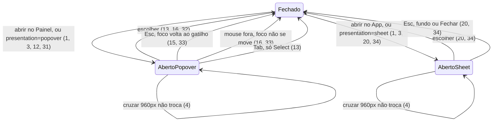

# Lote 4 do Lamb: Select, DateField, FilterBar, List e Section

> Build this with **tlc-implement**.
> Every criterion below becomes a check with a proof, referenced by its number. Nothing under
> `Unresolved` gets settled while building.

## Intent

O `@church/ui` ainda não tem um campo de escolha entre muitas opções, um campo de data, uma barra
de filtros, um contêiner de lista nem um bloco de conteúdo para o backoffice. Hoje, uma tela que
precise escolher o GC de uma pessoa, informar a data de uma reunião, filtrar a lista de membros ou
agrupar uma tabela com título, busca e paginação teria de montar tudo isso por conta própria:
`<select>` nativo, máscara de data à mão, chips soltos e cabeçalhos ad hoc. Cada tela faria de um
jeito, fora dos tokens, do teclado e das regras de acessibilidade do Lamb, e sem a troca para
BottomSheet que o App exige abaixo de 960px. O lote 5 (PageHeader, SideMenu, MenuDrawer e Page)
compõe telas com esses blocos. A fonte não traz números de impacto.

Com a entrega, passam a existir cinco organisms em `@church/ui/organisms/<Nome>`, cada um com spec
e story:

- **Select:** escolha única entre 6 ou mais opções, com busca opcional. Abre um popover no Painel
  e um BottomSheet no App.
- **DateField:** data com máscara `dd/mm/aaaa`, validação e calendário opcional (o DatePicker do
  lote 2), em popover ou BottomSheet.
- **FilterBar:** busca, botão Filtros com contagem, contador de resultados, chips ativos e Limpar
  tudo. O painel de filtros abre num Drawer ou num BottomSheet.
- **List** (com `ListSection`): lista com seções, skeleton de carregamento e estado vazio.
- **Section:** bloco do backoffice com cabeçalho (título, ações, busca e filtros), corpo livre e
  rodapé.

Select e DateField são campos da família do TextField: aceitam `control`/`name`/`rules` do
react-hook-form e mostram erro com `state` e `helperText`.

58 critérios em 7 slices · 3 one-way doors · 4 open, 0 block

## Criteria

### Apresentação no Painel e no App

1. Quando um Select ou DateField com `presentation="auto"` (o padrão) abre, ou quando o painel do
   FilterBar abre, a apresentação é decidida naquele momento:
   - **App** (BottomSheet) se o componente tem um ancestral `[data-viewport="mobile"]`, ou se não
     tem nenhum ancestral `[data-viewport]` e `matchMedia('(max-width: 959px)')` casa;
   - **Painel** (popover no Select e no DateField, Drawer no FilterBar) nos outros casos, inclusive
     com um ancestral `[data-viewport="desktop"]` numa janela estreita.
2. Sempre, enquanto o componente está fechado, nada depende da largura da janela: o HTML do
   servidor e o do primeiro render do cliente são iguais, e o componente não muda de aparência
   depois da hidratação.
3. Dado `presentation="popover"` ou `presentation="sheet"`, então o Select e o DateField abrem nessa
   apresentação em qualquer largura e sob qualquer `[data-viewport]`.
4. Enquanto o popover, o BottomSheet ou o Drawer está aberto, cruzar 960px não troca a
   apresentação. A largura nova vale na próxima abertura (Unresolved 2).

### Select

5. Sempre, o Select renderiza:
   - o rótulo e a nota de obrigatoriedade iguais aos do TextField: asterisco quando há `label` e
     não há `optional`, ou "(Opcional)" com `optional`;
   - a caixa do campo com o visual do TextField (`fieldControl`), com 32px de altura em `small`,
     48px em `medium` (o padrão) e 56px em `large`;
   - um gatilho `role="combobox"` com `tabindex="0"`, `aria-haspopup="listbox"`,
     `aria-expanded="false"` (ou `"true"` aberto), `aria-controls` no id da lista e
     `aria-labelledby` com o id do rótulo e o do valor. O gatilho tem `aria-required="true"` quando
     a nota é o asterisco e `aria-describedby` no texto de ajuda, quando há texto.
6. Dado nenhum valor, então o gatilho mostra "Selecione" (ou o `placeholder` informado) em
   `text-secondary`. Dado um valor, mostra o `label` da opção em `text-primary` e, se a opção tem
   `iconName`, o ícone antes do texto. Um texto longo é cortado com reticências.
7. Sempre, um ícone `expand_more` fica à direita da caixa e gira 180° em 150ms ease-out enquanto a
   lista está aberta. Enquanto aberta, a caixa tem borda `focus-ring` e anel de 1px `focus-ring`.
8. Dado `clearable` com um valor e sem `disabled`, então aparece antes do chevron um botão de
   ação do campo (`fieldActionButton`) com ícone `close` e nome "Limpar {label}" (ou "Limpar
   seleção" sem `label`). O clique chama `onChange(null, null)`, mostra o placeholder e devolve o
   foco ao gatilho. Sem valor, o botão não aparece.
9. Dado `disabled`, então o gatilho tem `tabindex="-1"` e `aria-disabled="true"`, a caixa tem o
   visual desabilitado do TextField (`bg-hover`, `border-default`, `text-disabled`) e nem clique
   nem teclado abrem a lista.
10. Dado o Select aberto como popover, então a lista aparece 4px abaixo da caixa, com a largura da
    caixa e `z-30`. O painel tem:
    - padding de 4px, raio de 16px, fundo `bg-surface`, borda de 1px `border-default` e sombra
      `elevation-low-bottom-12`;
    - altura máxima de 344px;
    - uma lista `role="listbox"`, nomeada pelo rótulo, com altura máxima de 288px (6 opções de
      48px) e rolagem interna.
11. Sempre, cada opção é `role="option"` com `aria-selected="true"` ou `"false"`, e
    `aria-disabled="true"` quando desabilitada. A opção tem:
    - altura mínima de 40px no Painel e 44px no App (≤ 959px ou `[data-viewport="mobile"]`);
    - padding de 8px × 12px, raio de 8px, gap de 8px e texto 500 14/16;
    - o ícone de 20px, quando há `iconName`;
    - a `description`, quando há, abaixo do `label` em 400 12/16 `text-secondary`.

    A selecionada tem fundo `bg-selected` e um ícone `check` no fim. A ativa (teclado ou mouse) tem
    fundo `bg-hover` e contorno interno de 2px `focus-ring`. A desabilitada tem texto
    `text-disabled` e cursor `not-allowed`, e o clique nela não faz nada.

12. Quando o usuário clica no gatilho, então a lista abre; um segundo clique a fecha. Com o gatilho
    focado e a lista fechada, ↓, ↑, Enter e Espaço abrem a lista. Ao abrir, a opção ativa é a
    selecionada, senão a primeira habilitada, e ela é rolada para a vista. O gatilho aponta para
    ela com `aria-activedescendant`.
13. Enquanto a lista está aberta:
    - ↓ e ↑ movem a opção ativa pulando as desabilitadas, e param na primeira e na última;
    - Home e End vão para a primeira e a última habilitadas;
    - Enter (e Espaço, sem busca) escolhe a ativa: `onChange(value, option)` é chamado uma vez, a
      lista fecha e o foco volta ao gatilho;
    - Tab fecha a lista sem escolher, e o foco segue para o próximo elemento.
14. Dado um Select sem busca e aberto, quando o usuário digita letras com menos de 600ms entre
    elas, então a opção ativa passa a ser a primeira habilitada cujo `label` começa com o texto
    acumulado, sem diferenciar acentos nem caixa ("sa" ativa "São João"). Depois de 600ms parado,
    a próxima letra começa um texto novo.
15. Quando o usuário aperta Esc com a lista aberta, então ela fecha e o foco volta ao gatilho. Dado
    um Select dentro de um Dialog, o Esc fecha só a lista: o Dialog não recebe `onClose`.
16. Dado o popover aberto, quando o usuário pressiona o mouse fora do Select, então a lista fecha
    sem escolher e sem mover o foco. Passar o mouse sobre uma opção habilitada a torna ativa, e
    clicar nela a escolhe como em 13. Pressionar o mouse numa opção não tira o foco do gatilho nem
    da busca.
17. Dado `searchable`, então o topo da lista tem uma linha de busca:
    - visual: ícone `search` de 20px, padding de 8px × 12px, borda inferior de 1px
      `border-default`, 4px de margem embaixo, input 400 16/24 e, com o foco dentro, uma linha
      interna de 2px `focus-ring` embaixo;
    - o input tem placeholder "Buscar" (ou `searchPlaceholder`), nome "Buscar em {label}" (ou
      "Buscar em opções"), `role="combobox"`, `aria-autocomplete="list"`, `aria-expanded="true"`,
      `aria-controls` na lista e `aria-activedescendant` na opção ativa;
    - no popover, o input recebe o foco ao abrir.
18. Dado `searchable`, quando o usuário digita na busca, então a lista mostra só as opções cujo
    `label` ou `description` contém o texto, sem diferenciar acentos nem caixa ("joao" acha "São
    João"), e a opção ativa passa a ser a primeira habilitada da lista filtrada. Com o gatilho
    focado e a lista fechada, digitar uma letra abre a lista com a busca já preenchida com ela.
    Ao fechar, a busca volta a ficar vazia.
19. Dada uma busca sem resultado, então, no lugar da lista, aparece um `role="status"` com
    "Nenhum resultado para “{busca}”" em 400 14/20 `text-secondary` e um Button `transparent`
    `neutral` `small` "Limpar busca". O botão esvazia a busca e devolve o foco ao input.
20. Dado o Select aberto como BottomSheet, então:
    - o título do sheet é o `label` (ou "Selecione"), e `detents` é `half` com mais de 6 opções e
      `auto` com até 6;
    - a lista não tem altura máxima, e cada opção tem altura mínima de 48px e texto 16/24;
    - a busca, quando há, fica fixa no topo ao rolar, com borda de 1px `border-control`, raio de
      12px e altura mínima de 48px, e recebe o foco ao abrir;
    - escolher uma opção fecha o sheet. Fechar o sheet (Esc, fundo ou Fechar) não escolhe nada, e
      nos dois casos o foco volta ao gatilho.
21. Dado `value` (string ou `null`), então o Select mostra esse valor e só muda quando a prop
    muda. Sem `value`, ele começa com `defaultValue` e guarda a escolha sozinho. Nos dois modos,
    escolher chama `onChange(value, option)`.
22. Dado `name` dentro de um formulário do react-hook-form (por `control` ou pelo `FormProvider`),
    então:
    - o valor exibido é o do formulário;
    - escolher ou limpar grava o valor (`string` ou `null`) no formulário;
    - fechar a lista marca o campo como tocado;
    - um erro de validação do campo aparece como texto de ajuda em `state="error"`, com
      `aria-invalid="true"` no gatilho e borda de erro na caixa.

    Fora do formulário, `state="error"` com `helperText` tem o mesmo visual.

23. Dado `defaultOpen` sem `disabled`, então a lista já está aberta no primeiro render do cliente.

### DateField

24. Sempre, o DateField renderiza:
    - o rótulo e a nota de obrigatoriedade iguais aos do TextField, ligados ao input por `htmlFor`;
    - a caixa do Field no `size` informado;
    - um `<input type="text">` com `inputMode="numeric"`, `autoComplete="off"`, placeholder
      "dd/mm/aaaa" e `maxLength={10}`;
    - à direita, um botão de ação do campo com ícone `calendar_month`, nome "Abrir calendário de
      {label}" (ou "Abrir calendário"), `aria-haspopup="dialog"` e `aria-expanded`.

    Com `disabled`, o input e o botão ficam desabilitados.

25. Sempre, o texto de ajuda é "{helperText} Formato dd/mm/aaaa.", ou só "Formato dd/mm/aaaa." sem
    `helperText`, e fica ligado ao input por `aria-describedby`.
26. Quando o usuário digita, então só os dígitos contam, até 8, e a barra entra sozinha: "1503"
    mostra "15/03", e "15032026" mostra "15/03/2026".
27. Quando o campo perde o foco, ou quando o texto chega a 10 caracteres, então o texto é validado.
    Num texto inválido, a mensagem aparece como texto de ajuda em `state="error"`, o input tem
    `aria-invalid="true"` e `onChange` não é chamado. As mensagens, por caso:

    | caso                              | mensagem                                          |
    | --------------------------------- | ------------------------------------------------- |
    | incompleto ("15/03")              | "Data incompleta. Use dd/mm/aaaa."                |
    | inexistente ("31/02/2026")        | "Essa data não existe. Confira dia e mês."        |
    | antes de `min="2026-01-01"`       | "Antes de 01/01/2026, a primeira data permitida." |
    | depois de `max="2026-12-31"`      | "Depois de 31/12/2026, a última data permitida."  |
    | `disabledDates` devolve "Feriado" | "Feriado."                                        |
    | `disabledDates` devolve `true`    | "Data indisponível."                              |

28. Quando o texto validado é uma data válida, então `onChange('2026-03-15')` é chamado uma vez e
    o erro local some. Quando o usuário edita o texto e ele fica com menos de 10 caracteres, o
    erro local some. Dado um valor, quando o usuário apaga o texto e sai do campo, então
    `onChange(null)` é chamado.
29. Dado um erro externo (`state="error"` com `helperText`, ou o erro do formulário), então ele
    aparece no lugar do erro local.
30. Dado `value="2026-03-15"`, então o input mostra "15/03/2026", e uma mudança da prop atualiza o
    texto. Sem `value`, o campo começa com `defaultValue` e guarda a data sozinho.
31. Quando o usuário clica no botão de calendário, ou aperta Alt+↓ no input, então o calendário
    abre. No Painel, ele é um popover `role="dialog"` com nome "Escolher {label}" (ou "Escolher
    data"), 4px abaixo da caixa, alinhado à esquerda, com `z-30`, padding de 16px, raio de 16px,
    fundo `bg-surface`, borda de 1px `border-default` e sombra `elevation-low-bottom-12`. Dentro
    dele está o DatePicker com `value`, `min`, `max`, `disabledDates`, `shortcuts`, `yearRange` e
    `label`. O foco vai para o dia focável do DatePicker.
32. Quando o usuário escolhe um dia ou um atalho no calendário, então `onChange` recebe a data ISO,
    o input mostra a data, o calendário fecha e o foco volta ao botão de calendário.
33. Quando o usuário aperta Esc no calendário, então ele fecha e o foco volta ao botão de
    calendário. Dentro de um Dialog, o Dialog não recebe `onClose`. Pressionar o mouse fora do
    DateField fecha o popover sem mover o foco.
34. Dado o calendário aberto como BottomSheet, então o título é o `label` (ou "Escolher data"), o
    DatePicker ocupa toda a largura do sheet, e os dias têm 44px. Escolher um dia fecha o sheet, e
    fechar o sheet devolve o foco ao botão de calendário.
35. Dado `name` dentro de um formulário do react-hook-form, então:
    - o input mostra a data do formulário;
    - o formulário só recebe uma data ISO válida, ou `null` quando o campo é esvaziado;
    - sair do input marca o campo como tocado;
    - o erro de validação do campo aparece como em 29.

### FilterBar

36. Sempre, o FilterBar é uma coluna com gap de 12px. A primeira linha quebra quando falta espaço,
    tem gap de 8px na vertical e 12px na horizontal e itens centralizados. O `search`, quando há,
    fica num invólucro `flex: 1 1 240px` com largura máxima de 360px.
37. Dado `panel`, então aparece um Button `ghost` `neutral` `small` com ícone inicial `tune`, o
    texto "Filtros" (ou `filtersLabel`), `aria-haspopup="dialog"` e `aria-expanded`. Sem `panel`,
    não há botão.
38. Dados N filtros ativos (N ≥ 1), então o botão Filtros:
    - mostra, depois do texto, uma pílula `aria-hidden` com N: altura de 20px, largura mínima de
      20px, padding de 0 × 4px, 4px de margem à esquerda, totalmente redonda, fundo
      `action-primary`, texto `text-inverse` 600 12/16;
    - tem o nome "Filtros, N ativos" ("Filtros, 3 ativos").

    Sem filtros, não há pílula e o nome é "Filtros".

39. Dado `resultCount`, então, no fim da primeira linha, um `
`
    mostra "{n} resultados", ou `resultLabel(n)` quando informado ("23 GCs"), em 500 14/16
    `text-secondary`, sem quebra de linha e empurrado para a direita. Sem `resultCount`, o
    elemento não existe (Unresolved 3).
40. Dado ao menos um filtro em `filters`, então uma segunda linha mostra uma lista `<ul>` com
    nome "Filtros ativos", gap de 8px e um FilterChip removível por filtro (`label`, `value` e
    `iconName`). Clicar no ✕ de um chip chama `onChange` com a lista sem aquele `id`. Dado `panel`,
    clicar no corpo de um chip abre o painel. Sem filtros, a segunda linha não existe.
41. Dados 2 ou mais filtros, então um Button `transparent` `neutral` `small` "Limpar tudo"
    aparece depois dos chips e chama `onClear`. Com 1 filtro, ele não aparece.
42. Enquanto a densidade é App (≤ 959px, ou um ancestral com `data-viewport="mobile"`):
    - os chips ficam numa linha só, que rola na horizontal com `scroll-snap-type: x proximity` e
      sem barra de rolagem visível;
    - a busca ocupa a linha inteira, sem largura máxima;
    - o contador perde o empurrão para a direita.

    Um ancestral com `data-viewport="desktop"` mantém o layout do Painel.

43. Quando o usuário clica em Filtros no Painel, então abre um Drawer `modal` com o título "Filtros"
    (ou `panelTitle`) e o `panel` no corpo. Quando clica no App, abre um BottomSheet com
    `detents="half"`, o mesmo título e o mesmo conteúdo. Nos dois, o rodapé tem:
    - um Button `ghost` `neutral` `medium` "Limpar", que chama `onClear` e mantém o painel aberto;
    - um Button `filled` `neutral` `medium` "Ver resultados", que fecha o painel e chama `onApply`.
44. Quando o painel fecha por Esc, pelo fundo ou pelo botão Fechar, então `onApply` não é chamado
    e o foco volta ao botão Filtros.

### List

45. Sempre, a List é uma coluna `text-primary`. Dado `label`, ela tem `role="region"` com esse
    nome. Sem `label`, não tem `role`.
46. Dados filhos sem `ListSection`, então eles ficam numa `<ul role="list">` sem marcadores, sem
    margem e sem padding. Um ListItem sem `density` recebe a `density` da List (`default` quando
    omitida). Um ListItem com `density` própria a mantém.
47. Dados filhos `ListSection`, então cada seção é uma `<section>` nomeada pelo próprio título:
    - o título é um `<h3>` (ou o nível de `headingLevel`, de 2 a 6) em 500 12/16 `text-secondary`,
      com padding de 12px no topo, 16px nas laterais e 4px embaixo;
    - os itens ficam numa `<ul role="list">` e recebem a `density` da List como em 46;
    - entre duas seções seguidas há 8px.
48. Dado `loading`, então, no lugar dos filhos, a List mostra:
    - uma `<ul role="list" aria-busy="true">` com `skeletonCount` (3 por padrão) linhas
      `aria-hidden`, cada uma com um círculo de 32px e duas barras de 12px de altura, com 60% e 35%
      da largura;
    - fundo `bg-selected` e raio de 8px nas barras, e o círculo totalmente redondo;
    - um item visualmente oculto `role="status"` com "Carregando…".

    `loading` vence o estado vazio.

49. Sem `prefers-reduced-motion`, o skeleton pulsa em 1,4s ease-in-out, sem parar, com opacidade
    de 50% no meio do ciclo. Enquanto `prefers-reduced-motion: reduce`, ele não anima.
50. Dados nenhum filho e `empty`, então a List mostra:
    - com um objeto de props, um EmptyState `variant="inline"` `size="small"` com essas props;
    - com um elemento React, o próprio elemento.

### Section

51. Sempre, a Section é uma `<section>` nomeada pelo título, em coluna, com fundo `bg-surface`,
    raio de 16px e largura mínima 0.
52. Sempre, o cabeçalho tem borda inferior de 1px `border-default`. A linha de cima:
    - tem padding de 16px, gap de 16px, itens alinhados ao topo e separados nas pontas, e quebra
      quando falta espaço;
    - mostra o título como `<h2>` (ou `<h3>` com `headingLevel={3}`) em 600 20/28;
    - mostra a `description`, quando há, num `
` 400 14/20 `text-secondary` 2px abaixo do título
      (Unresolved 1);
    - mostra as `actions`, quando há, à direita, numa linha com gap de 8px que quebra
      (Unresolved 1).
53. Dados `search` ou `filters` sem `simple`, então uma segunda linha do cabeçalho:
    - tem padding de 0 no topo e de 16px nas laterais e embaixo, gap de 16px, itens
      centralizados e separados nas pontas, e quebra;
    - põe o `search` num invólucro `flex: 1 1 240px` com largura máxima de 309px;
    - põe os `filters` numa linha com gap de 8px que quebra (Unresolved 1).

    Dado `simple`, a segunda linha não existe, mesmo com `search` ou `filters`.

54. Sempre, o corpo tem padding de 16px e é uma coluna com gap de 10px e largura mínima 0, com os
    `children` dentro.
55. Dado `footer`, então o rodapé tem borda superior de 1px `border-default`, itens centralizados
    com gap de 16px e padding de 16px (`footerType="button"`, o padrão) ou de 8px × 16px
    (`footerType="paginator"`, Unresolved 1). Sem `footer`, não há rodapé.

### Entrega no design system

56. Sempre, Select, DateField, FilterBar, List e Section são importáveis por
    `@church/ui/organisms/<Nome>`, e `ListSection` vem do mesmo caminho da List. Cada componente
    tem spec e story.
57. Sempre, o `parameters.design` da story da Section aponta para o nó `13630:9165`, conferido pelo
    `src/figma-links.spec.ts`. Select, DateField, FilterBar e List nasceram no Lamb e não têm nó.
58. Sempre, `packages/docs/figma-components.md` tem uma linha para cada um dos cinco, e a linha do
    ListItem deixa de dizer que List e ListSection "vêm com os organisms".

## States

O painel do FilterBar segue o mesmo desenho com Drawer no lugar do popover (43, 44), e
"Ver resultados" é a única saída que chama `onApply`.

## Out of scope

- **Select múltiplo e combobox de pessoas**: o README do Select lista os dois como lacunas do
  próprio Lamb.
- **`<input type="hidden">` gerado pelo `name`** do Select e do DateField: com a família do
  TextField, `name` é o campo do react-hook-form, que guarda o valor (decisão do usuário).
- **Arrastar para o lado (swipe) na List**: o README marca como "fica para depois".
- **Período (início e fim) no DateField**: o README manda usar o DatePicker `mode="range"`.
- **Horário no DateField**: o README diz "não suportado".
- **PageHeader, SideMenu, MenuDrawer e Page**: lote 5.
- **Upload e Progress**: fora do plano até o designer terminar o Progress.

## Observable

| Surface                                       | Decision                    | Landing                                                                                             |
| --------------------------------------------- | --------------------------- | --------------------------------------------------------------------------------------------------- |
| componente Select                             | vazio (sem valor)           | 6                                                                                                   |
| componente Select                             | vazio (busca sem resultado) | 19                                                                                                  |
| componente Select                             | vazio (`options=[]`)        | n/a - a fonte não define; a lista abre sem opções e o teclado não tem o que ativar                  |
| componente Select                             | carregando                  | n/a - a fonte não define; opções vêm prontas do consumidor                                          |
| componente Select                             | erro                        | 22                                                                                                  |
| componente Select                             | desabilitado                | 9                                                                                                   |
| componente Select                             | densidade e ordem           | 10, 11, 20 - a ordem das opções é a do consumidor                                                   |
| componente DateField                          | vazio                       | 24 (placeholder), 28                                                                                |
| componente DateField                          | erro                        | 27, 29                                                                                              |
| componente DateField                          | desabilitado                | 24                                                                                                  |
| componente FilterBar                          | vazio (sem filtros)         | 38, 40                                                                                              |
| componente FilterBar                          | carregando                  | n/a - o contador é do consumidor (`resultCount`)                                                    |
| componente FilterBar                          | ação destrutiva confirma    | n/a - "Limpar tudo" só limpa filtros, que o consumidor pode reaplicar; a fonte não pede confirmação |
| componente FilterBar                          | densidade                   | 42                                                                                                  |
| componente List                               | vazio                       | 50                                                                                                  |
| componente List                               | carregando                  | 48, 49                                                                                              |
| componente List                               | erro                        | n/a - a fonte não define; o consumidor passa um EmptyState `status="error"` em `empty`              |
| componente List                               | densidade e ordem           | 46, 47 - a ordem é a dos filhos                                                                     |
| componente Section                            | vazio, carregando, erro     | n/a - corpo livre; o README diz "não use como estado vazio", e o estado é do conteúdo               |
| documento `packages/docs/figma-components.md` | estrutura                   | existing - tabela "Components" (58)                                                                 |

## Swept

- validation: 27 (máscara e mensagens do DateField), 22 e 35 (erro do formulário)
- failure modes: 27 - texto inválido não chega ao `onChange` nem ao formulário
- idempotency and retry: 13 - escolher chama `onChange` uma vez e fecha; uma segunda escolha é
  outra intenção
- authorization: n/a - componentes não acessam dados
- concurrency and ordering: 15 e 33 (Esc fecha só a camada de cima), 4 (apresentação fixa enquanto
  aberta)
- data lifecycle: n/a - nada é persistido
- external-dependency failure: 1 - sem `window.matchMedia` (jsdom, navegador antigo), a
  apresentação cai no Painel; n/a para o resto
- state transitions: 12, 13, 15, 16, 20, 32, 33, 34, 43, 44 (ver States)
- observability: n/a - sem log (constituição XIV)

## Impact

| Front        | What changes                                                                                                                                                                                                                                                                                                 |
| ------------ | ------------------------------------------------------------------------------------------------------------------------------------------------------------------------------------------------------------------------------------------------------------------------------------------------------------ |
| domain       | novo termo: apresentação (Painel ou App) decidida na abertura - vive em `@church/ui/utils` e é reusada pelo MenuDrawer e pela Page no lote 5                                                                                                                                                                 |
| domain       | termo existente: `ISODate` (`molecules/DatePicker`) passa a ser também o valor do DateField e o tipo do valor no formulário                                                                                                                                                                                  |
| domain       | termo existente: o rótulo (`Label`) e o texto de ajuda (`FieldHelperText`) do TextField são internos de `atoms/TextField/components` e só alcançados por `../` a partir de atoms. Os organisms precisam deles por um caminho exportado do pacote; quem usa hoje: TextField, TextArea, SearchField e Checkbox |
| domain       | termo existente: o visual de menu do MenuDropdown é reusado pela lista do Select com semântica de `listbox`, sem usar o componente (o README do Select explica: `menuitem` é ação, não valor)                                                                                                                |
| dependencies | nenhuma nova. react-hook-form já é dependência do `@church/ui`                                                                                                                                                                                                                                               |
| stored data  | nothing to migrate                                                                                                                                                                                                                                                                                           |

## Decided

| Decision                                   | Shape                                                                                                                                                                                                                                                                                                                                                                                                                                                                                                                                                                                         | Alternative rejected                                                                                                                                                                                                                                                 |
| ------------------------------------------ | --------------------------------------------------------------------------------------------------------------------------------------------------------------------------------------------------------------------------------------------------------------------------------------------------------------------------------------------------------------------------------------------------------------------------------------------------------------------------------------------------------------------------------------------------------------------------------------------- | -------------------------------------------------------------------------------------------------------------------------------------------------------------------------------------------------------------------------------------------------------------------- |
| Apresentação decidida no momento de abrir  | Uma função em `@church/ui/utils` (ex.: `resolveViewport(element): 'mobile' \| 'desktop'`) lê `closest('[data-viewport]')` e, sem ancestral, `matchMedia('(max-width: 959px)')`. Ela só é chamada no handler que abre o componente, nunca no render; o resultado fica guardado até fechar (1, 2, 4). Sem `matchMedia`, devolve `desktop`. Exceção: com `defaultOpen` (23), um efeito de montagem do Select chama a função uma vez, antes da pintura; com SSR numa tela estreita, o HTML do servidor traz o popover até a hidratação. Aceito no MVP, porque `defaultOpen` serve a docs e testes | O hook `useViewport` do artefato (estado + listener de `matchMedia`): o lote 1 já o rejeitou porque o servidor renderiza Painel e a tela redesenha depois da hidratação. Ele também trocaria popover por sheet com a lista aberta, desmontando o foco no meio do uso |
| Select e DateField na família do TextField | Props de campo do TextField: `label`, `helperText`, `state` (`'default' \| 'error' \| 'success'`), `optional`, `size` (`small`/`medium`/`large`), `control`, `name`, `rules`, `slotProps`, `tooltip`. `name` liga ao react-hook-form por `Controller`, e o tipo segue o `TFieldValues` do formulário, como no TextField                                                                                                                                                                                                                                                                       | API do Lamb (`hint`, `error`, `required`, `name` → input hidden), igual à do RadioGroup: o consumidor teria de envolver cada campo num `Controller`, e o mesmo conceito ficaria com dois nomes entre TextField e Select. Escolha do usuário em 2026-10-09            |
| Esc do popover não escapa para o overlay   | O Select e o DateField tratam o Esc com `stopPropagation` no próprio elemento, como o MenuDropdown (critério 6 do lote 3), e não usam a camada modal (`useModalLayer`), que é só para overlays modais                                                                                                                                                                                                                                                                                                                                                                                         | Registrar o popover na camada modal: ele prenderia o foco e travaria a rolagem, o que um popover não faz no artefato                                                                                                                                                 |

Nomes de props seguem a regra dos lotes 1 a 3: nenhuma prop existente renomeada; ícone por nome é
`iconName` (na `SelectOption` e no filtro ativo do FilterBar); tamanhos são `small`/`medium`/
`large`; texto de ajuda é `helperText`; obrigatoriedade é `optional` (padrão obrigatório); e
conceitos novos ficam com o nome do Lamb (`options`, `searchable`, `searchPlaceholder`,
`clearable`, `presentation`, `defaultOpen`, `min`, `max`, `disabledDates`, `shortcuts`,
`yearRange`, `filters`, `resultCount`, `resultLabel`, `panel`, `panelTitle`, `onApply`,
`filtersLabel`, `density`, `loading`, `skeletonCount`, `empty`, `headingLevel`, `actions`,
`search`, `footerType`, `simple`). Variantes do Button do Lamb: `high` = `filled`, `low` = `ghost`,
`flat` = `transparent`.

## Surface

| Componente                        | In                                                                                                                                                                                                                                                                                                                                      | Out                                             | Criteria |
| --------------------------------- | --------------------------------------------------------------------------------------------------------------------------------------------------------------------------------------------------------------------------------------------------------------------------------------------------------------------------------------- | ----------------------------------------------- | -------- |
| `Select`                          | `options: { value; label; description?; iconName?; disabled? }[]`, `value?: string \| null`, `defaultValue?`, `onChange?: (value, option) => void`, `placeholder?`, `searchable?`, `searchPlaceholder?`, `clearable?`, `disabled?`, `presentation?: 'auto' \| 'popover' \| 'sheet'`, `defaultOpen?`, `id?` + props de campo (Decided 2) | `role="combobox"` + `role="listbox"`            | 5–23     |
| `DateField`                       | `value?: ISODate \| null`, `defaultValue?`, `onChange?: (value: ISODate \| null) => void`, `min?`, `max?`, `disabledDates?`, `shortcuts?`, `yearRange?`, `presentation?` + props de campo (Decided 2) e demais props do `<input>`                                                                                                       | `<input inputMode="numeric">` + `role="dialog"` | 24–35    |
| `FilterBar`                       | `search?`, `filters?: { id; label; value; iconName? }[]`, `onChange?: (filters) => void`, `onClear?`, `resultCount?`, `resultLabel?: (n) => string`, `panel?`, `panelTitle?`, `onApply?`, `filtersLabel?`                                                                                                                               | `role="status"` no contador                     | 36–44    |
| `List` / `ListSection`            | `children?`, `label?`, `density?: 'compact' \| 'default' \| 'comfortable'`, `loading?`, `skeletonCount?`, `empty?: EmptyStateProps \| ReactElement` / `title`, `headingLevel?: 2–6`, `children?`                                                                                                                                        | `role="region"`, `role="list"`                  | 45–50    |
| `Section`                         | `title`, `description?`, `actions?`, `search?`, `filters?`, `footer?`, `footerType?: 'paginator' \| 'button'`, `children?`, `headingLevel?: 2 \| 3`, `simple?`, `id?`                                                                                                                                                                   | `<section>` nomeada                             | 51–55    |
| apresentação (`@church/ui/utils`) | o elemento que abre                                                                                                                                                                                                                                                                                                                     | `'mobile' \| 'desktop'`                         | 1–4      |

## Sources

- Artefato "Lamb" (https://claude.ai/artifact/PwGC8XAgiawWSwqvnEbMmb, versão 1791228354-5316) -
  **binding for the interface**:
  - `project/components/{Select,DateField,FilterBar,List,Section}/README.md`, `Select.d.ts`,
    `DateField.d.ts`, `FilterBar.d.ts`, `List.d.ts` e `index.d.ts` (`SectionProps`);
  - `bundle.css`: `.lamb-select-*`, `.lamb-option*`, `.lamb-menu`/`.lamb-menuitem`,
    `.lamb-dp-pop`, `.lamb-control*`, `.lamb-filterbar*` (com os blocos `max-width: 959px` e
    `[data-viewport]`), `.lamb-list*`, `.lamb-skel*` e `@keyframes lamb-pulse`, `.lamb-section*`,
    e `.lamb-option { min-height: var(--touch-target) }` do App;
  - `bundle.js`: `Select` (teclado, typeahead de 600ms, `norm` sem acentos, `detents`),
    `maskBR`/`parseBR`/`dayBlock`/`DateField`, `FilterBar`, `List`/`ListSection` e `Section`.
- Figma `7I9GnO3cTPpaJPOUfFsI9t` - **binding for the interface**: Section `13630:9165` (1136×312;
  cabeçalho `13630:5151` com Default de 144px e Simple de 80px; rodapé `13630:10568` com
  Paginator de 64px e Button de 88px), conferido pelo Figma MCP em 2026-10-09. Diverge do
  `bundle.css` em quatro valores (Unresolved 1).
- `.tasks/lamb-atoms.md`, `.tasks/lamb-molecules.md` e `.tasks/lamb-overlays.md` - regra de nomes,
  precedência dentro do artefato (a/b/c), densidade App/Painel (`panel:` + `[data-viewport]`), e
  os componentes que este lote compõe: Field, SearchField, Button, FilterChip, EmptyState,
  ListItem, DatePicker, Drawer e BottomSheet.
- Usuário, 2026-10-09: Select e DateField na família do TextField (Decided 2).
- Usuário, 2026-10-09 (user delegated): a exceção do `defaultOpen` ao Decided 1 fica como foi
  construída, por ser a opção mais simples para o MVP.
- Memória do projeto, plano de 2026-10-08: lote 4 = Select, DateField, FilterBar, List e Section;
  Select e DateField são organisms.

This task is the record of decision. If a linked document diverges, ask before building.

## Unresolved

| #   | Kind | Question                                                                                                                                                                                                                                                       | Until answered                                                                                                                       |
| --- | ---- | -------------------------------------------------------------------------------------------------------------------------------------------------------------------------------------------------------------------------------------------------------------- | ------------------------------------------------------------------------------------------------------------------------------------ |
| 1   | open | Section: o Figma e o `bundle.css` divergem em quatro valores. Gap das ações (Figma 16px, CSS 8px), gap dos filtros (16 × 8), descrição (Figma 12/16 a 4px do título, CSS 14/20 a 2px) e padding do rodapé `paginator` (Figma 16px, CSS 8px × 16px). Qual vale? | Assumido o `bundle.css` pela precedência (c) dos lotes anteriores (52, 53, 55); acrescentar a `.tasks/lamb-notas-para-o-designer.md` |
| 2   | open | O artefato troca popover por sheet ao vivo quando a janela cruza 960px com o componente aberto. A decisão na abertura (Decided 1) mantém a apresentação até fechar. Aceitável?                                                                                 | Assumido: fixa enquanto aberto (4)                                                                                                   |
| 3   | open | O contador padrão é "{n} resultados" também para 1 ("1 resultados"). Corrigir o singular no padrão?                                                                                                                                                            | Escrito como a fonte (39); o consumidor corrige com `resultLabel`                                                                    |
| 4   | open | Select com `options=[]`: a fonte não define o que a lista mostra.                                                                                                                                                                                              | Assumido: abre vazia, sem mensagem; o consumidor não deveria renderizar um Select sem opções                                         |
