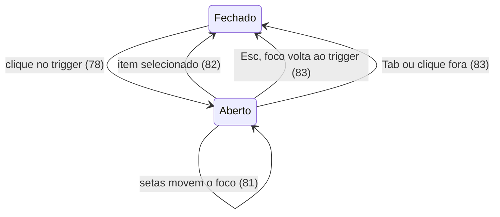

# Lote 2 do Lamb: as molecules do `@church/ui`, o `count` do NavItem e o `avatarGroup` da Cell

> Build this with **tlc-implement**.
> Every criterion below becomes a check with a proof, referenced by its number. Nothing under
> `Unresolved` gets settled while building.

## Intent

Os atoms do Lamb já estão no `@church/ui` (lote 1, `.tasks/lamb-atoms.md`), mas as peças que as
telas do backoffice montam com eles ainda não existem:

- trilha de navegação, filtro ativo, aviso em página, escolha única com legenda e erro;
- estado vazio, totalizador, cabeçalho de pessoa, linha de lista, menu de ações e calendário.

Cada tela que precisar de uma delas hoje a desenha por conta própria, fora dos tokens e da
acessibilidade do Lamb. Além disso:

- o NavItem não mostra contagem;
- a Cell não tem o tipo `avatarGroup` que a Table do Figma usa;
- os lotes 3 a 5 (overlays, Select, DateField, FilterBar, List, Section, PageHeader e Page)
  importam estas peças e não podem começar sem elas.

A fonte não traz números de impacto.

Com a entrega, 10 molecules e 1 atom novos passam a existir no `@church/ui`, cada um com spec e
story, e reproduzem os valores, estados e a acessibilidade do artefato Lamb:

- molecules: Breadcrumb, FilterChip, Alert, RadioGroup, EmptyState, StatCard (com SubInfo),
  AvatarContent, ListItem, MenuDropdown (com MenuItem) e DatePicker;
- atom: AvatarGroup.

O NavItem ganha `count`, a Cell ganha `type="avatarGroup"`, e o Radio e o Toggle do lote 1 passam
a aplicar o alvo de toque de 44px só na densidade App, como o artefato manda.

96 critérios em 13 slices · 3 one-way doors · 5 open, 0 block

## Criteria

### AvatarGroup (atom) e `decorative` no Avatar

1. Dado `people` com 5 pessoas (Pessoa A a Pessoa E) e o `max` padrão 3, então o
   AvatarGroup mostra 3 Avatars e um quarto círculo "+2", no tamanho padrão `small` (32px). O grupo
   é `role="img"` com nome "Pessoa A, Pessoa B, Pessoa C, Pessoa D, Pessoa E", e os Avatars e o "+2" ficam ocultos da
   tecnologia assistiva.
2. Quando `label="12 participantes"`, então esse texto é o nome do grupo.
3. Sempre, cada Avatar a partir do segundo sobrepõe o anterior: 8px em `xSmall`, 10px em `small`,
   14px em `medium`, 16px em `large` e 24px em `xLarge`. Cada um tem um anel de 2px na cor
   `bg-surface`.
4. Dado `people.length <= max`, então nenhum "+N" aparece.
5. Quando o Avatar recebe `decorative`, então ele não tem `role="img"` nem `aria-label`, tem
   `aria-hidden="true"`, e as iniciais e a foto continuam visíveis.

### Breadcrumb

6. Dado `items` = Início (`href="/"`), Pessoas (`href="/pessoas"`) e Pessoa Exemplo, então o Breadcrumb
   renderiza `<nav aria-label="Trilha de navegação">` com uma `<ol>` de 3 itens. Os dois primeiros
   são `<a href>`, e o último é um ``, sem link.
7. Sempre, entre dois itens aparece um separador "/" com `aria-hidden="true"`, e nenhum separador
   vem depois do último.
8. Sempre, o texto é 500 14/16, o gap entre item e separador é 8px, itens e links são
   `text-secondary`, e o item atual é `text-primary`. Com o ponteiro sobre um link, ele fica
   `text-primary` e sublinhado.
9. Dado um item intermediário sem `href`, então ele aparece como texto, sem link. Dado um item com
   `href` e `onClick`, o clique chama `onClick` uma vez.
10. Quando `label="Caminho"`, então esse é o nome do `<nav>`.

### FilterChip

11. Dado `label="Rede" value="Jovens" onRemove`, então o FilterChip é um contêiner de 32px de
    altura, borda de 1px `neutral-999`, raio de 8px, fundo `bg-hover` e texto 500 14/16. O corpo
    mostra "Rede:" em 400 `text-secondary` e "Jovens" em 600. Um botão ✕ de 32px de largura tem o
    nome "Remover filtro Rede: Jovens", e clicar nele chama `onRemove` uma vez.
12. Dado também `onClick`, então o corpo é um botão com nome "Editar filtro Rede: Jovens" que chama
    `onClick`. Sem `onClick`, o corpo é texto estático.
13. Quando o ponteiro passa sobre o corpo-botão ou sobre o ✕, então o fundo dele vira
    `bg-selected`. O ✕ pressionado tem fundo `neutral-alpha/40`.
14. Sempre, a área de toque se estende 6px acima e 6px abaixo (44px no total), sem mudar o tamanho
    visível.
15. Enquanto `disabled`, a borda é `border-default`, o fundo é transparente, rótulo e valor ficam
    `text-disabled`, os dois botões ficam desabilitados e nenhum callback é chamado.
16. Dado `variant="toggle"`, ou nenhum `onRemove`, então o FilterChip é um `Chip` com
    `aria-pressed` igual a `selected`. Enquanto `selected`, o ícone inicial é `check`; senão, é o
    `iconName` informado. Clicar chama `onClick`.
17. Dado `variant="removable"` sem `onRemove`, ou `variant="toggle"` com `onRemove`, então o
    `variant` explícito decide a forma.

### Alert

18. Dado o `variant` padrão `success`, então o Alert tem fundo `positive-subtle`, borda de 1px
    `green-alpha/40`, ícone `check_circle` preenchido de 20px em `text-positive` e título 600 14/20
    em `text-positive`. Tem padding de 12px, gap de 12px, raio de 10px e largura 100%, até 448px.
19. Para os outros `variant`s:

    | `variant` | fundo              | borda             | ícone     | cor do título    |
    | --------- | ------------------ | ----------------- | --------- | ---------------- |
    | `info`    | `bg-hover`         | `border-default`  | `info`    | `text-primary`   |
    | `error`   | `danger-subtle`    | `red-alpha/40`    | `report`  | `text-danger`    |
    | `warning` | `attention-subtle` | `yellow-alpha/40` | `warning` | `text-attention` |

20. Sempre, o título começa com um prefixo visualmente oculto e lido pela tecnologia assistiva:
    "Sucesso: ", "Informação: ", "Erro: " ou "Atenção: ".
21. Quando há `children`, então eles aparecem abaixo do título (gap de 4px) em 400 14/20
    `text-primary`.
22. Quando há `actions`, então elas aparecem abaixo do texto, em linha com gap de 8px e 12px de
    distância do texto.
23. Dado `onClose`, então aparece um botão de 32×32px com ícone `close` de 20px e nome
    "Fechar aviso" (ou o `closeLabel` informado), e o clique chama `onClose`. Sem `onClose`, não há
    botão.
24. Dado `live`, então o Alert tem `role="alert"` com `variant="error"` e `role="status"` com os
    demais. Sem `live`, não tem `role`.
25. Quando `iconName="campaign"`, então esse ícone substitui o do `variant`.

### RadioGroup e o Radio dentro dele

26. Dado `<RadioGroup legend="Tipo de visitante">` com três Radios, então ele renderiza um
    `<fieldset role="radiogroup">` com `aria-labelledby` na `<legend>`. A legenda é 500 16/24
    `text-primary`, com 4px abaixo dela. Com `legendHidden`, a legenda fica visualmente oculta e
    continua sendo o nome.
27. Sempre, os Radios do grupo recebem o mesmo `name` (o informado, ou um gerado), o `size` e o
    `disabled` do grupo. Um Radio está marcado quando seu `value` é o valor do grupo.
28. Dado `defaultValue="retorno"`, quando o usuário clica em "Primeira vez", então ela fica marcada
    e `onChange` é chamado com `("primeira", event)`. Dado `value` controlado, a marcação só muda
    quando o pai muda `value`.
29. Dado o foco numa opção, quando o usuário aperta seta para baixo, então a próxima opção
    habilitada fica marcada e focada.
30. Quando há `helperText`, então ele aparece abaixo da legenda em 400 14/20 `text-secondary`,
    ligado ao grupo por `aria-describedby`.
31. Dado `error="Responda para enviar o relatório."`, então a mensagem aparece abaixo das opções
    com ícone `error` e texto `text-danger`. O grupo ganha `aria-invalid="true"`, a mensagem entra
    no `aria-describedby`, e o círculo de cada Radio fica com borda `red-67` (`danger-solid`).
32. Sempre, por padrão, a legenda termina com " \*" (`aria-hidden`) e o grupo tem
    `aria-required="true"`. Com `optional`, não há asterisco nem `aria-required`, e a legenda
    mostra "(Opcional)", como no TextField.
33. Quando `orientation="horizontal"`, então as opções ficam em linha, com quebra e 24px entre
    colunas.
34. Dado `variant="card"`, então cada opção é um cartão com padding de 16px, borda de 1px
    `border-default`, raio de 12px e fundo `bg-surface`, e 8px separam os cartões. A descrição do
    Radio tem entrelinha de 20px.
35. Enquanto um cartão está marcado, a borda dele é `neutral-999` com 1px a mais por dentro (2px no
    total). Com o ponteiro sobre ele, o fundo é `bg-hover` e a borda `neutral-33`; pressionado, o
    fundo é `bg-selected`.
36. Quando um cartão recebe foco pelo teclado, então o anel `focus-ring` de 2px com offset de 2px
    contorna o cartão inteiro, e não o círculo.
37. Dado `variant="card"` com `error`, então a borda dos cartões é `red-67`. Dado `variant="card"`
    com uma opção `disabled`, o fundo dela é `bg-hover`, a borda `border-default` e não há a borda
    interna.
38. Dado `variant="card"` com `orientation="horizontal"`, então os cartões ficam numa grade de
    colunas com no mínimo 200px cada, que se ajusta à largura.
39. Dado `disabled` no grupo, então todas as opções ficam desabilitadas.
40. Enquanto a densidade é Painel (≥ 960px), as opções do grupo `default` ficam a 12px umas das
    outras, e o Radio não tem altura mínima nem padding vertical.
41. Enquanto a densidade é App (≤ 959px, ou um ancestral com `data-viewport="mobile"`), as opções
    do grupo `default` não têm gap. Cada Radio tem altura mínima de 44px com padding vertical de
    10px (6px no `large`). O grupo `card` mantém os 8px entre cartões, e os cartões não ganham
    altura mínima.
42. Dado um Radio solto, fora de um grupo, então ele continua funcionando com o próprio `name`,
    `checked` e `size` (lote 1, critérios 21–29).
43. **Correção do lote 1:** sempre, a altura mínima de 44px e o padding vertical do Radio só valem
    na densidade App (critério 41). No Painel, a linha do Radio tem a altura do conteúdo.
44. **Correção do lote 1:** sempre, a altura mínima de 44px da linha do Toggle só vale na densidade
    App. A área de toque de 44px em volta do trilho continua valendo em qualquer densidade.

### EmptyState

45. Dado só `title`, então o EmptyState (padrão `variant="inline"`, `size="medium"`,
    `status="neutral"`) é uma coluna centralizada, com texto centralizado, gap de 16px e padding de
    32px × 16px. Ele tem:
    - um círculo de 80px com fundo `bg-hover` e cor `text-secondary`, com o ícone `inbox` de 48px
      em contorno, peso 300 e `aria-hidden`;
    - o título num `<h3>` 600 16/24.
46. Quando há `description`, então ela aparece abaixo do título (gap de 4px) em 400 16/24
    `text-secondary`, com o texto limitado a 420px de largura.
47. Quando `headingLevel` vale 2, 3, 4, 5 ou 6, então o título é o heading desse nível.
48. Dado `status="success"`, então o ícone é `task_alt` preenchido e o círculo tem fundo
    `positive-subtle` e cor `text-positive`. As `actions`, mesmo passadas, não são renderizadas.
49. Dado `status="error"`, então o ícone é `error` preenchido, o círculo tem fundo `danger-subtle`
    e cor `text-danger`, e o EmptyState tem `role="status"`.
50. Quando há `actions` (e o status não é `success`), então elas aparecem numa linha centralizada,
    com quebra e gap de 8px.
51. Dado `variant="page"`, então a altura mínima é 360px, o conteúdo fica centralizado na vertical
    e o padding é 48px × 24px.
52. Dado `size="small"`, então o gap é 12px, o padding 24px × 16px, o círculo 56px, o ícone 32px e
    a descrição 14/20.
53. Dado `variant="compact"`, então o EmptyState é uma linha alinhada à esquerda, com gap de 12px e
    padding de 12px × 16px. O círculo tem 32px e o ícone 20px, o texto ocupa o espaço restante com
    gap de 2px, o título é 500 14/20, a descrição 400 12/16, e as ações não quebram linha.
54. Quando `iconName="diversity_3"`, então esse ícone substitui o do status. Quando há
    `illustration`, ela substitui o círculo.

### StatCard e SubInfo

55. Dado `label="Membros ativos" value={1284}`, então o StatCard (padrão `size="medium"`) é um
    `<article>` nomeado pelo rótulo (`aria-labelledby`). Tem padding de 24px, gap de 24px, raio de
    16px, fundo `bg-surface` e nenhuma sombra. O cabeçalho mostra o rótulo em 400 14/16
    `text-secondary`. O valor "1.284" aparece em Oswald 700 36/40, caixa alta, algarismos tabulares
    e `text-primary`.
56. Dado `iconName="group"`, então o ícone aparece antes do rótulo, com 16px e gap de 8px.
57. Dado `value={2115}` e `format={{ style: 'currency', currency: 'BRL' }}`, então o valor mostrado
    é o de `Intl.NumberFormat('pt-BR', format)`, "R$ 2.115,00". Dado `value="—"`, o texto aparece
    como veio.
58. Dado `trend="+12 este mês"`, então ele aparece logo depois do valor, em 500 12/16
    `text-positive`, 8px à esquerda e sem caixa alta.
59. Dado `help="Pessoas com presença nos últimos 90 dias"`, então aparece um botão de 24px, redondo
    e `text-secondary`, com ícone `info` de 16px e nome "Sobre Membros ativos: Pessoas com presença
    nos últimos 90 dias". Ao passar o ponteiro ou focar o botão, o texto de `help` aparece num
    `Tooltip`.
60. Dado `subs` com dois itens, então eles aparecem numa linha com quebra e gap de 12px. Cada
    SubInfo mostra o ícone opcional de 14px, o valor formatado em pt-BR (500 12/16 `text-primary`)
    e o rótulo (400 12/16 `text-secondary`), com gap de 4px.
61. Dado `size="small"`, então o padding e o gap são de 12px, e o valor é 24/30.

### AvatarContent

62. Dado `name="Pessoa Exemplo"`, então o AvatarContent é uma `<section aria-label="Pessoa Exemplo">` com
    padding de 24px, gap de 18px, raio de 16px, fundo `bg-surface` e borda de 1px `border-default`.
    O cabeçalho é uma linha com gap de 16px: um Avatar `large` (56px) decorativo e o nome num
    `<h3>` 600 20/28.
63. Quando há `description`, então ela aparece abaixo do nome em 400 14/20 `text-secondary`.
    Quando há `badges`, eles aparecem numa linha com quebra, gap de 8px e 4px acima.
64. Dado `meta` com 4 pares, então eles viram uma `<dl>` em grade de colunas com no mínimo 120px e
    gap de 12px. Cada `<dt>` é 500 12/16 `text-secondary` e cada `<dd>` é 500 14/20, com 2px
    acima.
65. Quando `headingLevel` vale 2, 3 ou 4, então o nome é o heading desse nível.

### ListItem

66. Dado só `title` e `subtitle`, então o ListItem é um `<li>` cuja área principal é uma `
`
    com altura mínima de 64px, padding de 8px × 16px e gap de 12px. O título é 500 16/24 e o
    subtítulo 400 14/16 `text-secondary`, os dois com corte em uma linha e gap de 2px. Não há
    chevron.
67. Quando há `leading` e `trailing`, então o `leading` aparece antes do conteúdo em
    `text-secondary` (ícones de 24px), e o `trailing` depois, em 400 14/16 `text-secondary` com
    gap de 8px.
68. Dado `href="/relatorios/1"`, então a área principal é um `<a href>` de ponta a ponta. Um
    `chevron_right` de 20px `text-secondary` aparece no fim, o cursor é `pointer`, o raio é 8px, o
    hover pinta `bg-hover` e o pressionado `bg-selected`.
69. Dado `onClick` sem `href`, então a área principal é um `<button type="button">` com o mesmo
    visual, e o clique chama `onClick` uma vez.
70. Quando a área principal interativa recebe foco pelo teclado, então um contorno `focus-ring` de
    2px aparece por dentro dela (offset de -2px).
71. Dado `density="compact"`, então a altura mínima é 48px e o título 14/20. Dado
    `density="comfortable"`, a altura mínima é 72px.
72. Sempre, por padrão, um divisor de 1px `border-default` vai de 16px da esquerda até a borda
    direita, na base do item, exceto no último item da lista. Com `divider={false}`, não há
    divisor.
73. Dado `selected`, então a área principal tem `aria-current="true"` e fundo `bg-selected`.
74. Dado `disabled` com `href`, então o link não tem `href`, tem `aria-disabled="true"`, o clique
    não navega nem chama `onClick`, e título e subtítulo ficam `text-disabled` sem hover. Dado
    `disabled` com `onClick`, o botão fica `disabled`.
75. Dado `as="label"` com um Checkbox no `leading`, então a área principal é um `<label>`
    interativo sem chevron, e clicar em qualquer ponto da linha alterna o Checkbox.
76. Quando `chevron` é passado, então ele decide se o chevron aparece. Quando há `action`, ela
    aparece ao lado da área principal, fora do link ou botão, com 8px de padding à direita.

### MenuDropdown e MenuItem

77. Dado o menu fechado, então o `trigger` recebe `aria-haspopup="menu"`, `aria-expanded="false"`
    e `aria-controls` apontando para o id do menu, e nenhum menu é renderizado.
78. Quando o usuário clica no `trigger`, então aparece um `role="menu"` (nomeado por `label`)
    logo abaixo do gatilho: 4px abaixo, alinhado à esquerda, ou à direita com `align="end"`. O menu
    tem largura mínima de 180px, padding de 8px, raio de 16px, fundo `bg-surface`, sombra
    `elevation-low-bottom-12` e borda de 1px `border-default`. O primeiro item habilitado recebe o
    foco, e o `trigger` passa a `aria-expanded="true"`.
79. Sempre, cada item é um `<button role="menuitem" tabindex="-1">` com altura mínima de 36px,
    padding de 8px × 12px, gap de 8px, raio de 8px, texto 500 14/16 `text-primary` e ícone de 20px.
    Com hover ou foco, o fundo é `bg-hover`; pressionado ou com `active`, é `bg-selected`.
80. Dado um item com `color="destructive"`, então o texto dele é `text-danger`. Dado um item
    `disabled`, o texto é `text-disabled`, as setas o pulam e o clique não chama `onSelect`.
81. Quando o usuário aperta seta para baixo ou para cima, então o foco vai para o próximo ou o
    anterior item habilitado, dando a volta no fim e no começo.
82. Quando o usuário clica num item, ou aperta Enter ou Espaço com ele focado, então o menu fecha e
    `onSelect` é chamado uma vez.
83. Quando o usuário aperta Esc, então o menu fecha e o foco volta ao `trigger`. Quando aperta Tab,
    o menu fecha. Quando clica fora do menu e do gatilho, o menu fecha.

### DatePicker

84. Dado hoje = 2026-10-08 e `initialMonth="2026-10-01"`, então o DatePicker mostra, em cima:
    botão "Mês anterior", seletor de mês (nome "Mês") em "Outubro", seletor de ano (nome "Ano") em
    2026 e botão "Próximo mês". Abaixo vem uma `<table role="grid">` nomeada por "outubro de 2026"
    (região `aria-live="polite"`), com cabeçalho dom, seg, ter, qua, qui, sex, sáb (`abbr` com o
    nome completo) e domingo primeiro. A primeira semana começa com 4 células vazias, porque
    1/10/2026 é uma quinta-feira.
85. Sempre, cada dia é um botão com o nome completo, por exemplo "quinta-feira, 8 de outubro de
    2026, hoje". O dia de hoje tem peso 600, um contorno interno de 1px `neutral-999` e um ponto de
    4px embaixo.
86. Sempre, o botão de dia é redondo, 400 14/16, com algarismos tabulares: 40×40px no Painel e
    44×44px no App. Com o ponteiro, o fundo é `bg-hover`; pressionado, `bg-selected`.
87. Dado `mode="single"`, quando o usuário clica no dia 15, então `onChange("2026-10-15")` é
    chamado. Com `value="2026-10-15"`, esse dia tem fundo `action-primary`, texto `text-inverse` e
    peso 600 (hover `neutral-100`), e a célula tem `aria-selected="true"`.
88. Sempre, só um dia da grade é tabulável: o selecionado, ou o do mês inicial, ou hoje. Seta
    esquerda/direita move ±1 dia, cima/baixo ±7, Home/End vão ao domingo/sábado da semana,
    PageUp/PageDown mudam de mês e, com Shift, de ano. Ao atravessar o mês, a grade troca de mês.
    Enter e Espaço selecionam o dia focado, e Esc chama `onCancel`.
89. Dado `min="2026-10-05"` e `max="2026-10-20"`, então os dias fora do intervalo têm
    `aria-disabled="true"`, texto `text-disabled` e riscado, e o nome deles termina em ",
    indisponível: Antes de 05/10/2026, a primeira data permitida" (ou "Depois de 20/10/2026, a
    última data permitida"). O clique neles não chama `onChange`. Os botões de mês ficam
    desabilitados quando o mês vizinho está inteiro fora do intervalo.
90. Dado `disabledDates` que devolve "Domingo é dia de culto" para domingos, então os domingos
    ficam indisponíveis com esse motivo no nome e num `Tooltip`. Quando a função devolve `true`, o
    motivo é "Data indisponível".
91. Dado `mode="range"`, quando o usuário clica no dia 10 e depois no dia 6, então `onChange`
    recebe primeiro `{ start: "2026-10-10", end: null }` e depois
    `{ start: "2026-10-06", end: "2026-10-10" }`, em ordem crescente. Os dias de 6 a 10 têm fundo
    contínuo `bg-selected`, com o início arredondado à esquerda e o fim à direita. Com só o início
    escolhido, passar o ponteiro sobre um dia mostra a faixa provisória.
92. Dado `shortcuts={['today', 'yesterday']}` em `mode="single"`, então os botões "Hoje" e "Ontem"
    aparecem abaixo de uma borda de 1px `border-default`, com gap de 8px. O clique seleciona a data
    e mostra o mês dela, e o atalho fica desabilitado se a data estiver bloqueada.
93. Quando o usuário troca o mês ou o ano nos seletores, então a grade mostra esse mês. As opções de
    ano vão do maior ao menor: `yearRange`, se informado; senão, de `min` a `max`; senão, de hoje
    − 100 a hoje + 5.

### Ajustes em NavItem e Cell

94. Dado `count={3}` no NavItem, então um CountBadge "3" (lido como "3 novos") aparece depois do
    rótulo, que ocupa o espaço restante. Com `count` 0 ou ausente, ou com `collapsed`, nenhum
    CountBadge aparece. Um `count` passado nos `items` da Navigation chega ao NavItem.
95. Dado `<Cell type="avatarGroup" people={…} />`, então a célula mostra um AvatarGroup `xSmall`
    (24px), nomeado com todos os nomes.

### Entrega no design system

96. Sempre:
    - as 10 molecules são importáveis por `@church/ui/molecules/<Nome>`, e o AvatarGroup por
      `@church/ui/atoms/AvatarGroup`, cada um com spec e story;
    - o `parameters.design` das stories aponta para Breadcrumb `13601:3774`, Alert `13792:9332`,
      StatCard `13619:2165`, AvatarContent `13803:10719` e MenuDropdown `13033:3147`, conferidos
      pelo `src/figma-links.spec.ts`;
    - `packages/docs/figma-components.md` tem uma linha para cada componente novo, e a linha
      "Menu dropdown — Not built yet" dá lugar ao MenuDropdown.

## States

O ciclo do MenuDropdown, que é o único estado com transição neste lote:

## Out of scope

- **List e ListSection** (loading, skeleton, vazio da lista, densidade herdada): são organisms do
  lote 4. Aqui o ListItem recebe `density` diretamente.
- **DatePicker dentro do DateField e do BottomSheet**: lote 4. Aqui ele é usado sozinho.
- **Trocar o `<select>` nativo do Paginator pelo MenuDropdown**: mudaria um componente pronto sem
  pedido.
- **SideMenu, MenuDrawer e PageHeader**, que usam NavItem, Logo e Breadcrumb: lote 5.
- **Aviso no console** do RadioGroup acima de 5 opções e do EmptyState positivo com ações: o
  repositório só permite `console.warn` como diagnóstico, e a fonte não pede que ele seja testado.
  Fica a critério do build, sem critério.
- **Select múltiplo e combobox de pessoas**: o README lista os dois como lacunas do próprio Lamb.

## Observable

| Surface                                       | Decision                                                    | Landing                                                                               |
| --------------------------------------------- | ----------------------------------------------------------- | ------------------------------------------------------------------------------------- |
| componente AvatarGroup                        | vazio (`people=[]`)                                         | Unresolved 2                                                                          |
| componente AvatarGroup                        | excedentes                                                  | 1, 4                                                                                  |
| componente Breadcrumb                         | um item só, ou nenhum                                       | Unresolved 3                                                                          |
| componente Breadcrumb                         | ordem                                                       | 6 (da raiz ao atual)                                                                  |
| componente FilterChip                         | estados enabled, hover, pressed, disabled                   | 11, 13, 15                                                                            |
| componente FilterChip                         | ação destrutiva confirma antes                              | n/a - remover um filtro é reversível; o README não pede confirmação                   |
| componente Alert                              | estados por `variant`                                       | 18, 19                                                                                |
| componente Alert                              | anúncio                                                     | 24                                                                                    |
| componente RadioGroup                         | erro                                                        | 31, 37                                                                                |
| componente RadioGroup                         | vazio (sem Radios)                                          | n/a - o consumidor sempre fornece as opções; o README pede de 2 a 5                   |
| componente RadioGroup                         | densidade                                                   | 40, 41                                                                                |
| componente EmptyState                         | é o próprio estado vazio, com os estados de erro e positivo | 45, 48, 49                                                                            |
| componente StatCard                           | valor ausente                                               | 57 (string como veio, por exemplo "—")                                                |
| componente AvatarContent                      | sem `meta`, sem `badges`                                    | 63, 64 (só aparecem quando informados)                                                |
| componente ListItem                           | estados hover, pressed, foco, selecionado, disabled         | 68, 70, 73, 74                                                                        |
| componente ListItem                           | densidade                                                   | 66, 71                                                                                |
| componente MenuDropdown                       | ação destrutiva confirma antes                              | n/a - o README manda o item `danger` abrir a confirmação depois; o Dialog é do lote 3 |
| componente MenuDropdown                       | menu sem itens habilitados                                  | Unresolved 4                                                                          |
| componente MenuDropdown                       | ordem                                                       | existing - a ordem do array `items`                                                   |
| componente DatePicker                         | estados hoje, selecionado, faixa, bloqueado                 | 85, 87, 89, 91                                                                        |
| componente DatePicker                         | valor inválido                                              | Unresolved 5                                                                          |
| componente NavItem                            | contagem zero                                               | 94                                                                                    |
| documento `packages/docs/figma-components.md` | estrutura                                                   | existing - tabela "Components" (96)                                                   |

## Swept

- validation: 4 (`max`), 89 (`min`/`max`), 90 (datas bloqueadas); ISO inválido no DatePicker:
  Unresolved 5
- failure modes: n/a - nenhum componente chama algo que falhe; erro de carregamento é conteúdo do
  EmptyState (49)
- idempotency and retry: n/a - não há efeito persistido; `onRemove`, `onSelect` e `onChange` são
  chamados uma vez por ação (11, 82, 87)
- authorization: n/a - componentes não acessam dados (README · Consumo)
- concurrency and ordering: 91 - a ordem dos cliques no range é normalizada (início ≤ fim)
- data lifecycle: n/a - nada é persistido
- external-dependency failure: n/a - sem rede; `Intl.NumberFormat` é do runtime (57)
- state transitions: 77–83 (ver States), 91 (início → faixa fechada)
- observability: n/a - sem log (constituição XIV)

## Impact

| Front       | What changes                                                                                                                                               |
| ----------- | ---------------------------------------------------------------------------------------------------------------------------------------------------------- |
| domain      | novo termo: `ISODate` - data local `YYYY-MM-DD` em string; vive em `molecules/DatePicker` e é o valor do DateField no lote 4                               |
| domain      | novo termo: `DateRange` - `{ start: ISODate \| null; end: ISODate \| null }`; vive em `molecules/DatePicker`                                               |
| domain      | termo existente: o `Radio` funcionava só sozinho; agora lê o contexto do RadioGroup quando está dentro de um (27). Hoje ninguém usa Radio fora das stories |
| domain      | termo existente: o alvo de toque de 44px do Radio e do Toggle passa a valer só no App (43, 44). Nenhuma tela usa os dois ainda                             |
| domain      | termo existente: o `Avatar` era sempre `role="img"`; ganha `decorative` (5). O padrão não muda, então Cell, Table e Navigation seguem iguais               |
| domain      | termo existente: `NavItemProps` ganha `count`, e `CellProps` ganha a variante `avatarGroup`; a Navigation repassa `items` sem mudança                      |
| tokens      | `packages/tokens/src/icon.ts` ganha 32 e 48 (os ícones do EmptyState); a escala vai hoje até 28                                                            |
| docs        | `packages/docs/figma-components.md`: 11 linhas novas, e a linha "Menu dropdown" muda                                                                       |
| stored data | nothing to migrate                                                                                                                                         |

## Decided

| Decision                             | Shape                                                                                                                                                                                                                                                                                                                                                                                                                                                                                                                                                                                                                                                                                                                                                                       | Alternative rejected                                                                                                                                                                                |
| ------------------------------------ | --------------------------------------------------------------------------------------------------------------------------------------------------------------------------------------------------------------------------------------------------------------------------------------------------------------------------------------------------------------------------------------------------------------------------------------------------------------------------------------------------------------------------------------------------------------------------------------------------------------------------------------------------------------------------------------------------------------------------------------------------------------------------- | --------------------------------------------------------------------------------------------------------------------------------------------------------------------------------------------------- |
| Valor de data pública                | `ISODate = string` no formato `YYYY-MM-DD` (data local, sem hora nem fuso); `DateRange = { start: ISODate \| null; end: ISODate \| null }`; `onChange(value)` recebe o mesmo formato. Datas calculadas com `Date` local e nomes em pt-BR, sem biblioteca de datas                                                                                                                                                                                                                                                                                                                                                                                                                                                                                                           | `Date` como valor público: carrega hora e fuso, e um `new Date('2026-10-08')` vira 7 de outubro às 21h em UTC−3. Uma biblioteca de datas seria dependência nova para o que `Date` + `Intl` já fazem |
| AvatarGroup é atom                   | `@church/ui/atoms/AvatarGroup`. A regra "um nível acima da dependência mais alta" do plano de 2026-10-08 é substituída pelo precedente do repositório: atom pode compor atom (Badge → Tag, Checkbox → Icon)                                                                                                                                                                                                                                                                                                                                                                                                                                                                                                                                                                 | `molecules/AvatarGroup`, como no plano: a Cell, que é atom, teria de importar uma molecule, invertendo a hierarquia                                                                                 |
| Regra de nomes aplicada às molecules | Continua a do lote 1 (confirmada pelo usuário). Os casos novos:  • ícone dado por nome = `iconName` (precedente: `NavItem.iconName`);  • status de feedback = `variant` com os literais do Toast (`info`/`success`/`warning`/`error`) no Alert, e `status: 'neutral' \| 'success' \| 'error'` no EmptyState, porque `variant` ali já é o layout;  • `danger` = `color: 'destructive'`;  • hint = `helperText`;  • `required` = `optional` (padrão obrigatório, como o TextField);  • tamanhos `small`/`medium`/`large` e os do Avatar (`xSmall`…`xLarge`).  Conceito novo usa o nome do Lamb: `legend`, `legendHidden`, `error`, `orientation`, `headingLevel`, `trend`, `subs`, `meta`, `density`, `chevron`, `trigger`, `align`, `mode`, `shortcuts` | API literal do Lamb (`icon`, `status: 'positive' \| 'negative'`, `danger`, `hint`, `required`, `sm/md`): o mesmo conceito ficaria com dois nomes no design system                                   |

## Surface

API pública consumida pelos apps. Nomes conforme Decided, linha 3.

| Componente                  | In                                                                                                                                                                                                                                                                | Out                              | Criteria |
| --------------------------- | ----------------------------------------------------------------------------------------------------------------------------------------------------------------------------------------------------------------------------------------------------------------- | -------------------------------- | -------- |
| `AvatarGroup` (atom)        | `people: { name: string; src?: string }[]`, `max?` (3), `size?` (`xSmall`…`xLarge`, padrão `small`), `label?`                                                                                                                                                     | `role="img"`                     | 1–4      |
| `Avatar` (muda)             | + `decorative?: boolean`                                                                                                                                                                                                                                          | `aria-hidden`                    | 5        |
| `Breadcrumb`                | `items: { label: string; href?: string; onClick?: MouseEventHandler }[]`, `label?`                                                                                                                                                                                | `<nav>` + `<ol>`                 | 6–10     |
| `FilterChip`                | `label: string`, `value?`, `selected?`, `onRemove?`, `onClick?`, `iconName?`, `disabled?`, `variant?: 'removable' \| 'toggle'`                                                                                                                                    | dois botões ou um `Chip`         | 11–17    |
| `Alert`                     | `variant?: 'info' \| 'success' \| 'warning' \| 'error'`, `title`, `children?`, `iconName?`, `actions?`, `onClose?`, `closeLabel?`, `live?`                                                                                                                        | `role` opcional                  | 18–25    |
| `RadioGroup`                | `value?`, `defaultValue?`, `onChange?: (value, event)`, `orientation?`, `legend?`, `legendHidden?`, `helperText?`, `error?`, `optional?`, `size?`, `variant?: 'default' \| 'card'`, `disabled?`, `name?`, `children`                                              | `role="radiogroup"`              | 26–41    |
| `EmptyState`                | `iconName?`, `illustration?`, `title`, `description?`, `status?: 'neutral' \| 'success' \| 'error'`, `size?: 'small' \| 'medium'`, `variant?: 'page' \| 'inline' \| 'compact'`, `actions?`, `headingLevel?: 2–6`                                                  | heading, `role="status"` no erro | 45–54    |
| `StatCard` / `SubInfo`      | `label`, `value: number \| string`, `format?: Intl.NumberFormatOptions`, `iconName?`, `trend?`, `help?`, `subs?: SubInfoProps[]`, `size?: 'small' \| 'medium'` / `value`, `label`, `iconName?`                                                                    | `<article>`                      | 55–61    |
| `AvatarContent`             | `name`, `src?`, `description?`, `badges?`, `meta?: { label: string; value: ReactNode }[]`, `headingLevel?: 2 \| 3 \| 4`                                                                                                                                           | `<section>` + `<dl>`             | 62–65    |
| `ListItem`                  | `title`, `subtitle?`, `leading?`, `trailing?`, `action?`, `href?`, `onClick?`, `as?: 'a' \| 'button' \| 'label' \| 'div'`, `interactive?`, `selected?`, `disabled?`, `divider?`, `density?: 'compact' \| 'default' \| 'comfortable'`, `chevron?`                  | `<li>`                           | 66–76    |
| `MenuDropdown` / `MenuItem` | `trigger: ReactElement`, `items: MenuItemProps[]`, `align?: 'start' \| 'end'`, `label?` / `label`, `iconName?`, `color?: 'neutral' \| 'destructive'`, `disabled?`, `active?`, `onSelect?`                                                                         | `role="menu"`                    | 77–83    |
| `DatePicker`                | `mode?: 'single' \| 'range'`, `value?: ISODate \| DateRange \| null`, `onChange?`, `min?`, `max?`, `disabledDates?: (iso) => boolean \| string`, `shortcuts?: ('today' \| 'yesterday')[]`, `yearRange?: [number, number]`, `initialMonth?`, `onCancel?`, `label?` | `role="grid"`                    | 84–93    |
| `NavItem` (muda)            | + `count?: number`                                                                                                                                                                                                                                                | CountBadge                       | 94       |
| `Cell` (muda)               | + `{ type: 'avatarGroup'; people: AvatarGroupProps['people'] }`                                                                                                                                                                                                   | AvatarGroup                      | 95       |

## Sources

- Artefato "Lamb" (https://claude.ai/artifact/PwGC8XAgiawWSwqvnEbMmb, versão 1791228354-5316) -
  **binding for the interface**:
  - READMEs de AvatarGroup, Breadcrumb, FilterChip, Alert, RadioGroup, EmptyState, StatCard,
    AvatarContent, ListItem, MenuDropdown, DatePicker, NavItem, Table e Badge;
  - `RadioGroup.d.ts`, `EmptyState.d.ts`, `ListItem.d.ts`, `DatePicker.d.ts`, `FilterChip.d.ts` e
    `index.d.ts` (`AlertProps`, `AvatarContentProps`, `MenuItemProps`, `MenuDropdownProps`,
    `SubInfoProps`, `StatCardProps`, `NavItemProps`, `CellProps`);
  - `bundle.css`: as famílias `.lamb-avatar-group`, `.lamb-breadcrumb`, `.lamb-fchip`, `.lamb-alert`,
    `.lamb-close`, `.lamb-radiogroup`, `.lamb-radio[data-variant="card"]`, `.lamb-empty`,
    `.lamb-stat`, `.lamb-subinfo`, `.lamb-info-btn`, `.lamb-avatar-content`, `.lamb-meta`,
    `.lamb-li`, `.lamb-menu`, `.lamb-menuitem`, `.lamb-menu-anchor`, `.lamb-datepicker`, `.lamb-dp-*`
    e o bloco `@media (max-width: 959px)` "Touch targets on App / responsive web" (40, 41, 43, 44,
    86);
  - `bundle.js`: `AvatarGroup`, `Breadcrumb`, `Alert` (`STATUS_ICON`, `STATUS_WORD`),
    `AvatarContent`, `NavItem`, `MenuDropdown`, `MenuItem`, `formatNumber`, `SubInfo`, `StatCard`,
    `Cell`, `RadioGroup`, `EmptyState` (`EMPTY_ICON`), `ListItem`, `FilterChip` e `DatePicker`
    (`MONTHS`, `WEEK`, `dayBlock`, `longLabel`, teclado e range).
- Figma `7I9GnO3cTPpaJPOUfFsI9t` - **binding for the interface**, conferido pelo Figma MCP em
  2026-10-08:
  - Breadcrumb `13601:3774`: 4 `_Breadcrumb item`, 16px de altura;
  - Alert `13792:9332`: `Status=Positive`, `Neutral`, `Negative` e `Attention`, 448×124;
  - Stat card `13619:2165`: `Size=Medium` 272×160 e `Size=Small` 272×106;
  - Avatar content `13803:10719`: avatar de 80px **acima** do título e da descrição, mais 4 Badges
    (o usuário decidiu em 2026-10-08: vale o artefato, critério 62);
  - Menu dropdown `13033:3147`: 6 `menu-item` de 36px num painel de 180px.
  - O nó do AvatarGroup (`13616:2874`) foi recusado ("invalid node selection"; Unresolved 1).
    RadioGroup, EmptyState, ListItem, FilterChip e DatePicker nasceram no Lamb e não têm nó.
- `.tasks/lamb-atoms.md` - regra de nomes (Decided), precedência (a)/(b)/(c) e os atoms usados
  aqui. Os critérios 21 e 40 de lá foram corrigidos em 2026-10-08 por este lote (43, 44).
- Memória do projeto, plano de 2026-10-08 - a ordem dos lotes e a lista das molecules. A
  classificação do AvatarGroup muda para atom (Decided, linha 2).

- Conversa de 2026-10-08, decisões do usuário: "siga o artefato, mas não mude os nomes de props que
  já existem, foi um padrão definido" (AvatarContent como no `bundle.css`, critério 62; nenhuma
  prop existente renomeada) e "Pode manter numa só" (DatePicker nesta task).

This task is the record of decision. If a linked document diverges, ask before building.

## Unresolved

| #   | Kind | Question                                                                                                | Until answered                                                                              |
| --- | ---- | ------------------------------------------------------------------------------------------------------- | ------------------------------------------------------------------------------------------- |
| 1   | open | O Figma MCP recusa o nó `13616:2874` do AvatarGroup, como recusou o do CountBadge. Qual é o nó atual?   | A story do AvatarGroup sai sem `parameters.design`                                          |
| 2   | open | AvatarGroup com `people=[]`: o `bundle.js` renderiza um `role="img"` sem nome. Mostrar nada?            | Assumido: não renderiza nada (`null`)                                                       |
| 3   | open | Breadcrumb com um item só, ou nenhum: a fonte não diz. O README manda usar a partir do 2º nível         | Assumido: renderiza o que vier; um item só aparece como página atual, sem separador         |
| 4   | open | MenuDropdown com todos os itens `disabled`: quem recebe o foco ao abrir?                                | Assumido: o foco fica no menu (`tabindex="-1"`), e Esc fecha                                |
| 5   | open | DatePicker com `value`, `min` ou `max` fora do formato `YYYY-MM-DD`: ignorar, ou tratar como sem valor? | Assumido: tratado como sem valor; nenhum dia fica selecionado e a grade abre no mês de hoje |
