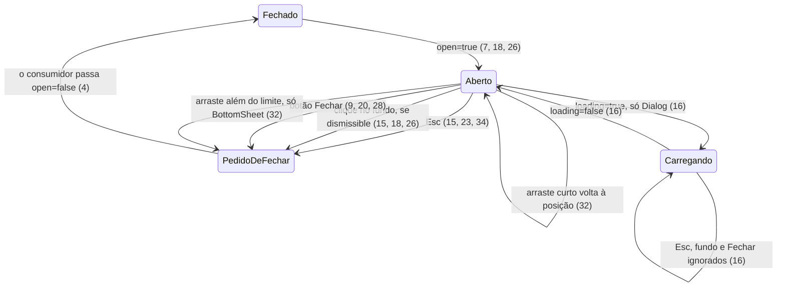

# Lote 3 do Lamb: os overlays Dialog, Drawer e BottomSheet

> Build this with **tlc-implement**.
> Every criterion below becomes a check with a proof, referenced by its number. Nothing under
> `Unresolved` gets settled while building.

## Intent

O `@church/ui` não tem nenhuma camada modal. Hoje, uma tela do backoffice que precise confirmar
uma ação destrutiva, editar um registro sem sair da lista ou oferecer uma escolha rápida no
celular teria de montar o próprio overlay: escurecimento do fundo, foco preso, Esc, retorno do
foco e trava de rolagem. Cada tela faria isso de um jeito, fora dos tokens e das regras de
acessibilidade do Lamb. Os lotes 4 e 5 também dependem desses overlays: o Select, o DateField e o
FilterBar abrem um BottomSheet abaixo de 960px, e o Drawer é o detalhe de entidade do Painel. A
fonte não traz números de impacto.

Com a entrega, passam a existir três organisms em `@church/ui/organisms/<Nome>`, cada um com spec
e story:

- **Dialog:** modal centralizado para confirmar, preencher um formulário curto ou dar um aviso que
  bloqueia.
- **Drawer:** painel lateral de 650px para ver e editar um registro, modal ou dentro do layout.
- **BottomSheet:** painel ancorado embaixo para ações rápidas no App, que pode ser fechado
  arrastando.

Os três compartilham uma camada modal no `@church/ui/utils`: foco preso, Esc só na camada de
cima, retorno do foco ao gatilho e trava de rolagem com contador. O MenuDropdown passa a não
deixar o Esc escapar para o overlay em que está.

36 critérios em 5 slices · 3 one-way doors · 3 open, 0 block

## Criteria

### Camada modal compartilhada

1. Enquanto um Dialog, um Drawer `modal` ou um BottomSheet está aberto, o `<body>` fica com
   `overflow: hidden`. Ao fechar, o `overflow` volta ao valor que tinha antes de abrir.
2. Dado um Drawer aberto e um Dialog aberto por cima, quando o Dialog fecha, então o `<body>`
   continua com `overflow: hidden` até o Drawer fechar também.
3. Enquanto o overlay está aberto, Tab no último elemento focável dele leva o foco ao primeiro, e
   Shift+Tab no primeiro leva ao último. Elementos dentro de `[inert]` ou ocultos não entram no
   ciclo, e um overlay sem nenhum focável mantém o foco no próprio painel.
4. Quando o overlay fecha, então o foco volta ao elemento que estava focado antes de ele abrir, se
   esse elemento ainda está no documento.
5. Dado um Dialog aberto sobre um Drawer aberto, quando o usuário aperta Esc, então só o Dialog
   recebe o pedido de fechar; o Drawer continua aberto.
6. Dado um MenuDropdown aberto dentro de um Dialog, quando o usuário aperta Esc, então só o menu
   fecha e o foco volta ao gatilho do menu; o Dialog não recebe `onClose`.

### Dialog

7. Dado `open={false}`, então o Dialog não renderiza nada. Dado `open`, ele renderiza:
   - uma camada `fixed` cobrindo a tela (`inset-0`, `z-50`), com conteúdo centralizado e padding
     de 16px;
   - um fundo `bg-scrim` com `aria-hidden="true"`;
   - um painel `role="dialog"` com `aria-modal="true"`, `aria-labelledby` no título e
     `tabindex="-1"`. O painel tem largura de 100%, altura máxima da tela menos 16px, fundo
     `bg-surface`, texto `text-primary`, raio de 16px, sombra `elevation-deep-high-bottom` e
     `overflow: hidden`.
8. Sempre, a largura máxima do painel é 400px com `size="small"`, 560px com `size="medium"` (o
   padrão) e 720px com `size="large"`.
9. Sempre, o cabeçalho tem padding de 24px nas laterais e no topo e 8px embaixo, e gap de 12px. O
   título é um `<h2>` 600 20/28 que ocupa o espaço restante. Dado `onClose`, aparece um IconButton
   `transparent`, `neutral` e `small` com ícone `close` e nome "Fechar" (ou o `closeLabel`
   informado), alinhado ao topo, que chama `onClose`. Sem `onClose`, não há botão.
10. Dado `color`, então um círculo de 32px com ícone de 20px preenchido aparece antes do título,
    conforme a tabela. Sem `color`, não há ícone.

    | `color`       | ícone          | fundo              | cor              |
    | ------------- | -------------- | ------------------ | ---------------- |
    | `neutral`     | `info`         | `bg-hover`         | `text-primary`   |
    | `destructive` | `report`       | `danger-subtle`    | `text-danger`    |
    | `positive`    | `check_circle` | `positive-subtle`  | `text-positive`  |
    | `attention`   | `warning`      | `attention-subtle` | `text-attention` |

11. Sempre, o corpo rola na vertical com `overscroll-behavior: contain`, padding de 8px no topo e
    24px nas laterais e embaixo, e gap de 16px. Dado `description`, ela aparece no topo do corpo
    em 400 16/24 `text-secondary` e é ligada ao painel por `aria-describedby`.
12. Dados `secondaryAction` e `primaryAction`, então o rodapé mostra, à direita, um Button `ghost`
    `neutral` `medium` com o rótulo secundário, seguido de um Button `filled` `medium` com o
    rótulo primário. A cor do primário segue o `color` do Dialog: `destructive` e `positive` mantêm
    a cor, e `neutral`, `attention` ou ausente usam `neutral`. O rodapé tem padding de 16px no topo
    e 24px nas laterais e embaixo, e gap de 8px. O `iconName` da ação primária aparece como ícone
    inicial, e o `disabled` de cada ação desabilita o botão dela.
13. Dado `footer`, então ele substitui o rodapé montado a partir das ações.
14. Quando o Dialog abre, então o foco vai, nesta ordem de preferência:
    1. para o elemento com `data-autofocus`;
    2. para o primeiro campo habilitado do corpo;
    3. com `color="destructive"`, para o botão da ação secundária;
    4. para o botão da ação primária;
    5. para o próprio painel.
15. Quando o usuário aperta Esc, então `onClose` é chamado. Quando clica no fundo, `onClose` é
    chamado se `dismissible` (o padrão); com `dismissible={false}`, o clique no fundo não faz nada
    e o Esc continua fechando.
16. Enquanto `loading`:
    - o painel tem `aria-busy="true"`;
    - o rodapé fica `inert`, com opacidade de 80%, e o botão primário mostra um Spinner no lugar
      do ícone;
    - o botão Fechar fica desabilitado, e nem Esc nem clique no fundo chamam `onClose`;
    - um `role="status"` visualmente oculto anuncia "Processando…".
17. Enquanto a densidade é App (≤ 959px, ou um ancestral com `data-viewport="mobile"`):
    - o rodapé empilha as ações em coluna, cada uma com 100% da largura, e a primária fica
      embaixo;
    - o padding passa a 20px nas laterais: cabeçalho 20/20/8, corpo 8/20/20, rodapé 12/20/20.

    No Painel (≥ 960px, ou `data-viewport="desktop"`), o rodapé é uma linha alinhada à direita. O
    Dialog nunca vira BottomSheet sozinho.

### Drawer

18. Dado `mode="modal"` (o padrão), então o Drawer renderiza:
    - um fundo `bg-scrim` `fixed` em tela inteira (`z-40`) que, ao ser clicado, chama `onClose`;
    - um painel `role="dialog"` com `aria-modal="true"`, `aria-labelledby` no título e
      `aria-describedby` na descrição, quando há descrição. O painel é `fixed` (`z-41`) a 24px do
      topo, da direita e da base, com largura de 650px limitada à tela (Unresolved 2), fundo
      `bg-surface`, raio de 24px, sombra `elevation-high-left`, `overflow: hidden` e coluna flex.
19. Sempre, o cabeçalho tem padding de 24px nas laterais e no topo e 12px embaixo, gap de 12px e
    borda inferior de 1px `border-default` (sem borda com `divider={false}`). O título é um `<h2>`
    600 16/24, e a descrição 400 14/20 `text-secondary`.
20. Dado `onBack`, então um IconButton `transparent` `small` com `arrow_back` e nome "Voltar"
    aparece antes do título e chama `onBack`. `headerActions` aparecem depois do título. Dado
    `onClose`, aparece por último um IconButton `transparent` `small` com `close` e nome "Fechar"
    (ou o `closeLabel` informado).
21. Sempre, o corpo ocupa o espaço restante e rola, com padding de 24px, coluna com gap de 16px e
    altura mínima de 120px. O corpo tem `tabindex="0"` e nome "Conteúdo", para que a área rolável
    seja alcançável pelo teclado.
22. Dado `footer`, então ele aparece numa linha centralizada na vertical, com padding de 24px, gap
    de 10px e borda superior de 1px `border-default` (sem borda com `divider={false}`).
23. Quando o Drawer `modal` abre, então o foco vai para o primeiro elemento focável do painel, e
    Esc chama `onClose`.
24. Dado `open={false}`, então o Drawer não renderiza nada. Sem `open`, ele fica aberto (o padrão
    é `true`).
25. Dado `mode="inline"`, então não há fundo. O painel é `role="region"` nomeado pelo título,
    fica no fluxo do layout (não é `fixed`), não prende o foco, não trava a rolagem e não trata o
    Esc.

### BottomSheet

26. Dado `open`, então o BottomSheet renderiza:
    - uma camada `fixed` em tela inteira (`z-55`) com fundo `bg-scrim`; clicar no fundo chama
      `onClose` se `dismissible` (o padrão);
    - um painel `role="dialog"` com `aria-modal="true"` e `aria-labelledby` no título. O painel
      fica ancorado embaixo e centralizado, com largura de 100% até 600px, altura máxima da tela
      menos 24px, fundo `bg-surface`, cantos superiores de 16px, sombra `elevation-low-above` e
      coluna flex.

    Dado `open={false}`, não renderiza nada.

27. Dado `detents="half"`, então o painel tem 50% da altura da tela. Dado `detents="full"`, tem a
    altura da tela menos 24px. Com `auto` (o padrão), tem a altura do conteúdo.
28. Sempre, no topo do painel:
    - há uma alça de 36×4px, redonda e `neutral-33`, centralizada, com 8px acima e 4px abaixo;
    - o cabeçalho tem padding de 4px no topo, 12px à direita, 8px embaixo e 20px à esquerda, e gap
      de 12px;
    - o título é um `<h2>` 600 16/24 que ocupa o espaço restante;
    - um IconButton `ghost` `neutral` `medium` (48px) com `close` e nome "Fechar" (ou o
      `closeLabel` informado) está sempre visível e chama `onClose`.
29. Sempre, o corpo ocupa o espaço restante e rola, com `overscroll-behavior: contain`, padding de
    8px no topo, 20px nas laterais e 16px embaixo, e coluna com gap de 16px.
30. Dado `footer`, então ele aparece numa coluna com gap de 8px, padding de 12px × 20px, borda
    superior de 1px `border-default` e fundo `bg-surface`, e cada filho ocupa 100% da largura.
31. Dado `safeArea="env"`, então um espaçador `aria-hidden` com a altura de
    `env(safe-area-inset-bottom)` fica abaixo do rodapé. Dado `safeArea="mock"`, o espaçador tem
    34px e desenha uma barra de 134×5px, redonda e `neutral-999`, centralizada. Dado
    `safeArea="none"`, não há espaçador. O padrão está em Unresolved 1.
32. Quando o usuário arrasta a alça ou o cabeçalho para baixo e solta, então:
    - se o arraste passou de `max(96px, 25% da altura do painel)`, `onClose` é chamado;
    - se passou de 40px em menos de 250ms, `onClose` também é chamado;
    - nos outros casos, o painel volta à posição e `onClose` não é chamado.

    Um arraste que começa num botão não move o painel.

33. Enquanto o teclado virtual reduz o `visualViewport`, a base do painel sobe a diferença
    (`innerHeight − visualViewport.height − visualViewport.offsetTop`), para que o rodapé não
    fique coberto.
34. Quando o BottomSheet abre, então o foco vai para o elemento com `data-autofocus`, senão para o
    primeiro campo do corpo, senão para o painel. Esc chama `onClose`.
35. Sem `prefers-reduced-motion`, ao abrir, o fundo aparece com fade de 200ms ease-out e o painel
    sobe de 100% da própria altura em 250ms ease-out. Enquanto `prefers-reduced-motion: reduce`,
    nem o fundo nem o painel animam.

### Entrega no design system

36. Sempre:
    - Dialog, Drawer e BottomSheet são importáveis por `@church/ui/organisms/<Nome>`, e a camada
      modal compartilhada por `@church/ui/utils`. Cada componente tem spec e story;
    - o `parameters.design` da story do Drawer aponta para o nó `13803:11075`, conferido pelo
      `src/figma-links.spec.ts`. Dialog e BottomSheet nasceram no Lamb e não têm nó;
    - `packages/docs/figma-components.md` tem uma linha para cada um dos três.

## States

O componente nunca fecha sozinho: ele chama `onClose`, e o consumidor decide quando `open` volta a
`false`.

## Out of scope

- **Select, DateField e FilterBar abrindo BottomSheet abaixo de 960px**: são do lote 4.
- **MenuDrawer e SideMenu**: lote 5. O MenuDrawer vai reusar a camada modal deste lote.
- **Transformar o Dialog em BottomSheet no App**: o README decide que não ("abaixo de 960px o
  Dialog não vira bottom sheet automaticamente").
- **Pilha de Dialogs sobre Dialogs** além do caso Drawer + Dialog: a fonte não descreve, e o
  README do BottomSheet proíbe fluxo dentro de sheet.
- **Botão de "voltar" do navegador fechando o overlay**: a fonte não pede.
- **Portal para `document.body`**: ver Decided, linha 2.

## Observable

| Surface                                       | Decision                       | Landing                                                                                                               |
| --------------------------------------------- | ------------------------------ | --------------------------------------------------------------------------------------------------------------------- |
| componente Dialog                             | carregando                     | 16                                                                                                                    |
| componente Dialog                             | ação destrutiva confirma antes | 12, 14 - o foco inicial vai para Cancelar e o primário usa `destructive`; a confirmação é o próprio Dialog            |
| componente Dialog                             | erro                           | n/a - a mensagem de erro de uma ação é conteúdo do consumidor (Alert ou Toast); o README não define um estado de erro |
| componente Dialog                             | densidade                      | 17                                                                                                                    |
| componente Drawer                             | vazio (sem `children`)         | 21 - o corpo mantém altura mínima de 120px                                                                            |
| componente Drawer                             | carregando                     | n/a - a fonte não define; o consumidor põe Spinner ou skeleton no corpo                                               |
| componente Drawer                             | App (< 960px)                  | Unresolved 2                                                                                                          |
| componente BottomSheet                        | vazio (sem `children`)         | 27 - `auto` fica com a altura do cabeçalho e do rodapé                                                                |
| componente BottomSheet                        | movimento reduzido             | 35                                                                                                                    |
| componente BottomSheet                        | área segura                    | 31, Unresolved 1                                                                                                      |
| documento `packages/docs/figma-components.md` | estrutura                      | existing - tabela "Components" (36)                                                                                   |

## Swept

- validation: n/a - as props são tipadas; nenhum valor é digitado pelo usuário dentro do overlay
  (os campos do corpo são do consumidor)
- failure modes: 16 - o Dialog trava fechamento e rodapé enquanto a ação do consumidor está em
  andamento; quem trata a falha é o consumidor
- idempotency and retry: 16 - em `loading`, o rodapé `inert` impede um segundo clique na ação
  primária
- authorization: n/a - componentes não acessam dados
- concurrency and ordering: 2 (trava de rolagem com contador), 5 (Esc só na camada de cima), 6
  (Esc do MenuDropdown não escapa)
- data lifecycle: n/a - nada é persistido
- external-dependency failure: 33 - sem `visualViewport` (navegador antigo, jsdom), o painel fica
  na base e nada quebra
- state transitions: 4, 15, 16, 32 (ver States)
- observability: n/a - sem log (constituição XIV)

## Impact

| Front        | What changes                                                                                                                                                                                                                                       |
| ------------ | -------------------------------------------------------------------------------------------------------------------------------------------------------------------------------------------------------------------------------------------------- |
| domain       | novo termo: camada modal - foco preso, Esc só na camada de cima, retorno do foco e trava de rolagem com contador; vive em `@church/ui/utils` e é reusada pelo MenuDrawer (lote 5)                                                                  |
| domain       | termo existente: o Esc do `MenuDropdown` deixa de propagar quando o menu está aberto (6). Hoje nenhum overlay escuta o Esc, então nada depende da propagação                                                                                       |
| domain       | termo existente: a camada `z-*`. O MenuDropdown usa `z-30` e o Tooltip `z-50`. Os overlays usam 40 (fundo do Drawer), 41 (Drawer), 50 (Dialog) e 55 (BottomSheet); um Tooltip dentro de um Dialog fica no mesmo contexto de empilhamento do painel |
| dependencies | nenhuma nova. O arraste e o deslocamento do teclado usam `motion` (já adotado, usado pelo NavItem)                                                                                                                                                 |
| stored data  | nothing to migrate                                                                                                                                                                                                                                 |

## Decided

| Decision                             | Shape                                                                                                                                                                                                                                                                                                                     | Alternative rejected                                                                                                                                                                                                                                   |
| ------------------------------------ | ------------------------------------------------------------------------------------------------------------------------------------------------------------------------------------------------------------------------------------------------------------------------------------------------------------------------- | ------------------------------------------------------------------------------------------------------------------------------------------------------------------------------------------------------------------------------------------------------ |
| Camada modal própria, sem biblioteca | Um hook em `@church/ui/utils` (ex.: `useModalLayer(open, { ref, onEscape, initialFocus })`). Ele trava a rolagem com um contador global, adia o foco inicial um tick, ouve `keydown` no painel (Esc com `stopPropagation`, Tab em ciclo) e devolve o foco ao fechar. Usado pelos três overlays e, depois, pelo MenuDrawer | `@radix-ui/react-dialog` ou `focus-trap-react`: dependência nova para o que o artefato já especifica em ~60 linhas. O `@radix-ui/react-checkbox` que está no `package.json` não serve de precedente, porque o Checkbox deixou de usá-lo no alinhamento |
| Overlay sem portal                   | Cada overlay renderiza no lugar, com `position: fixed` e `z-*`, como o artefato e como o MenuDropdown e o Tooltip já fazem. hazard: um ancestral com `transform`, `filter` ou `contain` vira o bloco de contenção do `fixed`, e o overlay fica preso nele                                                                 | `createPortal(…, document.body)`: no Next com SSR, o portal só existe depois de montar no cliente, e o primeiro render do servidor não teria o overlay; também diverge do artefato e do precedente do repositório                                      |
| Geometria dinâmica pelo `motion`     | O arraste do BottomSheet e o deslocamento do teclado virtual são `MotionValue`s do `motion` (`motion.div` com `style={{ y, bottom }}`); todo o resto do visual vem de classes Tailwind                                                                                                                                    | `style={{ transform: … }}` escrito à mão, como o artefato faz: é o CSS-in-JS que a constituição IV proíbe. Uma variável CSS por `style` cairia no mesmo problema                                                                                       |

Nomes de props seguem a regra dos lotes 1 e 2: nenhuma prop existente renomeada; a intenção da
ação é `color` (`'neutral' | 'destructive' | 'positive' | 'attention'`, porque o `status` do Lamb é
o mesmo conceito do `color` do Button); ícone por nome é `iconName`; tamanhos são
`small`/`medium`/`large`; conceitos novos ficam com o nome do Lamb (`dismissible`, `loading`,
`detents`, `safeArea`, `mode`, `divider`, `headerActions`, `onBack`).

## Surface

| Componente                        | In                                                                                                                                                                                                                                                                                                                                          | Out                                | Criteria |
| --------------------------------- | ------------------------------------------------------------------------------------------------------------------------------------------------------------------------------------------------------------------------------------------------------------------------------------------------------------------------------------------- | ---------------------------------- | -------- |
| `Dialog`                          | `open`, `onClose?`, `title`, `description?`, `children?`, `footer?`, `primaryAction?: { label; onClick?; iconName?; disabled? }`, `secondaryAction?: { label; onClick?; disabled? }`, `size?: 'small' \| 'medium' \| 'large'`, `color?: 'neutral' \| 'destructive' \| 'positive' \| 'attention'`, `dismissible?`, `loading?`, `closeLabel?` | `role="dialog"`                    | 7–17     |
| `Drawer`                          | `open?` (`true`), `onClose?`, `onBack?`, `title`, `description?`, `headerActions?`, `footer?`, `children?`, `divider?` (`true`), `mode?: 'modal' \| 'inline'`, `closeLabel?`                                                                                                                                                                | `role="dialog"` ou `role="region"` | 18–25    |
| `BottomSheet`                     | `open`, `onClose?`, `title`, `detents?: 'auto' \| 'half' \| 'full'`, `dismissible?`, `children?`, `footer?`, `safeArea?: 'env' \| 'mock' \| 'none'`, `closeLabel?`                                                                                                                                                                          | `role="dialog"`                    | 26–35    |
| camada modal (`@church/ui/utils`) | `open`, `ref` do painel, `onEscape`, `initialFocus?`                                                                                                                                                                                                                                                                                        | efeitos de foco, Esc e rolagem     | 1–5      |

## Sources

- Artefato "Lamb" (https://claude.ai/artifact/PwGC8XAgiawWSwqvnEbMmb, versão 1791228354-5316) -
  **binding for the interface**:
  - `project/components/{Dialog,Drawer,BottomSheet}/README.md`, `Dialog.d.ts`, `BottomSheet.d.ts`
    e `index.d.ts` (`DrawerProps`);
  - `bundle.css`:
    - `.lamb-scrim`, `.lamb-drawer*`, `.lamb-dialog*` e `.lamb-sheet*`;
    - o bloco `@media (max-width: 959px)` do Dialog (linhas 520–533), com os seletores
      `[data-viewport]`;
    - `@keyframes lamb-sheet-in`, o `lamb-fade` sob `prefers-reduced-motion: no-preference` e
      `.lamb-dialog:focus-visible, .lamb-sheet:focus-visible { outline: none }`;
  - `bundle.js`: `useModal` (Drawer), `lockScroll`/`unlockScroll`, `FOCUSABLE2`,
    `useModalLayer`, `Dialog` (`DIALOG_ICON`, `PRIMARY_STATUS`, ordem do foco inicial) e
    `BottomSheet` (arraste, `visualViewport`);
  - `tokens.json`: `drawer` = 650px.
- Figma `7I9GnO3cTPpaJPOUfFsI9t` - **binding for the interface**: Drawer `13803:11075` (650×1024,
  `_drawer header` 84px, `_drawer body` com scrollbar, `_drawer footer` 104px, conteúdo a 24px da
  borda), conferido pelo Figma MCP em 2026-10-09.
- `.tasks/lamb-atoms.md` e `.tasks/lamb-molecules.md` - regra de nomes, densidade App/Painel
  (`panel:` + `[data-viewport]`), Spinner, IconButton, Button e MenuDropdown, que este lote usa.
- Memória do projeto, plano de 2026-10-08: lote 3 = Dialog, Drawer, BottomSheet, como organisms.

This task is the record of decision. If a linked document diverges, ask before building.

## Unresolved

| #   | Kind | Question                                                                                                                                                                        | Until answered                                                                                                         |
| --- | ---- | ------------------------------------------------------------------------------------------------------------------------------------------------------------------------------- | ---------------------------------------------------------------------------------------------------------------------- |
| 1   | open | Padrão de `safeArea` do BottomSheet: o artefato usa `mock` (desenha um indicador de home falso, recurso de protótipo) e diz "`env` em produção".                                | Assumido `env` como padrão, porque o design system é de produção; `mock` continua disponível para protótipos e stories |
| 2   | open | Drawer abaixo de 960px: o artefato fixa `right: 24px` com largura `min(650px, 100%)`, então numa tela estreita o painel passa da borda esquerda. Qual é o comportamento no App? | Assumido: largura de `min(650px, 100% − 48px)`, com os mesmos 24px de cada lado; levar ao designer                     |
| 3   | open | O Dialog usa `color` para a intenção (regra de nomes), mas o Lamb chama de `status`, e `attention` não existe no `color` do Button.                                             | Escrito com `color` e os 4 literais do Lamb. Revisar se preferir `status`                                              |
