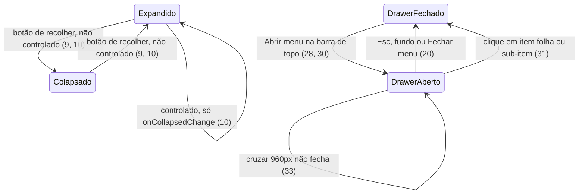

# Lote 5 do Lamb: PageHeader, SideMenu, MenuDrawer e Page

> Build this with **tlc-implement**.
> Every criterion below becomes a check with a proof, referenced by its number. Nothing under
> `Unresolved` gets settled while building.

## Intent

O `@church/ui` tem as peças de uma tela do backoffice, mas não a tela. Os NavItems e a
`Navigation` existem, assim como o Breadcrumb, os Chips, a Section e o StatCard. Falta o menu
lateral que recolhe, a gaveta de navegação abaixo de 960px, o cabeçalho de página e o template
que junta tudo com link de pular, `main` e largura máxima. Hoje, a primeira tela real do
`apps/web` teria de montar o próprio layout: menu, troca para hambúrguer, margens e cabeçalho
ad hoc. Esse layout ficaria fora dos tokens, do foco preso e da troca Painel/App do Lamb, e cada
tela nova o copiaria. O NavItem também troca de tamanho em 1024px (`lg`), não nos 960px do Lamb
(Unresolved 3 de `.tasks/lamb-alinhamento.md`). A fonte não traz números de impacto.

Com a entrega, passam a existir três organisms em `@church/ui/organisms/<Nome>` e um template em
`@church/ui/templates/Page`, cada um com spec e story:

- **SideMenu:** menu lateral do Painel com 240px expandido e 64px colapsado. Tem logo, botão de
  recolher, a `Navigation`, itens de rodapé e perfil.
- **MenuDrawer:** gaveta modal de navegação para a web responsiva, com itens de 48px.
- **PageHeader:** cabeçalho de tela `home` (saudação) ou `primary` (trilha, título, ações e chips).
- **Page** (com `PageBody`): SideMenu, cabeçalho e corpo. A partir de 960px mostra o SideMenu;
  abaixo, troca por barra de topo com hambúrguer e MenuDrawer. O corpo tem até 1440px e grade
  de StatCards.

O NavItem passa a trocar de densidade em 960px, ocupa a largura do menu, marca o pai colapsado de
um sub-item ativo e, com `href`, vira o `Link` do Next.

38 critérios em 7 slices · 4 one-way doors · 4 open, 0 block

## Criteria

### Tokens e a camada `templates`

1. Sempre, `size` em `@church/tokens` exporta `sidebar` 240, `sidebarCollapsed` 64, `contentMax`
   1440 e `menuDrawer` 390, além de `drawer` 650. O tema do `@church/ui` os publica como
   utilitários de largura (por exemplo, `w-sidebar` e `max-w-content-max`), sem valor arbitrário.
2. Sempre, o `package.json` do `@church/ui` exporta `./templates/*` para
   `./src/components/templates/*/index.ts`, e `Page` e `PageBody` são importáveis por
   `@church/ui/templates/Page`.

### NavItem no Painel e no App

3. Sempre, o NavItem troca de densidade em 960px, não em 1024px (`lg`):
   - **Painel** (≥ 960px, ou ancestral `[data-viewport="desktop"]`): altura mínima de 32px,
     padding de 6px × 10px, raio de 8px, texto 500 14/16 e ícone de 20px;
   - **App** (≤ 959px, ou ancestral `[data-viewport="mobile"]`): altura mínima de 48px, padding de
     12px × 14px, raio de 12px, texto 16/24 e ícone de 24px.

   Os sub-itens seguem a mesma troca. O modo colapsado continua com 32px de largura.

4. Dado um NavItem não colapsado, então ele ocupa a largura toda do contêiner (228px dentro do
   SideMenu de 240px, como no Figma `13020:3345`), e não os 200px fixos de hoje.
5. Dado um NavItem `collapsed` com um sub-item `activated`, então o item tem fundo `bg-selected`,
   `text-primary` e ícone preenchido, sem `aria-current`, porque o sub-item ativo está oculto.
   Sem sub-item ativo e sem `activated`, o item colapsado não tem fundo.
6. Dado `href` num NavItem sem `subItems` ou num sub-item (na sublista ou no pop-up do modo
   colapsado), então ele renderiza o `Link` do `next/link` (um `<a href>`) com o mesmo visual do
   botão, `aria-current="page"` quando `activated`, e `aria-label` e `title` no modo colapsado. O
   `onClick` do item é chamado no clique. Sem `href`, o item continua `<button type="button">`. Um
   item com `subItems` não aceita `href` (erro de tipo) e continua um `<button>` que expande a
   sublista.

### SideMenu

7. Sempre, o SideMenu é um `<aside>` em coluna, com altura de 100%, fundo `bg-surface` e borda
   direita de 1px `border-default`. Mede 240px expandido e 64px colapsado, com transição de
   largura de 300ms ease-out, e não encolhe no flex.
8. Sempre, o topo mede 64px de altura, com borda inferior de 1px `border-default`, itens
   centralizados e separados nas pontas, e padding lateral de 16px (12px colapsado). Ele mostra
   o `logo` informado. Sem `logo`, mostra o `Logo` `variant="full"` com 36px de altura (expandido)
   ou `variant="symbol"` com 32px (colapsado).
9. Sempre, o topo tem um botão de recolher `<button type="button">`:
   - visual: 28px, redondo, borda de 1px `neutral-17`, fundo `bg-surface` (`bg-hover` no hover),
     ícone de 20px em `neutral-83`;
   - posição: 18px abaixo do topo e 14px para fora da borda direita, sobre a linha do menu, acima
     do conteúdo vizinho;
   - expandido: ícone `chevron_left`, `aria-label="Recolher menu"` e `aria-expanded="true"`;
   - colapsado: ícone `chevron_right`, `aria-label="Expandir menu"` e `aria-expanded="false"`.
10. Quando o usuário clica no botão de recolher, então `onCollapsedChange(next)` é chamado uma vez
    com o novo valor. Sem `collapsed` (não controlado), o SideMenu alterna sozinho a partir de
    `defaultCollapsed` (padrão `false`). Com `collapsed`, a aparência segue só a prop.
11. Sempre, o meio é a `Navigation` com os `items` e o `collapsed` do SideMenu, nomeada por
    `label` (padrão "Menu principal"). Ele ocupa o espaço restante, tem rolagem vertical própria e
    padding de 16px × 6px (16px colapsado).
12. Sempre, o SideMenu tem um rodapé com borda superior de 1px `border-default`, padding de 12px
    6px 16px (12px 16px colapsado), em coluna com gap de 8px. Dado `footerItems`, o rodapé mostra
    esses NavItems numa lista, com o mesmo `collapsed`.
13. Dado `user`, então o rodapé termina com o botão de perfil (`<button type="button">`), com
    largura total, gap de 8px, padding de 8px × 10px, raio de 8px e `bg-hover` no hover. Ele tem:
    - o Avatar `small` (32px) decorativo, com `alt` igual ao `name` e `src` do `user`;
    - o `name` em 500 14/16 `text-primary`, com o `role` abaixo em 400 12/16 `text-secondary`,
      quando há;
    - o ícone `expand_more` no fim.

    O clique chama `onProfileClick` (Unresolved 2). Sem `user`, o botão não existe.

14. Dado o SideMenu colapsado com `user`, então o botão de perfil mostra só o Avatar, centralizado,
    com padding de 4px e `aria-label` "{name}, {role}", ou só "{name}" quando não há `role`
    (precedência (a); nota 29 do designer).

### MenuDrawer

15. Dado `open={false}`, então o MenuDrawer não renderiza nada. Dado `open`, ele renderiza:
    - um fundo `fixed inset-0 z-40 bg-scrim` com `aria-hidden="true"`;
    - um painel com `role="dialog"`, `aria-modal="true"`, `aria-label` igual a `label` (padrão
      "Menu principal") e `tabindex="-1"`.
16. Sempre, o painel aberto é fixo de cima a baixo, com `z-41`, largura de 390px limitada a 100%
    da janela, fundo `bg-surface` e conteúdo em coluna. Com `side="right"` (o padrão), fica colado
    à direita, com sombra `elevation-low-left`. Com `side="left"`, fica à esquerda, com
    `elevation-low-right`.
17. Sempre, o topo do painel mede 64px, com padding de 0 × 20px e borda inferior de 1px
    `border-default`. À esquerda fica o `Logo` `full` de 36px. À direita fica um `IconButton`
    `variant="ghost"` `color="neutral"` `size="medium"` com ícone `close` e
    `aria-label="Fechar menu"`.
18. Sempre, o painel tem `data-viewport="mobile"`, e por isso os NavItems medem 48px (critério 3)
    em qualquer largura de janela:
    - o menu é a `Navigation` nomeada por `label`, com padding de 16px × 20px;
    - o rodapé tem borda superior e padding de 12px 20px 20px, com os `footerItems` e, quando há
      `user`, o botão de perfil expandido do critério 13.

    O MenuDrawer nunca fica colapsado.

19. Quando o MenuDrawer abre, então o foco vai para o botão "Fechar menu", a rolagem da página
    trava, e Tab e Shift+Tab circulam dentro do painel (camada modal do lote 3).
20. Quando o usuário aperta Esc, clica no fundo ou clica em "Fechar menu", então `onClose` é
    chamado uma vez. Quando `open` passa a `false`, o foco volta ao elemento que o tinha antes de
    abrir, e a rolagem destrava.

### PageHeader

21. Sempre, o PageHeader é um `<header>` em coluna, com gap de 24px entre a linha principal e os
    chips. O padding é de 16px no topo e 12px embaixo. Nas laterais, é de 32px no Painel e de
    20px no App (≤ 959px, ou ancestral `[data-viewport="mobile"]`).
22. Sempre, a linha principal alinha os itens pela base, põe títulos e ações nas pontas com gap de
    16px e quebra quando falta espaço. Os títulos ficam em coluna, com gap de 4px e largura mínima 0. As `actions`, quando há, ficam numa linha com gap de 8px.
23. Dado `type="primary"` (o padrão), então o PageHeader mostra, nesta ordem:
    - o `Breadcrumb` com os itens de `breadcrumb`, quando há;
    - o `title` num `<h1>` em 600 24/28;
    - a `description`, quando há, num `
` em 400 14/20 `text-primary`.

    Dado `chips`, abaixo da linha principal fica um `role="group"` com
    `aria-label="Filtros rápidos"` e gap de 8px, que quebra.

24. Dado `type="home"`, então o `<h1>` mostra o `greeting` (ou o `title`, sem `greeting`) em
    Oswald 700 24/30 maiúsculo (Typography `d3`), seguido da `description`. O `breadcrumb` e os
    `chips` não aparecem, mesmo quando informados.

### Page e PageBody

25. Sempre, a Page é uma `
` flex em linha, com largura e altura de 100%, altura mínima de
    600px, fundo `bg-page` e texto `text-primary`. Dado `nav`, o SideMenu com as props de `nav`
    vem antes da área de conteúdo. A área de conteúdo ocupa o resto (`flex-1`, largura mínima 0),
    em coluna, com rolagem vertical própria.
26. Sempre, a área de conteúdo tem um `<main tabindex="-1">` com id único, largura de 100% até
    1440px (`contentMax`), centralizado, com o `header` seguido dos `children`.
27. Sempre, o primeiro elemento focável da Page é o link "Pular para o conteúdo" (ou o
    `skipLinkLabel`), com `href="#<id do main>"`. Fora de foco, ele fica visualmente oculto. Com
    foco, aparece:
    - posição absoluta, `z-70`, a 8px do topo e da esquerda;
    - padding de 8px × 12px e raio de 8px;
    - fundo `action-primary` e texto `text-inverse` em 500 14/16.
28. Dado `nav` com `responsive` (padrão `true`):
    - no **Painel** (≥ 960px, ou ancestral `[data-viewport="desktop"]`), o SideMenu aparece e a
      barra de topo não;
    - no **App** (≤ 959px, ou ancestral `[data-viewport="mobile"]`), a Page fica em coluna, o
      SideMenu some (`display: none`) e aparece a barra de topo.

    A barra de topo mede 64px, com padding de 0 × 20px, fundo `bg-surface` e borda inferior de
    1px `border-default`. À esquerda fica o `Logo` `full` de 32px. À direita fica um `IconButton`
    `variant="ghost"` `color="neutral"` `size="medium"` com ícone `menu`,
    `aria-label="Abrir menu"` e `aria-expanded` igual ao estado do MenuDrawer.

29. Sempre, a troca do critério 28 é só CSS. O HTML do servidor e o do primeiro render do cliente
    são iguais em qualquer largura, e nada muda depois da hidratação.
30. Quando o usuário clica em "Abrir menu", então o MenuDrawer abre com `side="right"` e com
    `items`, `footerItems`, `user`, `onProfileClick` e `label` vindos de `nav`. Fechá-lo
    (critério 20) devolve o foco a "Abrir menu".
31. Dado o MenuDrawer aberto pela Page, quando o usuário clica num NavItem sem `subItems` ou num
    sub-item, do menu ou do rodapé, então o drawer fecha e o `onClick` do item é chamado uma vez.
    Clicar num pai com `subItems` só expande ou recolhe a sublista, sem fechar o drawer.
32. Dado `responsive={false}`, então o SideMenu aparece em qualquer largura, e não há barra de
    topo nem MenuDrawer. Sem `nav`, não há SideMenu, barra de topo nem MenuDrawer.
33. Enquanto o MenuDrawer está aberto, cruzar 960px não o fecha. Ele fica aberto até uma das
    saídas do critério 20 (Unresolved 4).
34. Sempre, o PageBody é uma `
` em coluna, com gap de 16px. O padding é de 16px no topo,
    32px embaixo e 32px nas laterais no Painel, e de 20px nas laterais no App. Dado `stats`, o
    primeiro filho é uma grade `repeat(auto-fit, minmax(220px, 1fr))` com gap de 16px contendo
    `stats`, seguida dos `children`.

### Entrega no design system

35. Sempre, SideMenu, MenuDrawer e PageHeader são importáveis por `@church/ui/organisms/<Nome>`, e
    Page e PageBody por `@church/ui/templates/Page`. Cada componente tem spec e story (o PageBody
    aparece na story da Page), com títulos `organisms/<Nome>` e `templates/Page`.
36. Sempre, o `parameters.design` das stories aponta para estes nós, conferidos pelo
    `src/figma-links.spec.ts`: PageHeader `13505:4430`, SideMenu `12967:3606`, MenuDrawer
    `13506:21084` e Page `13685:3211`. A story da Navigation passa a apontar para `13020:3345`
    (Menus), porque `12967:3606` é o SideMenu.
37. Sempre, `packages/docs/figma-components.md` tem uma linha para PageHeader, SideMenu,
    MenuDrawer e Page (com PageBody). A linha da Navigation passa a `13020:3345` e deixa de dizer
    "Lamb's Side menu".
38. Sempre, stories e specs usam só dados obviamente fictícios ("Pessoa Exemplo", "Função
    Exemplo"), nunca os nomes dos previews do artefato.

## States

## Out of scope

- **NavigationBar:** é do App nativo, e o `apps/native` não consome o `@church/ui` (decisão de
  2026-10-08).
- **Rotas, permissões e persistência do colapso:** o README do SideMenu diz que "ficam no app".
- **Templates de formulário longo e de detalhe de entidade:** o README da Page diz que "ainda não
  têm template".
- **Menu do perfil (dropdown):** o artefato só chama `onProfileClick`, e o que abre fica com o
  consumidor.
- **Barra de topo como componente próprio:** no artefato, ela só existe dentro da Page.
- **Upload e Progress:** fora do plano até o designer terminar o Progress.

## Observable

| Surface                                       | Decision                 | Landing                                                                                       |
| --------------------------------------------- | ------------------------ | --------------------------------------------------------------------------------------------- |
| componente SideMenu                           | vazio (`items=[]`)       | n/a - a fonte não define; o topo e o rodapé renderizam, e o meio fica vazio                   |
| componente SideMenu                           | carregando, erro         | n/a - os itens vêm prontos do consumidor                                                      |
| componente SideMenu                           | não autorizado           | n/a - "permissões ficam no app" (README); o consumidor filtra `items`                         |
| componente SideMenu                           | densidade e ordem        | 3, 7, 11, 12 - a ordem dos itens é a do consumidor                                            |
| componente MenuDrawer                         | densidade                | 18                                                                                            |
| componente MenuDrawer                         | ação destrutiva confirma | n/a - fechar não perde nada                                                                   |
| componente PageHeader                         | vazio (sem `title`)      | n/a - a fonte não define; `title` é do consumidor                                             |
| componente PageHeader                         | densidade                | 21, 22                                                                                        |
| template Page                                 | vazio, carregando, erro  | n/a - o estado é do conteúdo (`children`: Section, EmptyState); o README não dá estado à Page |
| template Page                                 | não autorizado           | n/a - autenticação e permissões ficam no app (README do SideMenu)                             |
| template Page                                 | densidade                | 28, 34                                                                                        |
| documento `packages/docs/figma-components.md` | estrutura                | existing - tabela "Components" (37)                                                           |

## Swept

- validation: n/a - nenhum componente recebe entrada de dados
- failure modes: existing - o Avatar do perfil cai nas iniciais sem foto; n/a para o resto, porque
  nada chama rede
- idempotency and retry: 10 (`onCollapsedChange` uma vez), 20 (`onClose` uma vez), 31 (`onClick`
  uma vez ao fechar)
- authorization: n/a - "permissões ficam no app" (README do SideMenu)
- concurrency and ordering: 33 (cruzar 960px com o drawer aberto); existing - a camada modal do
  lote 3 entrega o Esc só à camada de cima
- data lifecycle: n/a - o colapso não persiste ("persistência do colapso fica no app")
- external-dependency failure: 29 - a troca Painel/App é CSS, sem `matchMedia`
- state transitions: 10, 19, 20, 30, 31 (ver States)
- observability: n/a - sem log (constituição XIV)

## Impact

| Front        | What changes                                                                                                                                                                                                                                                   |
| ------------ | -------------------------------------------------------------------------------------------------------------------------------------------------------------------------------------------------------------------------------------------------------------- |
| domain       | novo termo: camada `templates` - telas compostas do design system, em `packages/ui/src/components/templates` e exportadas por `@church/ui/templates/*`                                                                                                         |
| domain       | termo existente: densidade do NavItem trocava em `lg` (1024px), passa a trocar em `panel` (960px) com `[data-viewport]`. Entre 960 e 1023px o item cai de 48px para 32px. Quem usa hoje: a `Navigation` e as stories; o `apps/web` não importa nenhum dos dois |
| domain       | termo existente: largura do NavItem expandido era de 200px (`w-50`), passa à largura do contêiner. Quem usa hoje: a `Navigation` e as stories                                                                                                                  |
| domain       | termo existente: o NavItem colapsado com sub-item ativo era só `selected` (sem fundo), passa a ter fundo `bg-selected`                                                                                                                                         |
| domain       | termo existente: a `Navigation` representava o "Side menu" do Lamb (story e `figma-components.md` em `12967:3606`); passa a ser o "Menus" (`13020:3345`), o meio do SideMenu e do MenuDrawer                                                                   |
| domain       | termo existente: o NavItem era sempre `<button>`; com `href`, passa a ser o `<a>` do `Link` do Next. Quem usa hoje: a `Navigation` e as stories, que não passam `href` e continuam com `<button>`                                                              |
| tokens       | `size` ganha `sidebar`, `sidebarCollapsed`, `contentMax` e `menuDrawer`. Nenhum valor existente muda                                                                                                                                                           |
| tests        | `NavItem.spec.tsx:97-109` hoje confere as classes `lg:`; `src/figma-links.spec.ts` ganha quatro stories e muda a da Navigation                                                                                                                                 |
| dependencies | nenhuma nova: `next` já é peerDependency do `@church/ui`, e o Avatar já usa `next/image`                                                                                                                                                                       |
| stored data  | nothing to migrate                                                                                                                                                                                                                                             |

## Decided

| Decision                                         | Shape                                                                                                                                                                                                                                                                                                                                                                            | Alternative rejected                                                                                                                                                                                                                                                                                                                           |
| ------------------------------------------------ | -------------------------------------------------------------------------------------------------------------------------------------------------------------------------------------------------------------------------------------------------------------------------------------------------------------------------------------------------------------------------------- | ---------------------------------------------------------------------------------------------------------------------------------------------------------------------------------------------------------------------------------------------------------------------------------------------------------------------------------------------- |
| Itens de navegação no vocabulário do repositório | SideMenu, MenuDrawer e `Page.nav` recebem `items: NavItemProps[]` e `footerItems?: NavItemProps[]` (`iconName`, `label`, `activated`, `selected`, `count`, `subItems`, `href`, `onClick`) e os compõem pela `Navigation`. O consumidor marca o item atual com `activated` e navega pelo `href` (Decided 4) ou no `onClick`. Não existem `currentId`, `onNavigate` nem `NavEntry` | A árvore do Lamb (`NavEntry` + `currentId` + `onNavigate` + `href`): o mesmo conceito ficaria com dois nomes (`activated` × `currentId`) entre NavItem e SideMenu, e a `Navigation` existente ficaria de fora. Contraria a regra do usuário de 2026-10-08 ("conceito que o repositório já nomeia mantém o nome")                               |
| Camada `templates` no pacote                     | `"./templates/*": "./src/components/templates/*/index.ts"` no `exports` do `@church/ui`. `Page` e `PageBody` saem de `@church/ui/templates/Page`, como a `ListSection` sai da List                                                                                                                                                                                               | Page como organism: o usuário decidiu a camada `templates/` em 2026-10-08, e a constituição (II) já prevê `templates` "when needed"                                                                                                                                                                                                            |
| Troca Painel/App da Page por CSS                 | SideMenu e barra de topo estão sempre no HTML; `panel:` e `in-data-[viewport=…]` escolhem qual aparece (o padrão `TOGGLE_TOUCH_ROW` do lote 1). Só o estado aberto do MenuDrawer é JS, e ele começa fechado                                                                                                                                                                      | Decidir no JS com `resolveViewport` ou `useViewport`: o servidor não sabe a largura, então a tela redesenharia depois da hidratação, o que o lote 1 já rejeitou. O `resolveViewport` serve a quem abre algo; a Page tem de estar certa desde o primeiro HTML                                                                                   |
| NavItem como link do Next                        | `href?: LinkProps['href']` no NavItem sem `subItems` e no sub-item; com ele, o item renderiza o `Link` de `next/link` (navegação no cliente, prefetch, nova aba e clique do meio do navegador). Item com `subItems` não aceita `href`                                                                                                                                            | `<a href>` puro: no `apps/web`, cada clique recarregaria a página inteira. Um `as`/`linkComponent` polimórfico: mais tipos e trabalho para um único consumidor, que é Next; o pacote já depende de `next` (Avatar com `next/image`). Fecha para o `@church/ui` um consumidor fora do Next, que não existe hoje (o `apps/native` não o consome) |

Nomes de props seguem a regra dos lotes 1 a 4: nenhuma prop existente é renomeada, e tamanhos são
`small`/`medium`/`large`. Conceitos novos ficam com o nome do Lamb (`user`, `onProfileClick`,
`collapsed`, `defaultCollapsed`, `onCollapsedChange`, `label`, `logo`, `open`, `onClose`, `side`,
`type`, `greeting`, `description`, `breadcrumb`, `actions`, `chips`, `nav`, `header`,
`responsive`, `skipLinkLabel`, `stats`). A foto do `user` é `src`, como no Avatar, e não `avatar`.
Variantes do Button do Lamb: `low` = `ghost`, `flat` = `transparent`.

## Surface

| Componente   | In                                                                                                                                                                                                                                                      | Out                                                                         | Criteria |
| ------------ | ------------------------------------------------------------------------------------------------------------------------------------------------------------------------------------------------------------------------------------------------------- | --------------------------------------------------------------------------- | -------- |
| `SideMenu`   | `items: NavItemProps[]`, `footerItems?: NavItemProps[]`, `user?: { name: string; role?: string; src?: string }`, `onProfileClick?`, `collapsed?`, `defaultCollapsed?`, `onCollapsedChange?: (collapsed: boolean) => void`, `label?`, `logo?: ReactNode` | `<aside>` com `<nav>` nomeado                                               | 7–14     |
| `MenuDrawer` | `open`, `onClose`, `side?: 'left' \| 'right'`, `items`, `footerItems?`, `user?`, `onProfileClick?`, `label?`                                                                                                                                            | `role="dialog"` modal                                                       | 15–20    |
| `PageHeader` | `type?: 'home' \| 'primary'`, `title?`, `greeting?`, `description?`, `breadcrumb?: BreadcrumbItem[]`, `actions?`, `chips?` (nós React, salvo `breadcrumb`)                                                                                              | `<header>` com um `<h1>`                                                    | 21–24    |
| `Page`       | `nav?: SideMenuProps`, `header?: ReactNode`, `children?`, `responsive?: boolean`, `skipLinkLabel?: string`                                                                                                                                              | link de pular + `<main tabindex="-1">`                                      | 25–33    |
| `PageBody`   | `stats?: ReactNode`, `children?`                                                                                                                                                                                                                        | `
` com grade de stats                                                  | 34       |
| `NavItem`    | `href?: LinkProps['href']` (`next/link`) no item sem `subItems` e no sub-item                                                                                                                                                                           | `<a>` do Next com `href`; densidade em 960px, largura total, ramo colapsado | 3–6      |

## Sources

- Artefato "Lamb" (https://claude.ai/artifact/PwGC8XAgiawWSwqvnEbMmb, versão 1791228354-5316) -
  **binding for the interface**:
  - `project/components/{PageHeader,SideMenu,MenuDrawer,Page}/README.md` e `preview.html`;
    `index.d.ts` (`SideMenuProps`, `MenuDrawerProps`, `NavUser`, `PageHeaderProps`,
    `PageBodyProps`, `PageProps`);
  - `bundle.css`: `.lamb-sidemenu*`, `.lamb-collapse`, `.lamb-menu-list`/`.lamb-menu-sub`,
    `.lamb-profile*`, `.lamb-navitem*` (com `[data-branch]` e `[data-mobile]`),
    `.lamb-menu-drawer*`, `.lamb-scrim`, `.lamb-page*`, `.lamb-pageheader*`, `.lamb-pagebody`,
    `.lamb-grid-stats`, `.lamb-topbar`, `.lamb-skip` e o bloco `@media (max-width: 960px)`;
  - `bundle.js`: `NavMenu`, `Profile`, `SideMenu`, `MenuDrawer` (`useModal`: foco no primeiro
    focável), `PageHeader`, `PageBody` e `Page`;
  - `tokens.json`: `sidebar` 240px, `sidebar-collapsed` 64px, `content-max` 1440px e `bg-page`.
- Figma `7I9GnO3cTPpaJPOUfFsI9t` - **binding for the interface**, conferido pelo Figma MCP em
  2026-10-10:
  - Page Header `13505:4430`: Home com 1200×76 e Primary com 1200×152 (padding de 16px no topo e
    32px nas laterais, linha de 68px, chips de 32px a 24px dela, 12px embaixo);
  - Side menu `12967:3606`: 240×1196 e 64×1196;
  - Menu Drawer `13506:21084`: Closed com 390×64 e Open com 390×844;
  - Page `13685:3211`: Mobile=False com 1440×888;
  - Menus `13020:3345`: itens com 228px de largura (expandido) e 32px (colapsado).
- `.tasks/lamb-atoms.md`, `.tasks/lamb-molecules.md`, `.tasks/lamb-overlays.md` e
  `.tasks/lamb-fields-lists.md`: regra de nomes, precedência dentro do artefato (a/b/c),
  densidade Painel/App (`panel:` + `[data-viewport]`), camada modal (`useModalLayer`), e os
  componentes compostos aqui (NavItem, Navigation, Logo, Avatar, Breadcrumb, IconButton).
- `.tasks/lamb-alinhamento.md`, Unresolved 3: "o 960 entra com o SideMenu/Page". Esta task fecha
  essa pendência (critério 3).
- `.tasks/lamb-notas-para-o-designer.md`, notas 14 (breakpoint de 960px) e 29 (pai colapsado e
  perfil sem `role`).
- Decisões do usuário em 2026-10-08: Page em `templates/`, NavigationBar fora. Regra de nomes
  confirmada em 2026-10-08 (Decided 1).
- Usuário, 2026-10-10: o item de navegação com `href` usa o `Link` do Next ("O link do next não
  entra nesse caso?"), o que fecha a pergunta sobre link (Decided 4, critério 6).

This task is the record of decision. If a linked document diverges, ask before building.

## Unresolved

| #   | Kind | Question                                                                                                                                                                           | Until answered                                                         |
| --- | ---- | ---------------------------------------------------------------------------------------------------------------------------------------------------------------------------------- | ---------------------------------------------------------------------- |
| 1   | open | Pai com `subItems` no menu colapsado: no Lamb vira link para o `href` do pai, e os filhos ficam inalcançáveis (nota 29). O NavItem do repositório abre um pop-up com os sub-itens. | Assumido: mantém o pop-up existente; só o fundo do ramo ativo muda (5) |
| 2   | open | Perfil sem `onProfileClick`: o artefato renderiza um `<button>` que não faz nada.                                                                                                  | Escrito como a fonte (13): sempre `<button>`                           |
| 3   | open | Breakpoint em 960px exatos: o CSS do Lamb (`max-width: 960px`) põe 960 no App, e a variante `panel:` põe 960 no Painel (nota 14).                                                  | Assumido: 960 é Painel, como nos lotes 1 e 4 (3, 21, 28, 34)           |
| 4   | open | Drawer aberto quando a janela cruza 960px: a barra de topo some e o drawer modal continua aberto, como no artefato.                                                                | Assumido: continua aberto até Esc, fundo, Fechar ou um item (33)       |
