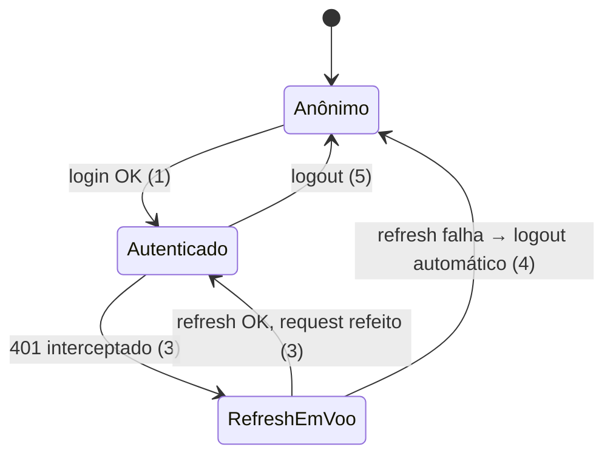

# Tela de Pessoas — listagem, auth mínima e interceptores HTTP

> Build this with **tlc-implement**.
> Every criterion below becomes a check with a proof, referenced by its number. Nothing under
> `Unresolved` gets settled while building.
>
> **Superada em parte** por `.tasks/backoffice-sessao-iron-session.md` (2026-10-19): a sessão
> sai do zustand para um cookie iron-session, `/api/auth/*` vira Server Actions e o refresh
> passa para o servidor (Slice A e as linhas de sessão e BFF auth do `Decided`).

## Intent

O backoffice (`apps/backoffice`) é hoje um placeholder com uma única página demo. Nenhuma tela
real funciona: não há cliente HTTP, não há sessão, não há rota de produto. Para testar qualquer
funcionalidade do backend localmente, um desenvolvedor precisa usar o Postman ou o Swagger
diretamente — sem interface para o produto.

O primeiro passo para transformar o placeholder em produto é: (a) um cliente HTTP com
interceptores que padronize o comportamento de erros e toasts para todas as páginas futuras, e
(b) a tela de Pessoas, primeira tela de gestão, que consome o endpoint `/admin/membros`. Como
efeito colateral obrigatório, uma tela de login mínima também precisa existir — `/admin/membros`
exige papel `admin` (JWT) e sem auth nenhum dado chega à tela.

Quando esta task estiver pronta: um admin consegue fazer login, ver a lista de membros paginada
com filtro por status, exportar o CSV, clicar em um membro e chegar ao shell da rota do perfil.
Qualquer request que falhe exibe um toast com a mensagem adequada, sem nenhum `console.error`
ou falha silenciosa.

Design: [node-id=131-4185](https://www.figma.com/design/HQ5Vfbwug9vzIskrlSIXJW/Backoffice?node-id=131-4185&p=f&m=dev) — **binding para a interface**.
Backend: `docs/backend/ibfc-server.md` — fonte de verdade; vence o Swagger.

22 critérios em 5 slices · 3 one-way doors · 1 open (blocks go-live)

## Criteria

### Slice A — Auth mínima e sessão via BFF

1. Quando o usuário submete email + senha válidos em `/login`, a BFF route
   `POST /api/auth/login` chama `POST /auth/login` no backend, recebe
   `{ accessToken, accessTokenExpiraEm, refreshToken }`, persiste `refreshToken` num cookie
   `httpOnly; SameSite=Strict; Path=/api/auth` e retorna `{ accessToken, accessTokenExpiraEm }`
   ao cliente; o cliente armazena `accessToken` no store zustand e redireciona para `/`.

2. Quando o usuário submete credenciais inválidas em `/login`, a BFF retorna o erro do backend
   (`401 "E-mail ou senha inválidos."`) sem expor o refreshToken; a tela exibe o campo de senha
   com estado de erro e a mensagem do backend.

3. Quando um request do cliente retorna 401 (access token expirado), o interceptor chama
   `POST /api/auth/refresh` uma única vez, de forma serializada (requisições concorrentes
   aguardam a mesma promessa); se o refresh retornar um novo `accessToken`, o request original
   é refeito com o novo token.

4. Se o refresh retornar 401 ou 403 (token revogado, conta inativa), o interceptor limpa o
   store zustand, chama `POST /api/auth/logout` para revogar o cookie httpOnly e redireciona
   para `/login`.

5. Quando o usuário clica em "Sair", `POST /api/auth/logout` chama `POST /auth/logout` no
   backend com o refreshToken do cookie httpOnly, depois apaga o cookie e limpa o store zustand.

### Slice B — HTTP client e interceptores de toast

6. Quando um request retorna `{ error, message }` com status 4xx (exceto 401), o interceptor
   exibe `toast.error(message)` via `react-toastify`; o `message` vem em pt-BR do backend e é
   exibido sem transformação.

7. Quando um request retorna status 500, o interceptor exibe
   `toast.error("Algo deu errado. Tente novamente em instantes.")` independentemente do corpo.

8. Quando um request retorna `{ statusCode: 403 }` (guard de papel), o interceptor exibe
   `toast.error("Sem permissão para realizar esta ação.")` e não faz logout.

9. Quando um request retorna 204 (recurso não encontrado, conforme convenção do backend), o
   HTTP client resolve com `null` sem lançar erro e sem exibir toast.

10. Quando um request retorna `{}` (sucesso sem dados — `logout`, `redefinir-senha`), o HTTP
    client resolve com `{}` sem lançar erro.

### Slice C — BFF route `/api/membros` (contorna CORS para headers de paginação)

11. `GET /api/membros` aceita query params `status`, `bairro`, `idGc`, `page` e `limit`; lê o
    header `Authorization: Bearer <token>` enviado pelo cliente, chama
    `GET /admin/membros` no backend com os mesmos params e o mesmo token, lê os headers
    de resposta `pagination-total` e `pagination-page` (não expostos via CORS ao browser) e
    devolve `{ data: MembroItem[], total: number, page: number }` como JSON — sem envelope.

12. Quando o backend retorna 401 ou 403, `GET /api/membros` repassa o status e o corpo ao
    cliente sem transformação (o interceptor do cliente trata o 401 com retry de refresh).

### Slice D — Tela de listagem `/pessoas`

13. Dado que o usuário está autenticado como `admin`, quando navega para `/pessoas`, a tela
    exibe o `PageHeader` com título "Gestão de pessoas", botão "Adicionar pessoa"
    (desabilitado — fora do escopo desta task) e botão "Exportar base".

13a. A tela exibe 3 `StatCard`s: "Total de membros" (chamada `GET /api/membros` sem filtro de
status, campo `total`), "Ativos" (`?status=ativo`, campo `total`) e "Inativos"
(`?status=inativo`, campo `total`); os três requests são feitos em paralelo ao montar a
tela; enquanto carregam, cada StatCard exibe `—` como valor.

14. Quando a lista está carregando, a tabela exibe um estado de skeleton; quando carregada,
    exibe as colunas `nome`, `telefone`, `bairro`, `status` (Tag), `origemCadastro` com os
    dados retornados por `GET /api/membros`.

15. Quando a lista retorna vazia ou `total = 0`, o `Section` exibe o estado vazio com a
    mensagem "Nenhum membro encontrado".

16. O `Paginator` exibe `total` itens (lido do campo `total` do JSON de `GET /api/membros`);
    ao mudar de página ou de `pageSize`, o cliente chama `GET /api/membros` com os novos
    params e a tabela atualiza.

17. Quando o usuário seleciona o chip de filtro "Ativo" ou "Inativo" (Chip do DS), o cliente
    chama `GET /api/membros?status=ativo` ou `?status=inativo`; ao desmarcar, chama sem o
    param `status`.

18. Quando o usuário clica em "Exportar base", o cliente faz `GET /api/membros/exportar` (BFF
    route que repassa a chamada ao backend com o token e devolve o CSV como stream) e o browser
    inicia o download do arquivo `membros.csv`; se o backend retornar `"erro\n..."` na primeira
    linha, um `toast.error` é exibido.

19. Quando o usuário clica em qualquer célula de uma linha da tabela (exceto nos ícones de
    ação), o router navega para `/pessoas/:id`.

### Slice E — Shell da rota de perfil

20. `GET /pessoas/:id` renderiza uma página com o título "Perfil do membro" e o `id` da URL
    visível; sem chamada de API e sem dados reais — o conteúdo da página é uma task separada.

## Out of scope

- Conteúdo da página de perfil (`/pessoas/:id`) — sem endpoint auth'd com dados completos do
  membro ainda (ver Unresolved 2 abaixo).
- Fluxo "Adicionar pessoa" — botão existe no PageHeader mas desabilitado nesta task.
- Ação "Inativar membro" por linha (ícone visível no Figma) — task separada.
- Recuperação de senha, ativação de conta — não são necessárias para testar localmente.
- Estrutura de homologação e produção, variáveis de ambiente além de `NEXT_PUBLIC_API_URL`.
- Campo de busca por nome — backend sem suporte ao filtro `nome`; campo não renderizado nesta task (ver Unresolved 1).
- StatCards resolvidos: Total / Ativos / Inativos (critério 13a).

## Observable

| Surface                  | Decisão                | Landing                                                |
| ------------------------ | ---------------------- | ------------------------------------------------------ |
| tela `/login`            | empty state            | n/a — form sempre presente                             |
| tela `/login`            | error state            | 2                                                      |
| tela `/login`            | loading (submitting)   | Unresolved 2 (open) — `Button` disabled + loading icon |
| tela `/pessoas`          | loading state          | 14                                                     |
| tela `/pessoas`          | empty state            | 15                                                     |
| tela `/pessoas`          | error state            | 6 e 7 (toast; tabela não muda de estado)               |
| tela `/pessoas`          | unauthorised           | 3 e 4 (interceptor redireciona para /login)            |
| tela `/pessoas`          | estado de filtro ativo | 17                                                     |
| tela `/pessoas`          | export action          | 18                                                     |
| tela `/pessoas`          | navegação por linha    | 19                                                     |
| tela `/pessoas/[id]`     | empty state            | 20 (shell sem dados)                                   |
| `GET /api/membros`       | error shape e codes    | 12                                                     |
| `GET /api/membros`       | quem pode chamar       | apenas requests do próprio Next.js (same-origin)       |
| `POST /api/auth/login`   | error shape            | repassa status + corpo do backend                      |
| `POST /api/auth/refresh` | error shape            | repassa status + corpo; cliente trata logout           |

## Swept

- validation: 2 — credencial inválida tratada no login; campos obrigatórios do form
- failure modes: 6, 7 — 4xx mostra `message`, 500 mostra genérico; 18 — CSV com `erro\n...`
- idempotency and retry: 3 — refresh serializado (uma promessa em voo); critério nomeia o mecanismo
- authorization: 1, 3, 4 — JWT injetado pelo interceptor; refresh via BFF httpOnly cookie
- concurrency and ordering: 3 — múltiplos 401 concorrentes aguardam o mesmo refresh; o token só é renovado uma vez
- data lifecycle: n/a — dados lidos do backend; nenhum dado persiste no cliente além do accessToken em memória (perdido ao fechar a aba)
- external-dependency failure: 7 — qualquer erro não mapeado (rede, timeout, 500) exibe toast genérico
- state transitions: 4 — token válido → 401 → refresh → novo token ou logout (diagrama abaixo)
- observability: n/a — produto local; sem logging estruturado nesta task

## States

## Impact

| Front       | What changes                                                                                                  |
| ----------- | ------------------------------------------------------------------------------------------------------------- |
| domain      | novo termo: `MembroItem` — row retornado por `/api/membros`; vive em `~/types/membros.ts`                     |
| domain      | novo termo: `Sessao` — `{ accessToken, accessTokenExpiraEm }` no store zustand; vive em `~/stores/session.ts` |
| stored data | n/a — nenhum dado persiste além do cookie httpOnly (gerenciado pela BFF)                                      |

## Decided

| Decisão                                                                                                                                 | Shape                                                                                                                                                           | Alternativa rejeitada                                                                                                                        |
| --------------------------------------------------------------------------------------------------------------------------------------- | --------------------------------------------------------------------------------------------------------------------------------------------------------------- | -------------------------------------------------------------------------------------------------------------------------------------------- |
| HTTP client como fetch wrapper em `~/lib/http.ts`                                                                                       | `apiFetch(url, options)` que injeta `Authorization`, desembrulha `{ data }`, trata 204 e chama o interceptor de erros                                           | axios — não está nas dependências adotadas (Princípio IV)                                                                                    |
| Sessão: accessToken em memória (zustand), refreshToken em cookie httpOnly via BFF                                                       | `useSessionStore` com `{ accessToken, setSession, clearSession }`                                                                                               | accessToken em localStorage — vulnerável a XSS; em cookie — conflita com `httpOnly` necessário para o refreshToken                           |
| BFF routes em `app/api/` para todos os calls que precisam de headers ou cookies server-side                                             | `app/api/auth/login/route.ts`, `app/api/auth/refresh/route.ts`, `app/api/auth/logout/route.ts`, `app/api/membros/route.ts`, `app/api/membros/exportar/route.ts` | Chamar o backend direto do browser — inviável por CORS (pagination-total não exposto) e por não suportar httpOnly cookie para o refreshToken |
| Toast contract: 4xx `{ error, message }` → `toast.error(message)`, 500 → genérico, 403 guard → "Sem permissão", 204 → `null` silencioso | via `react-toastify` (dependência adotada); `ToastContainer` já está em `app/layout.tsx`                                                                        | Toast por componente — quebraria a consistência entre telas futuras                                                                          |

## Surface

| Route                       | In                                                        | Out                                                   | Status        | Criteria |
| --------------------------- | --------------------------------------------------------- | ----------------------------------------------------- | ------------- | -------- |
| `POST /api/auth/login`      | `{ email, senha }`                                        | `{ accessToken, accessTokenExpiraEm }`                | 200, 401, 423 | 1, 2     |
| `POST /api/auth/refresh`    | — (cookie httpOnly)                                       | `{ accessToken, accessTokenExpiraEm }`                | 200, 401, 403 | 3, 4     |
| `POST /api/auth/logout`     | — (cookie httpOnly)                                       | `{}`                                                  | 200           | 5        |
| `GET /api/membros`          | `?status&bairro&idGc&page&limit` + `Authorization` header | `{ data: MembroItem[], total: number, page: number }` | 200, 401, 403 | 11, 12   |
| `GET /api/membros/exportar` | `?status&bairro&idGc` + `Authorization` header            | `text/csv` stream                                     | 200           | 18       |

## Sources

- Design [node-id=131-4185](https://www.figma.com/design/HQ5Vfbwug9vzIskrlSIXJW/Backoffice?node-id=131-4185&p=f&m=dev) — **binding**: tela `/login`, tela `/pessoas` (PageHeader, chips de status, tabela, Paginator, botão Exportar base), shell `/pessoas/:id`
- `docs/backend/ibfc-server.md` — contratos de todos os endpoints usados (§4 auth, §7 membros, §8 login/refresh/logout); vence o Swagger
- `apps/backoffice/app/layout.tsx` — `ToastContainer` já importado; não duplicar

## Unresolved

| #   | Kind           | Question                                                                                                                                                                                                                                                                                            | Until answered                                   |
| --- | -------------- | --------------------------------------------------------------------------------------------------------------------------------------------------------------------------------------------------------------------------------------------------------------------------------------------------- | ------------------------------------------------ |
| 1   | blocks go-live | O campo de busca "Buscar por nome" do Figma não tem equivalente no backend: `GET /admin/membros` só aceita `status`, `bairro` e `idGc`. Campo não implementado nesta task. Recomendo adicionar `nome` (busca parcial) ao `ListarMembros.query.ts` + `IPessoa.repository` antes de ir para produção. | Campo de busca não funciona para usuários finais |
| 2   | open           | Estado de loading do botão "Entrar" no login: `Button` do DS com `disabled` e ícone de loading (recomendado — user delegated).                                                                                                                                                                      | Aspecto visual do login; nada mais depende disso |
